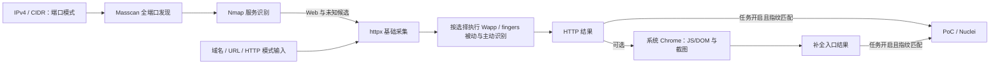

# SHEN Scan

基于 **Go + PostgreSQL + React** 的分布式扫描平台，支持手动 Worker 和阿里云抢占式实例。

设置 Worker 数量，导入 IP、CIDR、域名或 URL，创建扫描任务；按任务查看开放端口、服务指纹、HTTP 指纹、首页截图和 PoC 检查结果。

- **TCP 全端口**：IPv4 TCP **1–65535**，包含 Nmap 服务识别。
- **HTTP 能力独立选择**：被动指纹、主动指纹、JS/DOM、首页截图。
- **成熟工具与规则**：Masscan、Nmap、httpx、WappalyzerGo、fingers、Nuclei。
- **共享 Worker 池**：动态认领、资源准入、共享 HTTP 限速、抢占式回收处理。
- **任务制结果**：目标 → 开放端口 / HTTP 端点 → 识别依据、截图和报文。

当前为持续开发版本，仅用于自有或明确授权的目标。已验证的范围与容量见下方记录。


<details>
<summary>查看 HTTP 扫描选项与首页截图</summary>

| 独立选择扫描方式 | 点击缩略图查看首页 |
|---|---|
|  |  |

截图来自隔离环境和自建页面；页面中的软件标记用于验证识别，不代表真实安装了这些软件。

</details>

## 扫描方式

### 端口扫描

对输入 IP 扫描 TCP **1–65535**，再对已发现的端口执行 Nmap 轻量服务识别。可同时开启 HTTP 指纹，继续探测 Web 服务。

原始开放端口不会因数量多而截断。高开放率目标会限制下游指纹派生量，并显示“指纹受限”；未识别、无响应与端口关闭分别处理。

### HTTP 指纹与截图

包含网站基本信息、CMS、框架和中间件识别。四个选项互相独立：

| 选项 | 默认 | 执行内容 |
|---|---|---|
| 被动指纹 | 开启 | WappalyzerGo 与 fingers 匹配已采集的响应头、HTML、图标等证据 |
| 主动指纹 | 开启 | fingers 执行原始主动规则，请求相应路径并匹配；无需先被动命中 |
| JS / DOM | 关闭 | 系统 Chrome 执行页面，采集 Wapp 的运行时 JS 属性和 DOM 条件 |
| 首页截图 | 关闭 | 使用 httpx 原生截图实现保存首屏；列表显示缩略图，点击放大 |

基础 **httpx Runner** 采集始终执行，四项均关闭时仅收集网站基本信息。被动匹配复用采集结果，基础采集本身仍包含网络请求。仅开启截图时浏览器会执行页面 JS 以完成渲染，但不会执行 JS/DOM 指纹匹配。

JS/DOM 与截图同时开启时复用一次浏览器加载，各自记录完成或异常状态。每 Worker 最多一个浏览器执行槽，空闲 **60 秒**后释放 Chrome。首屏为 **1280×720 PNG**；图片有大小上限，资源加载受限时保留有效图片并标记不完整。图片单独存储、鉴权读取，列表按需加载缩略图。

**Chrome 不包含在 Agent 发布包中。** 安装脚本配置 Google 官方签名软件源，检查版本；满足要求则跳过下载，缺少或过旧时再安装。浏览器安装失败会显示能力不可用，普通扫描仍可运行。

详见 [HTTP 选项与截图](docs/HTTP_BROWSER.md)、[Chrome 安装说明](deploy/browser/README.md) 和 [验证记录](docs/HTTP_BROWSER_VALIDATION.md)。

### 输入与 PoC

- 支持手动输入、TXT / CSV 导入：IPv4、CIDR、域名和 HTTP(S) URL。
- 域名仅进入 HTTP 流程，不自动把解析 IP 加入 TCP 全端口队列。
- 仅选择 HTTP 模式时，裸 IP / 域名探测 HTTP 和 HTTPS；完整 URL 保留指定端口和路径。
- **PoC 默认关闭，必须在任务中显式开启**，按已确认的产品指纹匹配规则；未知产品不自动遍历全库，候选指纹不触发产品 PoC。

当前 Nuclei 执行器支持旧版兼容规则及 **`http-basic-v1` 原始 YAML 子集**：GET / HEAD、最多 3 个静态同源请求。DSL、extractor、动态变量、raw、payload、fuzz、race、flow、重定向及其他协议尚未支持。

Nuclei 上游原库可全量同步、查看和导出，**不等于全部模板都能执行**。原始模板需按支持范围导入并绑定产品。规则库已有条目数量取决于安装、更新和导入历史，不作为新安装的固定数量。详见 [PoC 执行说明](docs/NUCLEI_MIGRATION_PLAN.md) 和 [规则管理](docs/RULE_LIBRARY.md)。

## 执行架构



| 组件 | 职责 |
|---|---|
| Go 控制面 | 任务分片、认领、租约、执行版本隔离、结果及云节点管理 |
| PostgreSQL | 唯一权威存储，保存任务、结果、规则快照和截图；无需 Redis 或独立消息队列 |
| Worker Agent | 与平台通信，本机资源准入，调度工具，续约、取消、回传和回收排空 |
| Masscan / Nmap | 独立进程执行端口发现与服务识别；Nmap 只探测已发现端口 |
| web-probe-worker | 调用完整 httpx Runner；Wapp 响应匹配，以及独立可选的浏览器采集 |
| fingerprint-worker | 加载 fingers HTTP 规则包，执行原生被动、主动及 favicon 等 matcher |
| 系统 Chrome | 专用非 root 用户运行，保留沙箱；截图复用 httpx SDK 捕获路径 |
| Nuclei | 按已匹配产品运行支持的模板，单独限制并发和请求预算 |

Agent 封装并调度工具。HTTP 采集、图标、主动规则、浏览器及支持的 PoC 请求共用许可和限速；规则和工具不能自行扩大固定连接 IP、Host、SNI 的范围。普通 HTTP 结果先显示，浏览器结果随后补全。

## 指纹库与规则管理

- HTTP 目录统一展示 **Wappalyzer、Fingers、FingerprintHub、EHole、Goby** 的来源、原文和执行方式，包含 favicon 等组合条件。
- Wapp 与 fingers 支持一键更新。fingers 按完整执行包导入、导出和更新；普通 Wapp / 自定义规则支持编辑、启停、导入、导出及删除。
- 端口指纹和 PoC 分开管理；Nuclei 上游原库与实际执行库分开显示。
- 已退役平台内置的 **151 条普通 native HTTP 指纹及 6 条旧补采规则**，保留历史任务快照、自定义规则、端口规则和 PoC。
- 新任务固定当次规则及选项；更新规则不会追改已有任务。未执行、不兼容、超时和未命中分别记录。

规则数量、装载完整性与识别准确率是不同指标。上游无效条件可能使 JS/DOM 覆盖状态为 `partial`，已有指纹和有效截图仍保留。详见 [规则包](docs/FINGERPRINT_BUNDLES.md) 与 [HTTP 执行方案](docs/HTTP_FINGERPRINT_FULL_IMPLEMENTATION.md)。

## 快速启动控制面

需要 Go **1.26+**（覆盖控制面、Agent 和独立 helper 模块）、Node.js **22.12+**、npm、Docker Compose。控制面由一个 Go 进程和 PostgreSQL 组成，前端构建后由 Go 提供静态文件。

```sh
git clone https://github.com/yimingy72/shen-scan.git
cd shen-scan
cp .env.example .env
```

编辑 `.env`：设置 `POSTGRES_PASSWORD`，同步修改 `DATABASE_URL`，并将 `SCAN_ADMIN_TOKEN` 和 `SCAN_JOIN_TOKEN` 替换为两个不同的随机值。数据库密码用于 URL 时需正确编码。

```sh
# Compose 只启动 PostgreSQL。
docker compose --env-file .env -f deploy/compose.yaml up -d --wait
npm ci --prefix web
npm run build --prefix web

set -a
. ./.env
set +a
go run ./cmd/server
```

打开 **http://127.0.0.1:8080**，使用 `SCAN_ADMIN_TOKEN` 登录；健康接口为 `/api/health`。默认 `SCAN_CLOUD_PROVIDER=manual`，启动控制面不会申请云实例。没有在线 Worker 时，任务等待认领。

前端开发可使用 `npm run dev --prefix web`，Vite 将 `/api` 代理到本地 `8080`。

## 接入 Worker

### 手动 Worker

实际扫描使用 **Linux amd64**。先按 [Masscan 构建说明](deploy/masscan/README.md) 构建固定扫描器，再安装工具和 Agent：

```sh
go build -o bin/scan-agent ./cmd/agent
sudo install -m 0755 bin/masscan/masscan /usr/local/bin/masscan
sudo apt-get update
sudo apt-get install -y nmap

# 发布包保留 Nuclei 与 HTTPx CLI，HTTP 主路径使用下方 SDK helper。
deploy/nuclei/download.sh
deploy/httpx/download.sh
sudo install -m 0755 bin/nuclei/nuclei /usr/local/bin/nuclei
sudo install -m 0755 bin/httpx/httpx /usr/local/bin/httpx

deploy/build-web-helpers.sh
sudo install -m 0755 bin/web-helpers/web-probe-worker /usr/local/bin/web-probe-worker
sudo install -m 0755 bin/web-helpers/fingerprint-worker /usr/local/bin/fingerprint-worker

# 需要 JS/DOM 或截图时安装系统 Chrome 与隔离运行环境。
sudo sh deploy/browser/install.sh deploy/browser
```

浏览器安装脚本支持 Ubuntu **22.04+** / Debian **12+** amd64、systemd；所需最低版本见 [runtime.json](deploy/browser/runtime.json)，满足要求的较新版本不会降级。

将以下变量配置到 Worker 服务环境中：

```dotenv
AGENT_CONTROL_URL=https://scan.example.com
SCAN_JOIN_TOKEN=与控制面一致的引导令牌
AGENT_INSTANCE_ID=manual-worker-01
AGENT_METADATA_URL=off
AGENT_CA_FILE=/path/to/public-ca.crt
```

`AGENT_INSTANCE_ID` 应稳定且唯一。端口扫描需要原始套接字权限；浏览器路径需要 root Agent/helper 通过专用 wrapper 启动非 root Chrome。以服务方式启动 Agent 后，在 Workers 页启动手动节点池即可认领任务。普通部署默认禁止私网和回环目标；受控内网验证可显式配置 `SCAN_ALLOW_PRIVATE_TARGETS=true`，云 metadata 等目标仍受保护。

### 阿里云抢占式 Worker

1. 将控制面部署到 Worker 可访问的 HTTPS 地址，配置数据库、TLS 和令牌。
2. 构建 Masscan，准备工具与自己的公开 CA 文件，打包：

   ```sh
   deploy/nuclei/download.sh
   deploy/httpx/download.sh
   CONTROL_CA_FILE=/path/to/public-ca.crt deploy/build-release.sh
   ```

3. 发布 `bin/release/scan-agent-linux-amd64.tar.gz` 及对应 Masscan 源码归档，配置 `SCAN_AGENT_PACKAGE_URL`、`SCAN_AGENT_PACKAGE_SHA256`、`SCAN_CONTROL_PUBLIC_URL` 和公开 CA 路径。
4. 设置 `SCAN_CLOUD_PROVIDER=aliyun`，在 **Workers → 阿里云账号** 中验证并保存凭据，选择地域、可用区并一键准备 VPC、交换机和安全组。
5. 设置目标 Worker 数量并启动。cloud-init 校验安装包，安装 Nmap 数据和系统 Chrome，启动 Agent；浏览器安装失败会单独报告，不阻断普通扫描。
6. 停止节点池时先排空任务，再释放实例。以云端释放结果为准。

Chrome 通过系统软件源安装，Agent 包仅携带安装脚本和版本策略。可在基础镜像中预装工具以减少新实例准备时间。云账号需要对应的 ECS、系统事件读取及 VPC 管理权限，库存和可用规格会影响实例申请。

首次部署后，先在 **指纹库 → 来源与更新** 同步 Wapp 规则，再创建需要被动或 JS/DOM 识别的 HTTP 任务。fingers 可使用随 helper 提供的完整规则包；一键更新需要在控制面安装 `fingerprint-worker` 并配置 `FINGERPRINT_CHECKER_BINARY`，详见部署说明。新安装不会继承已有部署的规则和数据。

现有 Worker 升级采用 **维护 → 等待空闲 → 替换并重启 → 校验能力 → 恢复调度**，先少量节点再分批推进。上传新包只影响后续实例，不会自动重启现有节点。详见 [部署、配置与升级](docs/DEPLOYMENT.md)。

## 调度与资源控制

Worker 是平台共享容量，按存活节点和空闲资源认领可重派任务。小规模 IP 任务在满足校准、额度及收益条件时可跨 Worker 拆分端口范围；增加节点不会自动提高同目标的全局额度。

| 项目 | 仓库默认值 / 当前约束 |
|---|---|
| TCP 范围 | IPv4 TCP 1–65535 |
| 发包预算 | 每 Worker 5000 PPS；同目标共享 5000 PPS，可通过环境配置调整 |
| 端口分片 | 默认最多 4 IP，`SCAN_PORT_SHARD_MAX` 支持 1–16，受执行时间预算约束 |
| 工具并发 | 每 Worker 最多 1 个 Masscan、1 个 Nmap；默认 2 个可复用 Web 采集进程 |
| Agent 任务槽 | 上限默认 17，仍受阶段、CPU、内存、连接及上传积压约束 |
| HTTP 共享许可 | 按实际连接 IP 共享 10 次/秒，集群 250 次/秒 |
| 完整 HTTP 执行 | 每段最多 1024 个请求许可；入口累计最多 16384、32 段、20 分钟；达到限制明确标记 partial |
| 浏览器 | 每 Worker 1 个槽；入口最多 32 次请求，JS/DOM 5 秒、含截图时 10 秒；空闲 60 秒回收 Chrome |
| PoC | 默认关闭；每 Worker 最多 1 个执行任务 |
| 高开放率目标 | 完整保留原始端口，单 IP 下游指纹默认最多 1024 个端口 |
| 抢占式回收 | ECS `Instance:PreemptibleInstanceInterruption`、metadata 与租约三层信号；排空或重派 |

PPS 是发包预算，不等于有效 SYN 吞吐。完整端口覆盖与已收到的开放端口证据独立计量；失联或租约过期不能被视为已停止发包。共享 HTTP 许可也不等于网络到达的精确滑动窗口速率。

## 验证记录

| 验证 | 已记录结果 | 证据 |
|---|---|---|
| TCP 全端口流水线 | 5 台 2 核 / 2 GiB Worker 扫描 1000 个自建 IP，端口、服务和当时版本的 HTTP 识别完成；API 观察耗时 29 分 22.48 秒，核验 65,535,000 个 SYN | [扫描速度验证](docs/SCAN_SPEED_VALIDATION.md) |
| 完整 HTTP 指纹 | httpx Runner 与 fingers 工具链、原始资源装载、进度及证据验证 | [HTTP 重构验证](docs/HTTP_FULL_VALIDATION.md) |
| JS/DOM 与截图 | 2 CPU / 2 GiB 配额下，自建目标六种选项组合、图片鉴权、缩略图和真实 Chrome 验证 | [浏览器能力验证](docs/HTTP_BROWSER_VALIDATION.md) |

TCP 压测使用每 Worker **10000 PPS、最多 8 IP/片**，与仓库默认配置不同；该记录早于最新 HTTP 与浏览器改造，**不能代表开启全量主动指纹、JS/DOM 和截图后的相同耗时**。自建目标与配额验证也不代表公网或百万 IP 持续负载的容量保证。各报告保留条件、截图和完整请求响应。

## 文档与开发

| 文档 | 内容 |
|---|---|
| [部署说明](docs/DEPLOYMENT.md) | 环境配置、TLS、云资源、维护升级与备份 |
| [HTTP 选项与截图](docs/HTTP_BROWSER.md) | 四种选项、浏览器调度、截图存储和安装 |
| [完整 HTTP 执行](docs/HTTP_FINGERPRINT_FULL_IMPLEMENTATION.md) | httpx / fingers 职责、请求复用与恢复 |
| [指纹规则包](docs/FINGERPRINT_BUNDLES.md) | 原始来源、完整导入导出和更新语义 |
| [规则与 PoC](docs/RULE_LIBRARY.md) | 管理、产品匹配与检测结果 |
| [Nuclei 兼容范围](docs/NUCLEI_MIGRATION_PLAN.md) | 原始 YAML 执行与当前限制 |
| [执行架构](docs/SCAN_ARCHITECTURE_V2.md) | 任务制与 v0.5 设计基线 |
| [P1 调度](docs/P1_SCHEDULING.md) / [P2 资源](docs/P2_EXECUTION.md) | 共享限速、批次调优、资源准入与阶段积压 |
| [API](docs/API.md) | 管理接口、Agent 协议与结果结构 |

源码入口：`cmd/server`、`cmd/agent`；两个 helper 位于各自独立的 `cmd/*-worker` Go module。控制面、执行器和云节点管理分别位于 `internal/control`、`internal/agent`、`internal/cloud`，前端位于 `web`。

按改动范围运行必要检查。根模块测试不包含独立 helper 模块：

```sh
go test ./...
(cd cmd/web-probe-worker && go test ./...)
(cd cmd/fingerprint-worker && go test ./...)
npm run build --prefix web
```

PostgreSQL 集成检查需设置 `CONTROL_TEST_DATABASE_URL`；未设置时相关用例会跳过。真实 Chrome 检查需要对应 Linux 运行环境。普通本地检查不会自动创建付费 ECS。

## 当前边界与许可

- TCP 全端口执行器仅支持 IPv4。当前为单管理员令牌，没有多用户或细粒度 RBAC。
- 浏览器受同源范围、时间、请求和图片大小限制，部分网站可能只获得不完整截图或指纹证据。
- Nuclei 执行仍为上述兼容子集；完整报告导出、OSS 证据归档、高级自动灰度和百万 IP 持续负载验收尚未完成。
- 原始端口按行保存；密集位图存储、网段自动熔断与自动归档尚未完成。实例回收后的恢复依赖平台租约与重试，本机临时文件不是跨实例持久检查点。

公开仓库不包含云账号密钥、私有运行配置、部署证书、数据库或真实资产的私有报文。验证材料使用自建目标和隔离测试数据。

Masscan 及其修改使用 **AGPLv3**，许可证、固定源码和补丁见 [deploy/masscan](deploy/masscan/README.md)，发布包携带对应源码。Nuclei v3.11.1 和 httpx v1.12.0 的下载校验与许可见 [deploy/nuclei](deploy/nuclei/README.md)、[deploy/httpx](deploy/httpx/README.md)。其他组件与规则数据按各自来源许可使用，[第三方声明](internal/rulelib/THIRD_PARTY_NOTICES.md)继续保留历史来源记录。

本仓库尚未为平台自有代码声明单独的开源许可证。
