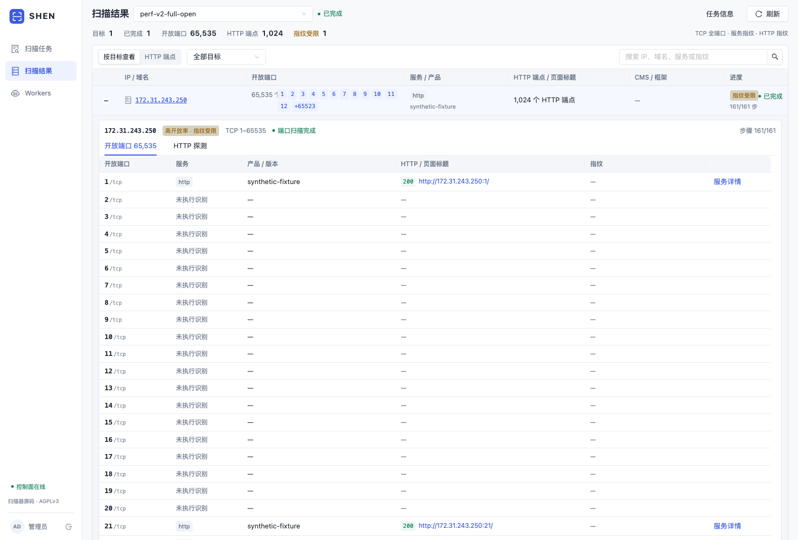
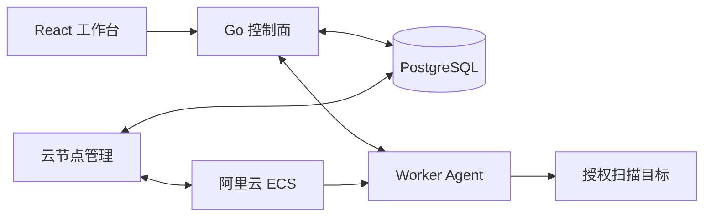

# SHEN Scan

基于 Go、PostgreSQL 和 React 的分布式扫描平台，支持使用阿里云抢占式实例作为 Worker。

在工作台设置 Worker 数量，导入 IP、CIDR、域名或 URL，选择扫描模式，即可查看每个任务下的开放端口、服务、HTTP 页面和 CMS / 框架指纹。

> 当前为持续开发中的版本。TCP 全端口扫描、任务调度、结果回传、云节点管理和工作台已实现；大规模持续负载、真实公网丢包环境下的容量结论尚未建立。仅用于自有或明确授权的目标。



*截图使用隔离环境中的合成数据，不代表真实软件安装或公网资产。*

## 功能

| 模块 | 当前能力 |
|---|---|
| 端口扫描 | IPv4 TCP **1–65535**，发现开放端口后继续执行服务指纹 |
| HTTP 指纹 | HTTP / HTTPS 探测，页面标题、状态码、Server、CMS / 框架及识别依据 |
| 指纹库 | 内置 54 条 HTTP 指纹、22 条端口指纹、7 条只读 PoC；编辑、启停、复制、导入、导出和规则版本 |
| PoC / Nuclei | 任务显式开启；原生只读检查和 Nuclei HTTP 模板，命中 / 未命中 / 检测错误及请求响应证据 |
| 输入 | 手动输入或导入 TXT / CSV；支持 IPv4、CIDR、域名与 HTTP(S) URL |
| 结果查看 | 按任务 → IP / 域名 → 开放端口 / HTTP 端点查看；提供搜索、筛选和分页 |
| 报文证据 | 查看已采集的请求、响应、Banner 和异常；超过采集上限时标注截断 |
| 任务控制 | 创建、暂停、恢复、取消，租约重派和执行版本隔离 |
| Worker 池 | 用户指定目标数量；节点认领任务，平台维护容量、排空并释放节点 |
| 阿里云接入 | 验证并加密保存账号凭据，一键准备专用 VPC / 交换机 / 安全组 |
| 抢占式回收 | 监听 ECS 中断事件、实例 metadata 和租约状态，触发排空或重派 |

### 两种扫描模式

- **端口扫描**：对输入 IP 扫描 TCP 全端口，并执行端口服务指纹；可同时勾选 HTTP 指纹。
- **HTTP 指纹**：包含 CMS / 框架识别。仅选择此模式时，裸 IP / 域名探测 HTTP 和 HTTPS；完整 URL 保留指定端口和路径。
- **域名仅进入 HTTP 流程**，不会把解析出的 IP 自动加入 TCP 全端口队列。输入域名时必须选择 HTTP 指纹。

**PoC / Nuclei 默认关闭**，创建任务时选择 HTTP 指纹后可勾选只读检查，并指定规则。它是 HTTP 流程的可选后续检查。指纹库中启用规则不会自动对已有任务执行检查，任务创建时固定规则快照。详见 [指纹库与只读 PoC](docs/RULE_LIBRARY.md)。

原始开放端口不会因为数量多而被截断。高开放率目标会限制下游指纹的派生量，并显示“指纹受限”；未识别不等于端口关闭。没有响应也不等于端口关闭。

## 架构



- **控制面**提供 API 和前端静态文件，保存任务、租约、结果和云资源状态。
- **PostgreSQL**是唯一权威存储；当前没有 Redis 或独立消息队列依赖。
- **Agent**负责认领、执行、续约、批量回传和停止；管理员令牌、引导令牌、Worker 会话令牌各自独立。
- **Nuclei**以受限独立进程运行；只执行任务固定的只读 HTTP 模板，不自动下载模板或连接云服务。
- **Masscan**以独立进程运行。仓库包含固定版本的接收修复补丁、构建脚本和许可证，发布包携带对应源码。

## 快速启动控制面

需要：Go 1.25+、Node.js 22.12+、npm、Docker Compose。实际端口扫描的 Worker 需要 **Linux amd64**、Masscan 和原始套接字权限。

```sh
git clone https://github.com/yimingy72/shen-scan.git
cd shen-scan
cp .env.example .env
```

编辑 `.env`，至少替换：

- `POSTGRES_PASSWORD`，并同步修改 `DATABASE_URL` 中的密码；密码出现在 URL 中时需正确编码。
- `SCAN_ADMIN_TOKEN`：工作台使用的管理员令牌。
- `SCAN_JOIN_TOKEN`：Agent 注册引导令牌，使用另一个随机值。

启动数据库和控制面：

```sh
docker compose --env-file .env -f deploy/compose.yaml up -d --wait
npm ci --prefix web
npm run build --prefix web

set -a
. ./.env
set +a
go run ./cmd/server
```

打开 **http://127.0.0.1:8080**，输入 `SCAN_ADMIN_TOKEN` 登录。健康检查地址为 `/api/health`。

默认 `SCAN_CLOUD_PROVIDER=manual`，这一步**不会创建云实例**。没有在线 Worker 时，任务会留在队列中。接下来可以接入手动 Worker，或配置阿里云节点池。

开发前端时可运行 `npm run dev --prefix web`；Vite 将 `/api` 代理到 `127.0.0.1:8080`。

## 接入手动 Worker

在 Linux amd64 Worker 上构建并安装随项目固定的扫描器，方法见 [Masscan 构建说明](deploy/masscan/README.md)。然后构建 Agent：

```sh
go build -o bin/scan-agent ./cmd/agent
sudo install -m 0755 bin/masscan/masscan /usr/local/bin/masscan
# 使用 Nuclei 检查时安装固定引擎：
deploy/nuclei/download.sh
sudo install -m 0755 bin/nuclei/nuclei /usr/local/bin/nuclei
```

为 Agent 设置以下环境变量，再以具备原始套接字权限的账号运行 `bin/scan-agent`：

```dotenv
AGENT_CONTROL_URL=https://scan.example.com
SCAN_JOIN_TOKEN=与控制面一致的引导令牌
AGENT_INSTANCE_ID=manual-worker-01
AGENT_METADATA_URL=off
# 使用私有 CA 时填写公开 CA 文件路径：
AGENT_CA_FILE=/path/to/public-ca.crt
```

手动 Worker 使用稳定且唯一的 `AGENT_INSTANCE_ID`。在工作台的 Workers 页启动节点池后，Agent 才开始认领任务。普通部署禁止私网、回环等受保护目标；受控内网环境可显式配置 `SCAN_ALLOW_PRIVATE_TARGETS=true`，云 metadata 等目标仍会被拦截。

## 使用阿里云抢占式 Worker

1. 将控制面部署到 Worker 能访问的 HTTPS 地址，配置数据库、TLS、管理员令牌和引导令牌。
2. 按 [Masscan 构建说明](deploy/masscan/README.md) 生成扫描器；准备自己的公开 CA 文件并打包：

   ```sh
   deploy/nuclei/download.sh
   CONTROL_CA_FILE=/path/to/public-ca.crt deploy/build-release.sh
   ```

3. 将 Agent 包发布到受控 HTTPS 下载地址，记录 SHA-256。配置 `SCAN_AGENT_PACKAGE_URL`、`SCAN_AGENT_PACKAGE_SHA256` 和 `SCAN_CONTROL_PUBLIC_URL`。
4. 设置 `SCAN_CLOUD_PROVIDER=aliyun`，在 Workers → 阿里云账号中验证并保存 AK/SK，在资源配置中选择地域、可用区并准备网络。
5. 设置目标 Worker 数量并启动。实例通过 cloud-init 下载校验过的安装包，启动 Agent；注册成功后才计入健康容量。
6. 点击停止时，平台先排空任务，再释放实例。以云端确认释放为准。

云账号需要与所用功能对应的 ECS 创建、查询、释放、系统事件读取及 VPC 网络管理权限。地域、镜像、可用规格和库存会影响实例申请。当前通过安装包引导 Agent，不要求预先制作自定义镜像。

详细配置、systemd 部署和更新步骤见 [部署说明](docs/DEPLOYMENT.md)。云凭据在服务端加密保存；凭据密钥文件与数据库应一起备份。凭据不会返回到浏览器。

## 使用流程

1. **Workers**：配置云账号和网络，设置希望维持的节点数并启动；也可接入手动 Worker。
2. **扫描任务**：输入任务名称，手动粘贴或导入目标，选择端口扫描和 / 或 HTTP 指纹。
3. **扫描结果**：选择任务，展开目标查看开放端口；切换 HTTP 端点查看页面与技术指纹。
4. **PoC 检查**：任务显式开启后，在结果页查看命中、未命中和检测错误。信息级命中不等于漏洞，超时不等于未命中。
5. **指纹库**：按 HTTP、端口、PoC 分类管理规则。导入 JSON 或受支持的 Nuclei YAML，校验后默认禁用。
6. **详情**：查看服务 Banner、请求响应、规则版本及识别依据。失败、取消、未扫描和指纹受限分别显示。

创建任务不需要填写预算、发包速率或内部执行阶段。Worker 是全平台共享容量，任务按存活节点认领执行；云节点回收后，未完成任务可由其他节点重派。

## 调度与默认参数

| 项目 | 当前默认值 / 约束 |
|---|---|
| TCP 范围 | IPv4 TCP 1–65535 |
| 端口发包预算 | 每 Worker 5000 PPS；运维可通过 `SCAN_PORT_RATE_PPS` 设置 1000–20000 |
| 端口分片 | 默认最多 4 IP；`SCAN_PORT_SHARD_MAX` 支持 1–16，并受执行时间预算约束 |
| Masscan 并发 | 每 Worker 最多 1 个进程，预留端口任务槽 |
| Agent 任务槽 | 默认 17 个：1 个端口槽 + 最多 16 个指纹任务槽 |
| 全局端点并发 | 默认 16；单服务任务最多 8，单 HTTP 任务最多 2 |
| PoC 并发 / 超时 | 每 Worker 最多 1 个 PoC；原生 60 秒，Nuclei 90 秒；每规则最多 3 个请求 |
| 收包等待 / 任务上限 | 15 秒 / 180 秒，任务上限包含结果回传和完成确认 |
| 高开放率处理 | 保留全部原始端口；单 IP 下游指纹最多选择 1024 个端口 |
| 结果缓冲 | 有界内存队列；Masscan 原始输出使用临时文件解耦回传，128 MiB 监测阈值 |

PPS 是 Masscan 的发包预算，不能直接视为每秒有效 SYN 探针数。更高速率需要结合网络、捕获丢包、CPU、内存与结果入库能力验证。当前默认值仍保持 5000 PPS；20,000 PPS 等配置属于可调候选，不代表已经完成大规模公网容量验收。

本次扫描提速工作保留在源码中；并发全开放问题已加入临时文件解耦修复，大批量新旧配置对照在开发者要求下停止，**尚未形成完整的吞吐验收结论**。不以局部测试替代全系统性能保证。

更多细节见 [调度与完整性](docs/SCHEDULING.md)、[指纹策略](docs/FINGERPRINTS.md)、[工作台显示逻辑](docs/WORKBENCH.md) 和 [API](docs/API.md)。

## 当前边界

- 当前使用单管理员令牌登录，尚无多用户、项目隔离或细粒度 RBAC。
- TCP 全端口执行器仅支持 IPv4；内置指纹库不承诺识别所有产品。Nuclei 只支持经校验的静态同源 GET / HEAD 模板，不支持整个官方模板集合。
- 网页截图、完整报告生成、完整 OSS 证据归档和高级灰度发布尚未实现。
- 原始端口仍按行存储；没有完成密集位图、网段自动熔断和自动归档。
- 临时文件用于解耦收包和回传，不是跨实例回收的持久检查点；实例丢失依靠租约与重试恢复。
- 尚未完成百万 IP 长期负载、复杂公网丢包及数据库主备切换的完整验收。

## 目录

```text
cmd/server/        控制面入口
cmd/agent/         Worker Agent 入口
internal/control/  任务、租约、结果与 API
internal/agent/    执行器、指纹、回传与停止
internal/cloud/    云账号、网络准备、实例与回收事件
internal/rulelib/  指纹定义、内置库、匹配与 Nuclei 模板校验
deploy/            发布脚本、systemd、PostgreSQL、固定扫描器构建
web/               React 工作台
docs/              部署、调度、API 与使用说明
```

## 开发检查

```sh
go test ./...
npm run build --prefix web
```

PostgreSQL 集成用例需要单独设置 `CONTROL_TEST_DATABASE_URL`；未设置时相关用例会跳过。普通本地检查不会自动启动付费 ECS。`deploy/cloud-fixture.sh` 和 `deploy/load-fixture.sh` 只用于显式启用的隔离验证环境。

## 仓库与第三方组件

公开仓库包含源码、必要测试、构建脚本与通用文档，不包含实际云账号、密钥、运行环境文件、部署证书、数据库或真实环境的原始报文。

Masscan 及其修改使用 AGPLv3，相关许可证、固定源码与补丁说明见 [deploy/masscan](deploy/masscan/README.md)。发布脚本会将对应源码和许可证一起放入 Agent 包。其他依赖的许可见各自项目；本仓库当前尚未为平台自有代码声明单独的开源许可证。

Nuclei 引擎固定为 v3.11.1（MIT），下载校验和许可见 [deploy/nuclei](deploy/nuclei/README.md)。内置规则为本项目编写，没有打包第三方模板仓库；导入自有规则时请保留其来源和许可证。
