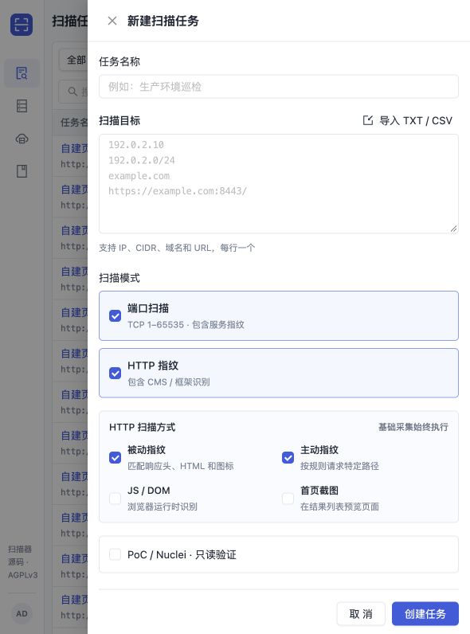
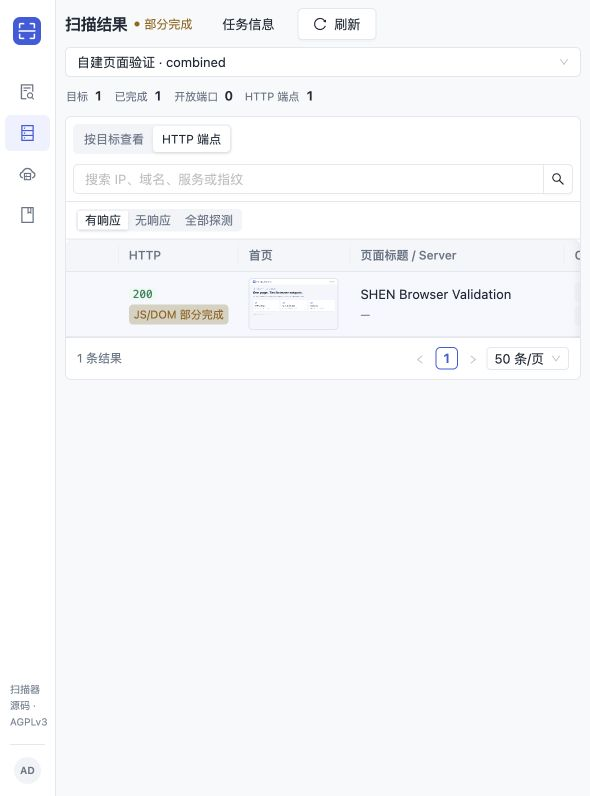
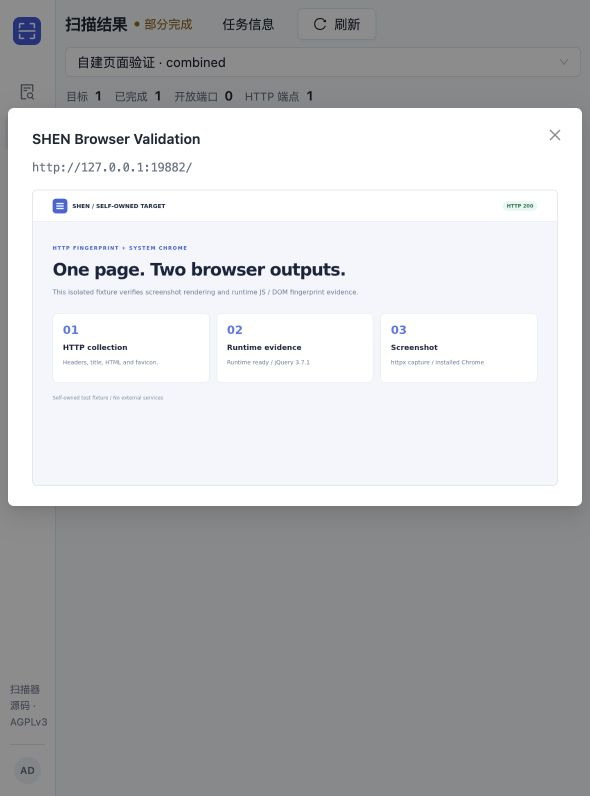
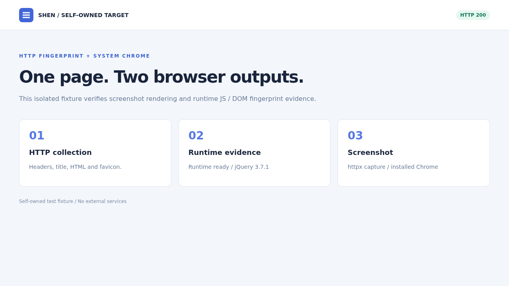

# HTTP 选项、Chrome JS/DOM 与首页截图验证

日期：2026-10-18。使用隔离 PostgreSQL/Control、Linux Agent 和自建 HTTP 页面；Agent 进程组限制为 2 CPU 配额、2 GiB 内存，每轮设置 1 小时自动停止。未新增云 Worker、未扫描外部目标；配额测试不等同于真实两核实例的吞吐压测。

## 结果

| 选择 | 完成步骤 | 结果 | API 观察耗时 |
|---|---:|---|---:|
| 仅基础采集 | 1 | 完成 | 8.61s |
| 仅被动指纹 | 1 | 完成 | 6.48s |
| 仅主动指纹 | 1 | 完成 | 20.68s |
| 仅 JS/DOM | 2 | 工作结束；JS 条件部分完成 | 6.54s |
| 仅首页截图 | 2 | 完成；截图 complete | 6.45s |
| 被动 + JS/DOM + 截图 | 2 | 工作结束；JS 条件部分完成；截图 complete | 10.50s |

`partial` 与工作失败分开：整库 JS/DOM 测试包含 7,607 个 Wapp app 和 2 个合成规则，7,077 个运行时条件中有 2 个上游非标准 `dom.src` 条件及 1 个无效选择器。它们明确记录为未支持/未完成，不当作未命中；已识别的 React、jQuery 和两个合成指纹正常保留。JS-only 为控制资源占用不加载图片。截图可独立成功，与这类 JS 规则不完整状态无关。

页面中的 WordPress meta、JS 全局变量和 DOM 标记均为自建测试内容，不证明真实安装了对应软件。MySQL/PHP 为 Wapp 关联推断，Goby 的 Windows 子串命中保持候选，不触发 PoC。

## 界面和实际图像

四选项与默认值：

HTTP 列表按需加载缩略图，点击展示原图：

实际 httpx SDK / 系统 Chrome 首屏 PNG：

## 完整报文与复现资料

[完整 HTTP 请求/响应数据包](validation/browser-options/complete-http-replay.zip) 保存方法、URL、全部请求头与请求体、响应状态/头/完整响应体。PNG、压缩 JS 等二进制同时保留完整 Base64 JSON 与原始报文字节，未裁剪。管理员及许可 token 均属于隔离测试，不是生产凭据。包内有 fixture 源码、各轮 API/目标报文和必要 PG fence 用例；初次联调失败记录也保留，并注明已修复。

[最终模式矩阵](validation/browser-options/results.json)、[系统浏览器能力](validation/browser-options/remote-helper-capabilities.json)、[实际安装检查](validation/browser-options/real-install.txt)、[必要检查记录](validation/browser-options/checks.txt)。这些是功能与资源上限验证，不是公网识别准确率或 1,000 IP 扫描容量结论。

## 必要检查与修复

- 截图原图和 240px 缩略图均要求鉴权；匿名访问返回 401。原图 SHA-256 与元数据一致，PNG 不进入分页 JSON；图像路由排除 gzip，避免 Content-Length 错配。
- 新选项纳入冻结摘要和 Agent/helper 能力门槛。真实 PG 覆盖过期 lease、父完成版本变化、重放、规则引用/inline 规则保留和图片级联清理。
- 修复浏览器认领初始化丢失 `rules_ref` 的问题；规则引用与 deadline 分别处理。修复同时启用截图时结果引擎标识不一致的问题。
- 有效的 partial PNG 可保存和预览；无效图片只影响截图。截图超限不丢 JS 阳性，JS 规则错误不抹掉截图。
- 修复 favicon 被 Chrome 归类为 `Other` 后误拦的问题；同源 GET/HEAD 仍受原有身份、许可、读体、时限和次数限制。
- 采样结束停止接收新请求，允许已接收请求最多 500ms 排空；父级取消不等待该窗口。带 400ms 许可延迟的 favicon 定向验证通过。
- Chrome 空闲 60 秒释放，活跃入口和旧计时器隔离；图片与规则编译缓存分别有界。
- 正式安装脚本在已有 Chrome 155.0.8059.84-1 的 Linux 环境跳过下载并通过隔离检查。缺失/过旧版本、错误签名/软件源和服务失败分支使用隔离 fixture 验证；本轮未重做全新主机的真实 apt 下载。
- 前端构建通过，真实浏览器完成独立开关提交、缩略图展示和点击预览验证。端口执行器未修改，未重复进行 TCP 发包压测。

## 接口与资产验证状态

| 目标/接口 | 用途 | 验证状态 |
|---|---|---|
| `127.0.0.1:19882` | 自建页面、CSS、JS、SVG、favicon | 未利用；功能验证通过 |
| `POST /api/runs` 的 `web_scan_options` | 四种能力独立选择与冻结 | 未利用；界面/API 验证通过 |
| `GET /api/observations/{id}/screenshot` | 原图与缩略图鉴权读取 | 未利用；内容与鉴权验证通过 |
| 浏览器子任务 claim | 固定父记录与规则引用 | 调度字段丢失已修复 |

本记录不涉及漏洞利用。生产发布清单与校验结果在发布完成后补充。
