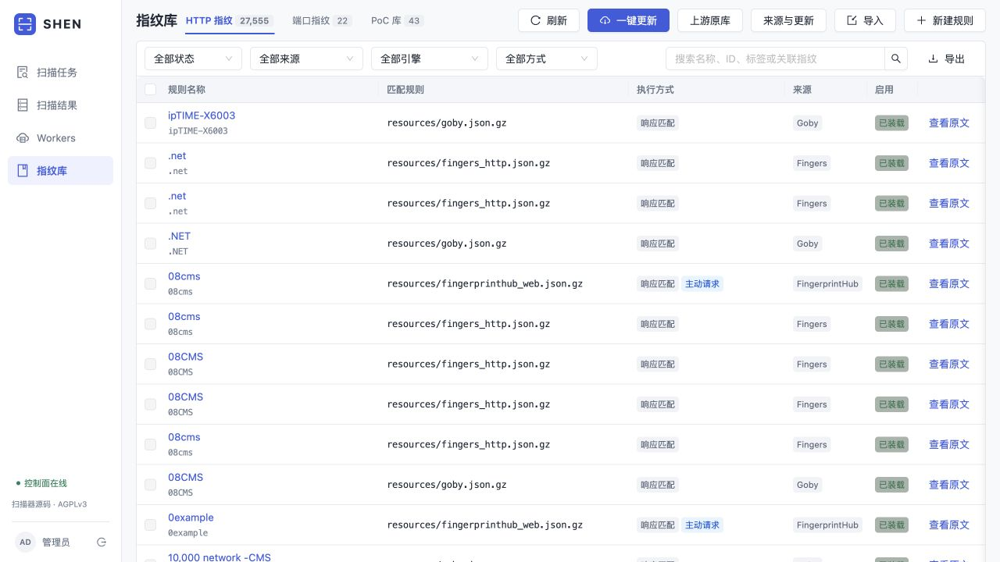
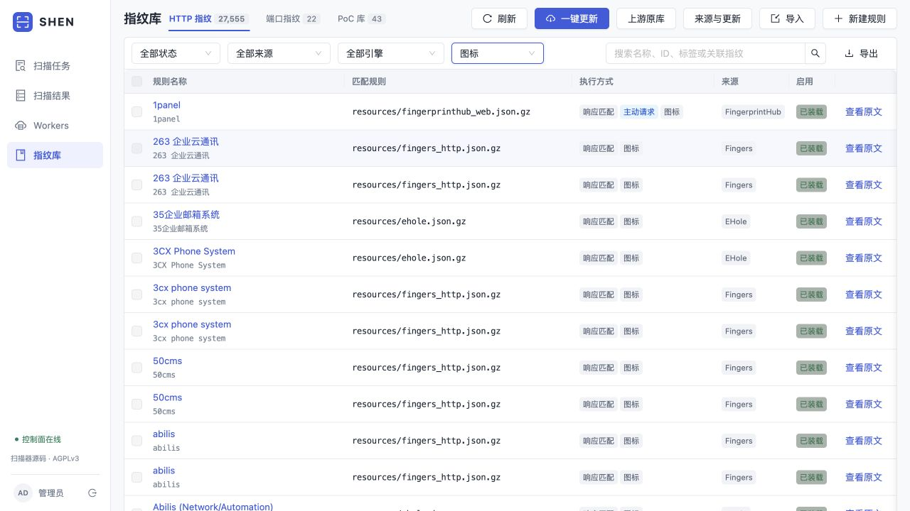
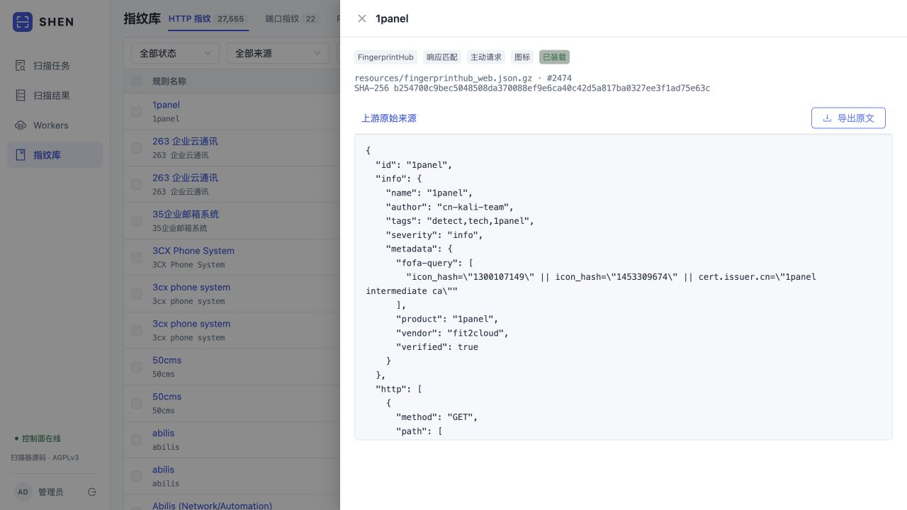
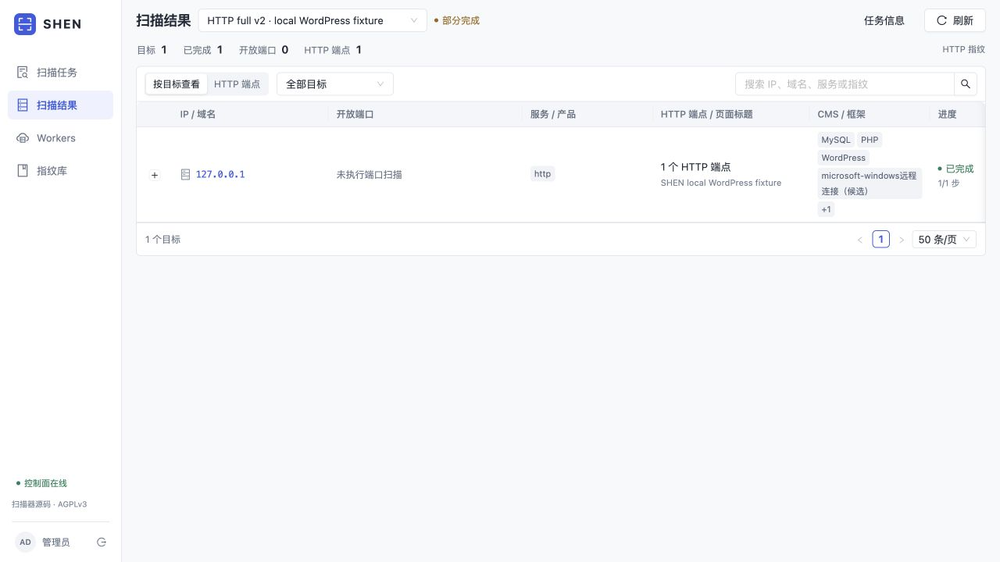
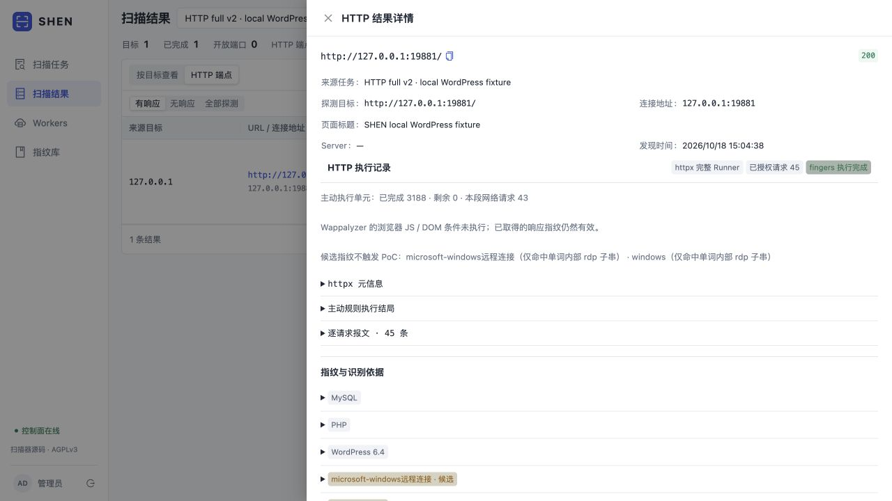

# HTTP 完整执行重构验证

日期：2026-10-18。对象为本地隔离 PostgreSQL、手动 Agent 和自建 HTTP 服务；没有对外部资产扫描，也未新增云 Worker。本记录验证 HTTP 重构，不重做 TCP 发包压测；TCP 1–65535 发现路径保持原有覆盖约定。

## 结果

- 完整 fingers 资源：Fingers 8,727、FingerprintHub 3,139、EHole 958、Goby 7,085，共 19,909 条原记录；39 条别名单列，零过滤。保留原文和重复记录各自的 pointer。
- 完整 worker 串联未知页面：httpx 1.02 秒 / 2 请求；fingers 2.79 秒（含进程启动与包检查）/ 43 请求 / 3,188 主动单元完成 / 0 剩余；3,154 单元无需新增网络请求。该结果不是公网容量或准确率结论。
- 实际 Control → Agent → httpx Runner → fingers → PG：**9.64 秒**，1 个任务步骤完成、0 失败、1 条 HTTP 结果，45 次累计授权，3,188 主动单元完成。WordPress 6.4 命中；MySQL/PHP 是 Wapp 原规则的关联推断，不证明目标真实安装。
- 上游 Goby 的 `rdp` 特征命中 `WordPress` 子串已复现。保留两条原始命中为“候选”；候选单独触发 0 个 PoC，有独立确认后才派生。未修改原规则文件，也未宣称全库误报已解决。
- Wapp JS/DOM 条件未执行，结果明确保留 `wappalyzer-browser-js-dom` 能力缺口。因此入口整体是 `partial`，而 fingers 主动执行是 complete；不能把工作完成当作所有指纹能力完整。
- 旧 embedded helper 与旧代码/SDK对同一真实 HTTP 响应的最终 JSON 完全一致；原 v1 包下载、历史摘要、领取 fence 和重新初始化退役检查通过。

## 界面截图

统一 HTTP 目录；数量含独立管理的 Wapp 记录，不把别名计入指纹：

favicon 规则保持原始条件与来源：

实际自建目标结果与执行详情：

## 完整请求与响应

[完整 HTTP 复现数据包](validation/http-full/complete-http-replay.zip) 包含方法、URL、请求头、请求体、响应头和响应体；二进制正文同时以 base64 JSON 保存。报文未裁剪；鉴权值为已停止的隔离测试凭据。目录含 httpx 身份/重定向/图标/取消、fingers 未知发现/组合规则/缓存/状态链、Control 进度 fence 和实际平台端到端请求。它不是漏洞利用报告；无新增外部资产。

[工具链统计](validation/http-full/worker-chain-summary.json)、[平台链统计](validation/http-full/control-agent-summary.json)、[旧版兼容](validation/http-full/legacy-summary.json)。

## 接口与验证状态

| 接口/目标 | 用途 | 状态 |
|---|---|---|
| 本地 127.0.0.1:19881 | 自建 HTTP 指纹目标 | 未利用；采集及识别已验证 |
| `/api/library/http-fingerprints` | 统一索引、筛选、分页 | 未利用；本地验证 |
| `/api/library/http-fingerprints/{unit_key}` | 原始规则与来源 | 未利用；本地验证 |
| `/api/library/fingerprint-bundles/import` | 实际编译后原子发布完整包 | 未利用；本地验证 |
| Goby rdp/WordPress 子串误报 | 产品确认质量边界 | 已修复为候选；原命中证据保留 |

## 范围与限制

本轮退役精确 157 条平台内置 native HTTP 规则，线上删除前后端口规则 22、PoC 907 未变，历史任务快照保留。fingers 合集以包管理，页面不将其原文改写为 native；普通 Wapp/自定义规则保留原有编辑、启停、删除功能。

实际网络失败、预算耗尽、读体截断和证据不足仍可导致 partial。浏览器 JS/DOM、全库准确率及公网容量未在此轮完成验证。生产发布与 GitHub 提交信息另附发布记录。
