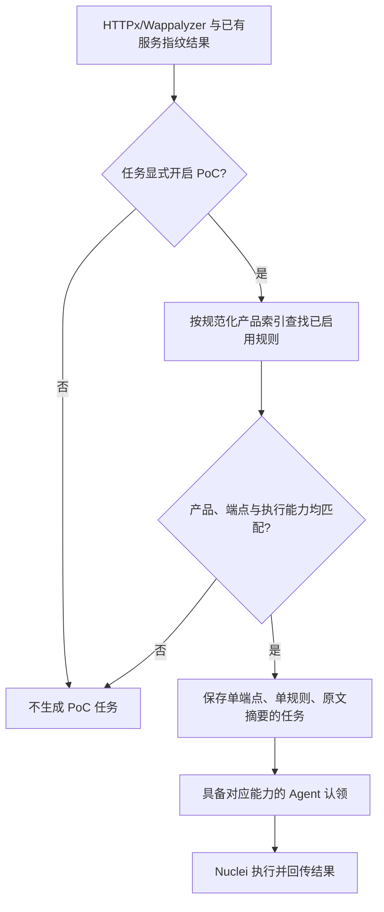

# 原始 Nuclei YAML 执行兼容性适配方案

文档版本：v0.3；更新日期：2026-10-17（北京时间）。

**状态：`http-basic-v1` 已实现、发布并完成线上端到端验证。** Control 支持原始 YAML 导入与冻结快照，Agent 支持原文落盘、摘要复核、原始模板 ID 校验和能力协商；本地真实 Nuclei v3.11.1 已通过命中、未命中、错误三态验证；生产控制面也已验证 HTTPx 指纹命中后的规则派发、原始 YAML 执行和证据回传。本文描述的执行范围之外仍不可执行，上游全量目录也不会自动转为执行规则。

代码与发布基线：`01da075`。本方案采用用户最后确认的范围：原始 YAML 兼容性适配，只使用本地无害 HTTP 模板验证；PoC 默认关闭、任务显式开启、按目标指纹匹配。此前无限制原始模板执行迁移不在本计划内。

## 1. 目标和完成定义

让受支持的 HTTP 模板以**原始 YAML 字节**交给官方 Nuclei 执行，平台负责目标选择、任务调度、连接范围、进程生命周期和结果存储，不再把原始模板重写成另一份 YAML 后执行。

首阶段交付必须同时满足：

1. 导入、存储、导出和执行临时文件中的 YAML 内容一致，保留原始 `id`、注释、缩进和签名文本。
2. 一个明确的 HTTP 兼容子集可执行；不支持的结构在派发前明确报出原因，不静默丢弃字段。
3. PoC 默认关闭；显式开启后，仅对识别出对应产品的端点派发匹配规则，不对每个目标运行全库。
4. 新旧规则和 Agent 能共存；不能把新格式任务派给旧 Agent。
5. 本地无害 HTTP/HTTPS 目标完成命中、未命中、错误、取消及指纹派发验证。
6. 提供可回滚发布包和真实验证记录；部署不自动启动 Worker 或扫描任务。

“原始 YAML”表示保留模板文件原文，不等同于启用 Nuclei 的 `raw` HTTP 请求功能。

## 2. 当前实现与需要补齐的差距

以下是基线代码和已有交付记录中的状态，不是本方案新增的完成项。

| 环节 | 当前实现 | 本次计划 |
|---|---|---|
| 引擎 | 已调用官方 Nuclei v3.11.1 子进程 | 复用现有二进制与进程管理，不另造引擎 |
| 旧 YAML 导入 | `parseNucleiTemplate` 提取严格子集并重新编码 YAML | 新路径保留原文字节；旧路径继续兼容 |
| 旧 YAML 执行 | `runNucleiPoC` 再次解析，写入 `parsed.Template` | 新路径写入原始 `Rule.Template`，只做结构检查和执行计划提取 |
| 原始目录 | 14,075 条模板仅供查看、导出；原文及辅助文件保存在 BYTEA | 继续完整同步，首阶段不批量转成执行规则 |
| 可执行 PoC | 现有部署907条，保留原执行逻辑；新安装数量不同 | 不覆盖、不清空、不自动重新启用 |
| HTTP 识别 | HTTPx + WappalyzerGo，完整 Wapp app 参与被动识别 | 复用现有产品结果，不再重复探测以决定 PoC |
| 派发 | 默认关闭、产品关联、端点范围、任务快照、attempt fence | 增加原始格式能力判断，其余复用 |
| 结果 | 命中/未命中/错误；JSONL和请求响应证据 | 增加原始模板ID与内容摘要关联，严格处理无事件和证据缺失 |
| 二进制观测 | 已支持 NUL 查询索引与 BYTEA 原始观测 | 继续沿用，避免再次出现反复回传后超时 |

14,075和907是当前部署快照中的数量，不作为安装默认值、兼容性数量或长期常量。

## 3. 首阶段兼容范围

建议将新格式标记为 `http-basic-v1`。这是**平台执行能力标记**，不是新增扫描模式，也不是用户手工固定上游版本。

| 能力 | 首阶段处理 |
|---|---|
| 单文档 YAML、`id`、`info`、注释及签名文本 | 保留原文，提取索引 |
| 结构化 `http` 请求 | 支持经过完整检查的简单请求 |
| 方法 | GET、HEAD；不因方法名称就宣称请求必然无副作用 |
| 路径 | `BaseURL`/`RootURL` 加静态路径；复用现有路径范围检查 |
| 静态请求头 | 沿用现有允许集合，不扩展认证、Host覆盖等行为 |
| matcher | 沿用现有 status、word、regex及其条件/大小写/否定组合；行为由Nuclei执行 |
| 多个静态请求/路径 | 总展开请求数不超过现有3个上限；禁止动态增殖 |
| 元信息中的产品 | 提取产品绑定，执行前按识别结果匹配 |
| 重定向 | 首阶段不跟随；模板要求跟随时明确不兼容，不覆盖模板意图后假装兼容 |
| DSL、extractor、动态变量/请求关联 | 首阶段不支持 |
| `raw`、payload列表/文件、fuzz、race、workflow/flow | 首阶段不支持 |
| code、headless、JavaScript、DNS、network、file、云协议、外部回连 | 首阶段不支持 |
| 写操作、爆破、DoS、破坏性行为 | 不进入本次执行范围；同步原库不会自动启用 |
| 未识别字段、YAML重复键、别名/锚点、多文档、超限输入 | 执行导入明确拒绝；原库浏览和导出不受此限制 |

模板是否适合运行不能仅由 `severity: info`、标签、签名或 GET/HEAD 判断。验收只使用自己编写的本地普通健康页/标记页模板，不对真实漏洞软件做验证，不恢复公网或云压测。

建议首阶段新增执行模板原文上限256 KiB，最多3个请求、每请求最多8个matcher；复用当前更严格的标量、路径和正则校验。全量原库归档的上限保持现状，不能将归档限制直接当成任务下发限制。

Nuclei 原生支持比本阶段更丰富的 HTTP 能力。平台支持矩阵以上表为准，不能因官方引擎支持就自动放行。[官方 HTTP 模板说明](https://docs.projectdiscovery.io/templates/protocols/http/basic-http)

## 4. 数据模型：原文、索引、运行能力分开

### 4.1 复用现有结构

优先复用 `Rule`、`NucleiMetadata`、`Upstream`、`rule_source_catalog`、`rule_source_files` 和 `runs.rules_snapshot`，不新建一套规则管理服务。

建议最小增量如下，字段名在实现时统一确认：

| 字段 | 语义 |
|---|---|
| `Rule.Engine = nuclei` | 继续使用同一个引擎名称 |
| `Rule.Template` | 受支持执行规则的原始 YAML；禁止重新序列化后覆盖 |
| `NucleiMetadata.execution_profile` | 新增，`http-basic-v1`；空值按现有旧格式或目录逻辑解释 |
| `NucleiMetadata.template_id` | 原始 YAML 的 `id`，独立于平台规则ID |
| `NucleiMetadata.CatalogOnly` | 目录条目仍为true；只有独立创建且通过兼容性检查的执行规则才为false |
| `NucleiMetadata.RuntimeReason` | 不支持/缺少运行能力的明确原因，不伪装成可执行 |
| `Upstream` | 已有来源、revision、path、SHA-256；用于自动追溯 |
| 导入模板内容摘要 | 无Upstream的自定义规则也计算SHA-256；放在已有规则/任务元信息中，避免新建审批表 |

新路径中的 `Definition` 不存放第二套可执行matcher定义。执行前临时提取请求范围描述，供代理核对方法、路径、请求头和请求数；Nuclei负责实际匹配。旧规则继续保留其历史Definition，避免改变已创建任务。

### 4.2 ID映射

平台规则ID可能为带前缀/路径摘要的ID，不能要求其等于YAML中的 `id`，更不能通过重写YAML解决冲突。

下发单条规则时明确保存：平台 `rule_id`、原始 `template_id`、内容SHA-256、来源路径。JSONL返回的 `template-id` 必须等于已派发的原始ID；最终观测关联平台规则ID。其他模板ID、其他目标或无法关联的事件记为错误。

### 4.3 原文、签名与版本

- 文件SHA在原始字节上计算；保留行尾、注释和编码，不trim或“格式化修复”。
- 保存签名注释不代表签名已经通过验证；引擎返回的验签状态单独记录，不能伪造“官方已认证”。
- 模板一经改写，不能继续使用原签名状态或来源摘要。
- 上游一键更新仍自动获取最新revision，无需管理员逐commit批准。
- 运行任务保存创建时实际使用的内容，这是重试一致性和审计要求，不是要求用户手工锁定规则库版本。

模板内容变更与签名验证的关系参照[官方签名说明](https://docs.projectdiscovery.io/templates/reference/template-signing)。

## 5. 导入、规则管理和上游更新

首阶段通过现有导入/编辑/启停界面接入少量兼容模板，不增加自动“全库转执行”的按钮。

1. 上传原始 YAML，按UTF-8和单文档结构检查，保留上传的原文。
2. 提取元信息及能力；逐字段检查是否属于 `http-basic-v1`。
3. 不兼容时返回具体字段路径、原因和支持范围，不自动转为native或删除字段。
4. 导入成功默认禁用，显示“原始 YAML / HTTP基础兼容”。
5. 原始新规则要求明确产品绑定；没有绑定不能进入按指纹派发路径。不得猜测厂商名或用名称模糊匹配填充。
6. 用户编辑后重新检查内容并增加现有规则revision；运行中的任务仍使用自己的快照。
7. 导出原始模板时返回原文；JSON导出同时包含绑定、来源和能力元信息。

对旧规则的导入、启停、删除、本地修改保护和现有通用规则行为保持兼容。新规则仍需任务显式开启PoC；在任务中手选该规则也不绕过产品匹配。

上游原库继续全量保存和更新。首阶段不修改现有907条执行规则，也不将目录中的 `enabled` 解释为运行许可。以后如需自动同步兼容模板，必须另做来源ID映射、更新/退役、本地修改保护及兼容率评估，本计划不默认包含。

## 6. 指纹匹配与任务派发

沿用当前端点结果和产品规范化，流程如下：



具体约束：

- 复用产品精确规范化和显式别名；不使用模糊子串或仅厂商名匹配。
- HTTP产品只关联对应HTTP端点；服务产品按当前同IP/同端口规则关联，不传播到该IP的其他所有网站。
- 提取阶段一次建立产品到规则的索引，随后按产品查候选；禁止对每个端点重新解析或遍历14,075份YAML。
- 一个PoC任务仍只携带一个端点、一条规则；无需第一阶段引入多模板聚合进程或长期进程池。
- 去重使用稳定端点身份、平台规则ID和任务快照中的内容摘要；attempt变化不生成新的逻辑检查。
- `poc_enabled=false`、无对应产品、禁用/删除规则或能力不支持时均不执行。
- 复用现有一个Worker最多一个活跃PoC任务的限制，避免先认领多项再排队耗尽180秒任务时间。

对原始新格式，`BaseURL`应保留输入端点的合法路径语义，`RootURL`对应其origin；不能直接沿用旧 `pocBaseURL` 清空路径的行为而改变模板含义。路径拼接、尾斜杠、默认端口和重定向边界必须有一个参数化验收用例。

## 7. Control 与 Agent 协议兼容

建议在claim中增加单个能力字段，例如 `supports_nuclei_http_original:true`，与现有HTTPx能力协商保持同样简单的设计，不建立新的插件注册协议。

1. 新Control同时服务旧格式和新格式；新任务标记所需能力。
2. 未声明能力的Agent只能领取现有可执行格式。
3. 新Agent声明能力前检查已安装的Nuclei二进制和所需参数；缺少工具时不谎报能力。
4. 重放已有claim时仍核对能力与快照，不允许把新格式回放给降级后的旧Agent。
5. 新字段为可选、默认兼容旧值；旧任务不做批量JSON重写。

首阶段把一条受限大小的YAML随现有PoC任务payload传递。不要把整库ZIP或全部辅助文件下发给Worker。256 KiB原文经过JSON转义后的响应也需检查现有4 MiB控制响应限制；超过上限明确报错。

只有以后实测证明单条模板或辅助依赖使内联不可行时，再增加按内容摘要引用的下载接口。届时必须复用Worker身份、有效lease、attempt和任务范围校验，不能开放未授权的任意规则文件下载。

## 8. Agent执行流程与资源限制

复用现有 `runPoC`、`runNucleiPoC`、scope proxy、进程组取消和批次回传。

新格式执行顺序：

1. 校验任务lease、rate许可、快照和兼容标记。
2. 检查原文摘要、原始ID与元信息一致，重新计算请求范围，不能只信任控制面传入的能力布尔值。
3. 创建独立临时目录、干净HOME/config/cache；原文以0600权限写入文件。
4. 核对落盘文件摘要与下发摘要一致，禁止写入规范化后的模板。
5. 对指定端点启动现有范围代理；固定实际connect IP，同时保留合法Host/SNI。
6. 只向Nuclei传入本次一个模板路径和一个目标，使用参数数组启动，不拼shell命令。
7. 读取有界JSONL及错误输出，核对事件身份和实际请求范围。
8. 保存结果及逐请求证据，等待批次确认和完成确认，最后清理临时目录。

默认沿用：每Worker一个PoC进程，Nuclei每进程并发1、bulk1、速率3请求/秒、请求超时8秒、引擎重试0、PoC执行90秒，任务总预算180秒。取消/回收/许可失效触发现有进程组终止机制，不延长窗口掩盖不兼容。

保留关闭自动更新、云认证、外部回连和额外HTTP预探测等现有参数。首阶段不传启用code/headless/本地任意文件访问的参数。确切CLI选项在实现时对**部署中的v3.11.1**及官方说明逐项核对，不能直接假设当前在线文档和已安装二进制一致。[官方运行说明](https://docs.projectdiscovery.io/opensource/nuclei/running)

scope proxy只转发已列出的目标origin、方法和路径；遇到越界请求记录错误，不尝试连接。GET/HEAD静态检查不能证明任意路径无副作用，所以本阶段验证只连接自有本地健康页。新增协议和旁路网络不在该代理的保证范围内，不应以“设置了proxy”替代能力限制。

## 9. 结果语义与证据

| 情况 | 处理 |
|---|---|
| 已完成请求且有有效正向matcher事件 | `matched` |
| 请求确实完成、证据完整且有明确未匹配事件 | `not_matched` |
| 退出成功但没有实际请求或没有可解释的matcher事件 | `error`，不得默认算未命中 |
| 模板语法/能力错误、ID不符、越界、工具缺失 | 明确错误；确定性问题不反复消耗执行重试 |
| 超时、取消、丢失许可、连接错误 | 沿用任务生命周期和错误分类，不伪造阴性结果 |
| JSONL/响应证据超限或截断 | 标注截断；无法支撑判断时记为错误 |

建议在现有观测中记录平台规则ID/revision、原始template ID、内容SHA、引擎版本、执行profile、matched-at、matched products、触发原因及逐请求证据。优先复用已有字段和 `checks`，不要新增另一套证据存储系统。

新profile先按 `purpose=check` 记录兼容性检查。导入模板带CVE标签、severity或匹配成功，均不能自动转为“已验证漏洞”，也不能借用现有11条native verification的正负对照含义。

模板读取、请求发送和规则命中应能分别判断。日志只记录任务标识、摘要、状态、耗时和短错误；原始响应进入已有证据接口，不直接写到常规日志。

## 10. 前端与API最小改动

前端由主代理亲自修改，子Agent不负责前端开发。

- 继续使用“指纹库 → PoC库”的导入、编辑、启停、删除、导出入口。
- 规则详情增加精简的执行格式、原始ID、原文摘要和不兼容原因。
- “上游原库”继续表示完整目录；清楚区分“已同步”和“可执行”。
- 创建任务保留现有PoC开关，默认关闭；不额外要求填写内部运行阶段、引擎参数或版本号。
- 结果详情显示实际运行的模板身份和完整请求响应；不新增大面积解释性面板。

接口优先扩展现有 `/api/library/import`、规则详情、claim payload和观测详情。仅当无法无歧义兼容旧导入时，增加可选的执行profile参数；不要改变旧客户端省略字段时的行为。任何新增字段在 `docs/API.md` 同步记录。

## 11. 最小验证矩阵

只做以下有实质覆盖的定向检查，不建设大规模模板跑分或云压测体系。

| 验收组 | 本地输入 | 必须观察到的结果 |
|---|---|---|
| 原文与语义 | 有注释/不同缩进/行尾、原始ID与平台ID不同的无害模板 | 导入/导出/落盘摘要一致；事件映射正确；BaseURL/RootURL不混淆 |
| 三态结果 | 普通标记页、无标记页、超时/无事件 | 分别matched、not_matched、error；不将无输出当阴性 |
| 指纹派发 | 匹配产品、不匹配产品、PoC未开启、规则禁用 | 仅第一种产生检查请求；手选不绕过绑定 |
| 范围与兼容 | 超范围路径/重定向、未知字段、未支持能力 | 派发前或连接前明确拒绝，不发生外部请求 |
| 生命周期 | 执行中取消、重复批次、旧Agent认领 | 发包及时停止；结果不重复；旧Agent不领取新格式 |
| 存储与升级 | 含NUL的返回正文、旧规则/旧快照、部署回滚 | 原始观测完整读回；旧流程不变；可停止新格式派发并回滚 |

使用临时本地HTTP/HTTPS服务和隔离PG；Nuclei使用实际官方二进制，不以假的CLI输出替代引擎验证。规则解析测试可以使用无网络样例，执行测试只运行无害模板。

一次端到端验证串起：创建HTTP任务 → 识别合成产品 → 仅匹配规则派发 → Nuclei执行 → 证据回传 → 任务完成。复用这次运行验证主要断言，修复失败后只复测受影响项。

首个无害样例可采用下列自编模板，不引用任何漏洞利用规则：

```yaml
id: shen-local-health-marker
info:
  name: SHEN local fixture health marker
  author: shen
  severity: info
  metadata:
    product: ShenFixtureApp
http:
  - method: GET
    path:
      - "{{RootURL}}/health"
    matchers-condition: and
    matchers:
      - type: status
        status: [200]
      - type: word
        part: body
        words: ["shen-local-fixture-ready"]
```

该样例仅用于说明模板形状；本轮线上验证使用了等价的独立临时模板，验证后已删除，未把样例正文当作真实漏洞规则。

## 12. 开发拆分、顺序和文件归属

开发已按以下拆分实施。后端子Agent最多两个同时工作，共享类型先确定契约，避免覆盖同一文件；前端由主代理负责。

| 工作包 | 主要内容/文件 | 依赖与负责人 |
|---|---|---|
| A：规则模型和解析 | `internal/rulelib/types.go`、`nuclei*.go`、`validate.go`；原文保存、profile、请求范围分析、旧格式兼容 | 后端子AgentA；先确定类型和函数契约 |
| B：执行适配 | `internal/agent/nuclei.go`、`scope_proxy.go`、`poc.go`、类型/claim；原始ID、原文落盘、事件和取消 | 子AgentB；A的接口确定后并行，不能自行扩大能力 |
| C：控制面和界面 | `internal/control/library.go`、`agent.go`、快照/结果；前端规则详情及导入提示 | 主代理；前端不委派 |
| D：集成和发布 | 一个本地端到端夹具、证据、文档、构建、升级和回滚 | 主代理；A/B/C完成后执行 |

先约定新增字段、旧值含义、原始ID映射和错误分类，再并行修改。共享类型由A负责；其他代理通过消息提出修改，不同时覆盖文件。无需新建泛化插件系统、引擎SDK服务或规则审批系统。

实施顺序：A接口与范围 → A/B并行 → Control接入和前端 → 必要本地验收 → 发布。每一步交付可审查的diff和定向验证结果；不得把受限方案改回已被拦截的无限制执行迁移。

## 13. 发布、回滚与停止条件

发布已按以下步骤完成，后续同类变更继续沿用：

1. 备份控制面、Agent发布包引用、配置和数据库，记录当前规则数、Worker池状态和活动任务。
2. 发布可识别新profile、但不主动开启新格式任务的Control。
3. 构建新Agent完整包；保留Nuclei二进制完整性校验和许可证。
4. 若Worker在线，在空闲后分批更新；若池已停止，只更新后续启动包，不启动实例。
5. 验证新版能力上报、旧Agent排除、新旧规则共存；测试仍只使用本地目标。
6. 发布界面；不自动启用导入规则、PoC任务开关或全量目录模板。

回滚前先停止生成/认领新格式任务，等待活动任务结束或按现有机制取消，随后回退Agent/Control。含新profile的运行快照和结果保留；旧二进制不得把未知格式降级解释为legacy执行。若旧Control无法识别这些状态，保留兼容Control而只关闭新格式派发，待导出/备份后再评估回退；不能删除数据掩盖回滚问题。

确定性模板错误、越界请求、原文摘要不一致、无法分清阴性与错误、旧Agent误领新格式任务，任一出现都停止新格式发布。外部工具审核再次拒绝相关实现时记录拒绝动作和原因，不换代理或通道重复同一被拒绝范围。

## 14. 文档与交付证据要求

开发完成后更新 `API.md`、`RULE_LIBRARY.md`、`POC_SOURCES.md`、`RULE_UPDATES.md`、`DEPLOYMENT.md` 和README中的能力边界。

验证报告放在私有验证目录：每项成果至少一张 `screenshots/` 截图，附完整HTTP方法、URL、Headers、请求体和响应体；认证信息使用占位符，正文不截断，传输解码方式明确。同步资产梳理文档并标注验证状态。合成模板命中只标注功能验证/未利用，不写成真实漏洞复现。

本文件保留开发方案与实施边界；线上验证记录存放在内部验证目录，包含截图、完整请求响应和资产梳理更新。合成模板命中只表示功能验证，不表示真实业务漏洞。

## 15. 实施与验证结果

2026-10-17 的交付状态：

| 项目 | 结果 |
|---|---|
| 实现提交 | `01da075` `Execute supported original Nuclei HTTP YAML` |
| 本地检查 | 完整 `go test ./...` 通过；`npm run build` 通过 |
| 真实 Nuclei | v3.11.1，matched / not_matched / error 三态通过；只访问本地无害 HTTP 标签页 |
| 线上控制面 | `101.201.116.63:8443` 健康检查正常，新 Agent 包已发布 |
| 线上端到端 | HTTPx 识别 `ExampleDomainE2E` → 冻结原始 YAML → Nuclei `matched` → 观测回传；任务 2 / 2 步完成 |
| 观测身份 | `template_id=shen-e2e-example-domain`、`execution_profile=http-basic-v1`、原文 SHA-256 `26121a32…b7b3` |
| 清理 | 临时规则和临时 Agent 已删除/停止；Worker 池恢复停止状态；验证目标仅为保留域名 `https://example.com/` 的单次 GET |

旧 Agent 能力闸门、原文摘要复核、模板 ID 与平台规则 ID 分离均已在线上路径验证。当前发布没有自动启用导入规则，也没有把上游全量目录转为可执行规则。受限范围之外的 DSL、extractor、动态请求、raw、payload、fuzz、race、flow 和重定向仍按第 3 节拒绝。
