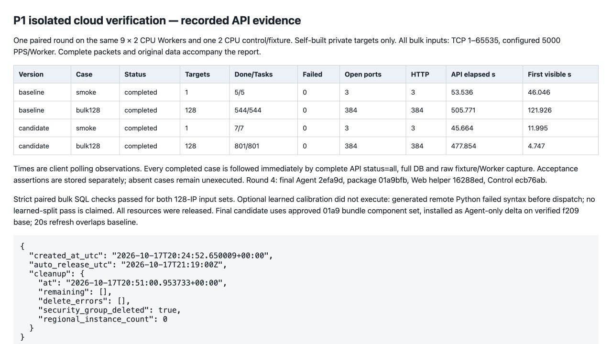
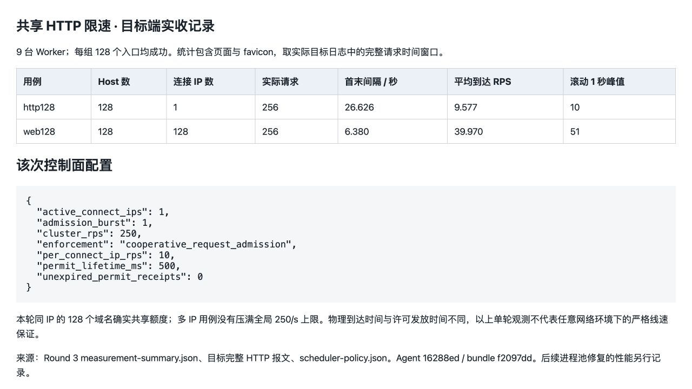
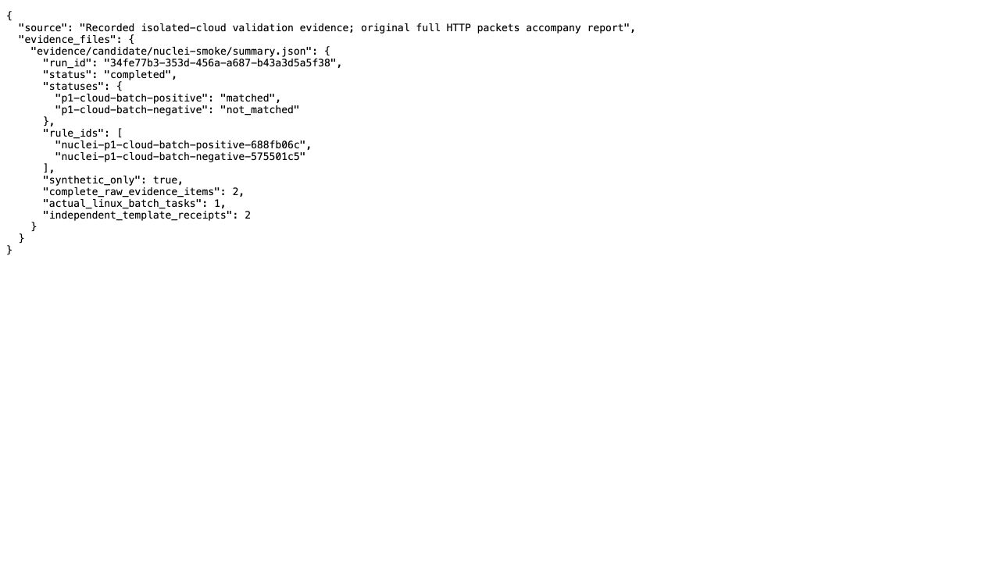
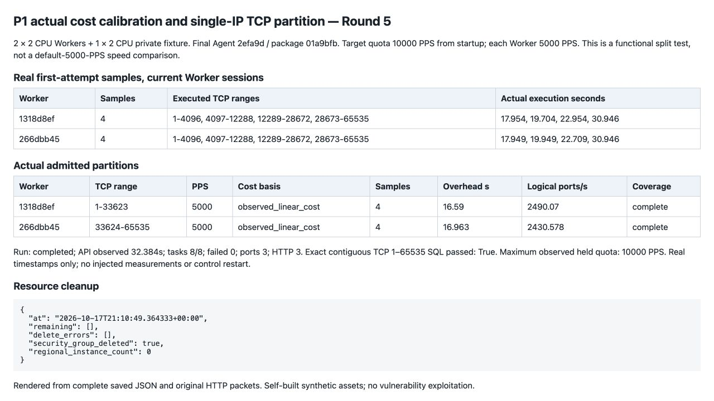

# P1 扫描与调度验收

验证日期：2026-10-18（UTC+8）。所有目标均为自建隔离夹具，验证状态：**未利用**。范围是任务制扫描与调度，不包含外围报告平台和持续资产库。

## 交付内容

- HTTP采集、图标和支持的PoC按实际连接IP共用请求许可；默认每IP 10次/秒、集群250次/秒。排队在连接目标之前完成，避免低额度等待耗尽目标的空闲连接时间。
- 根据真实首尝试样本调整后续IP和服务批次；同Worker/session足够样本可学习固定开销和端口成本，满足收益与配额条件后拆分单IP端口区间。
- Agent复用默认最多2个Web helper；相容的Nuclei原始模板可按入口最多4条合批，每模板单独保存凭证。PoC默认关闭、任务显式开启、按指纹匹配。
- Masscan逐条刷新阳性端口，控制面提前派生去重后的服务任务；端口阳性与完整扫描覆盖分开记录，保留TCP 1–65535。

详细语义与边界见[P1调度实现](P1_SCHEDULING.md)。

## 同批节点的全端口对比

第四轮使用同一批9台2核2GiB Worker，加1台2核4GiB控制面/自建目标，共10台。128个私网合成IP各开放80、8088、9443，包含HTTP和TLS；两版均扫描TCP 1–65535，共8,388,480个逻辑IP/端口组合，重传另外计入发包。

两版每Worker 5000 PPS、同目标默认5000 PPS、IP分片硬上限4、15秒收包等待、默认重传；保留相同低频ICMP背景流量，避免旧Masscan安静网卡退出问题影响对比。基线为`f4c3ffd`；最终Agent为`2efa9d`，Web helper为`16288ed`，控制面为`caafc82`。最终包SHA-256：`01a9bfb05a4b39d71e408e3332c2e32447a0292a667783585c9588fb3426392b`。

| 指标 | 基线 | P1 |
|---|---:|---:|
| 客户端轮询观察的完成耗时 | 505.771秒 | 477.854秒 |
| 首个API可见端口结果 | 121.926秒 | 4.747秒 |
| DB最后任务完成 | 500.180秒 | 471.142秒 |
| 首个HTTP观察 | 127.538秒 | 8.160秒 |
| 输入IP / 完整覆盖IP | 128 / 128 | 128 / 128 |
| 开放端口 / HTTP入口 | 384 / 384 | 384 / 384 |
| 失败任务 | 0 | 0 |
| 端口 / 服务 / HTTP任务数 | 32 / 128 / 384 | 43 / 374 / 384 |
| 服务任务累计执行时长 | 828.299秒 | 2395.341秒 |

本次总耗时下降**5.52%**。独立数据库检查逐IP核验原始输入清单、区间无缺口地覆盖1–65535、确切开放端口/HTTP集合、有效首attempt、无HTTP错误及额度释放；不是仅检查任务状态为completed。

提前派生缩短了结果等待，但增加了服务小任务和进程开销。累计任务执行时长包含并行重叠，不能当成墙钟时间或计费台时。平均Worker主机CPU忙碌率约8.11%→10.15%，最大扫描器合计RSS约578→626MiB；本次没有把节点CPU打满。只进行了一次同批节点对比，结果不能外推到百万IP/天、公网丢包或不同目标开放率。

最终Agent在已校验底包上增量安装，运行时组件哈希全部复核；发布服务器另行核验完整最终安装包。20秒的候选工件安装与基线运行有重叠，基线进程/工件未改动，但不声称环境完全没有噪声。

[完整创建、状态和结果HTTP报文](validation/p1/http/README.md) · [逐版本独立核验](validation/p1/data/comparison-summary.json)。截图由本地只读页面渲染实际保存的API记录，未修改数字或伪造终端结果。

## 功能验证层级

第三轮使用相同控制面和Web helper、前一版Agent `16288ed`：同IP的128个域名入口完成128/128，含图标共256次请求；目标侧观察平均9.58次/秒、任意滚动1秒最多10次。128个不同IP的入口完成128/128，256次请求，平均39.97次/秒；**没有打满集群250许可/秒**。许可发放是协作式准入，通信延迟可能聚集实际到达，不能解释为任意网络窗口的严格包速上限。

同轮真实Linux Nuclei完成一个两模板批次，分别得到matched和not_matched两张独立凭证；安静网卡全TCP用例不依赖背景ICMP，45.395秒完成。第三轮后续对比因旧版缺少新遥测接口而被采集脚本中止；该问题在第四轮修正，第三轮不充当吞吐对比。

最终Agent `2efa9d` 的必要本地回归核验双helper并发、复用、取消隔离、退出回收；9个Agent池共18个真实helper、128别名、256许可/256真实请求，无请求头前断连。第四轮另外核验最终Agent的全端口到HTTP链路。这里明确区分本地隔离测试与真实云全链测试。

## 真实校准与单IP双节点分片

第五轮使用最终完整安装包，只有2台2核Worker和1台2核自建控制面/目标。每个Worker实际执行4档端口区间：1–4096、4097–12288、12289–28672、28673–65535。8份当前session的首尝试完整结果用于学习成本；没有注入完成时间、吞吐或伪造启动凭证。为验证双节点分片，本轮从启动起将目标总额度设为10000 PPS，每Worker仍为5000 PPS，测试中没有重启控制面或临时切换额度。

随后通过普通创建接口提交一个IP，调度器根据实际启动预留与成本生成：

| 节点 | 端口区间 | PPS | 实测成本来源 | 样本 | 固定开销 | 保守逻辑端口速率 |
|---|---|---:|---|---:|---:|---:|
| Worker A | 1–33623 | 5000 | observed_linear_cost | 4 | 16.590秒 | 2490.070端口/秒 |
| Worker B | 33624–65535 | 5000 | observed_linear_cost | 4 | 16.963秒 | 2430.578端口/秒 |

任务32.384秒完成、8/8子任务、0失败，确切3开放端口与3 HTTP入口。SQL核验TCP全范围连续无缺口，两个实际启动凭证绑定相应Worker/session；500毫秒间隔采样观察到的最高占用额度为10000 PPS，未超过本轮上限。配置PPS与有效逻辑端口速率不同，后者包含重传和实际执行成本。

这证明实际成本可以驱动分片，**不是与默认5000 PPS同速率的提速对比**。生产默认目标额度保持5000 PPS；样本不足、额度不足或收益不够时仍保守使用单片。两台同规格节点也不代表已覆盖所有异构实例组合。

[完整HTTP与逐run结果](validation/p1/http/README.md) · [实际分片](validation/p1/data/r5-parts.json) · [实际校准样本](validation/p1/data/r5-real-samples.json) · [独立覆盖核验](validation/p1/data/r5-split-db-quality.json)。末尾一个额外汇总脚本因文件缺失报错；各校准run与split的API、DB、节点和目标报文此前已完整保存，数据库/节点额外快照也成功。这一采集错误保留记录，不冒充整轮脚本无错误。

## 资源与测试范围

各轮均不超过10台2核实例（包括夹具/控制面），单轮最长53分47秒；有效成对对比26分8秒，最终分片验证5分59秒。每轮结束后确认测试实例与专用安全组删除。共享网络配置保留，生产待执行任务没有用于测试。完整本地与私有云归档保留历史失败轮次；公开报文为合成目标的可复核子集。

## 资产与接口清单

| 对象 | 用途 | 验证状态 |
|---|---|---|
| 隔离私网172.28.1.1–172.28.1.128 | TCP全端口、80/8088 HTTP、9443 TLS | 未利用；合成数据 |
| 同IP域名别名及多IP入口 | HTTP共享许可、图标请求 | 未利用；合成页面 |
| 合成PoC命中/未命中路径 | 原始Nuclei批次与逐模板凭证 | 未利用；无害响应 |
| `POST /api/runs`、`GET /api/runs/:id` | 创建与状态 | 未利用；隔离控制面 |
| `GET /api/runs/:id/results`、`/http` | 完整覆盖与观察 | 未利用；隔离控制面 |
| `GET /api/scheduler/status` | 配额与批次依据 | 未利用；隔离控制面 |

公开报文仅含合成目标，认证令牌用占位符。测试基础设施已经释放，原URL不能继续访问；复现应在自己的隔离环境启动同类夹具并使用自己的令牌。历史失败轮次不计入成功对照：第一轮监测上限提前取消，第二轮候选出现partial且缺少严格候选DB证据，第四轮额外校准夹具在执行前语法失败。这些都未被改写为通过。
