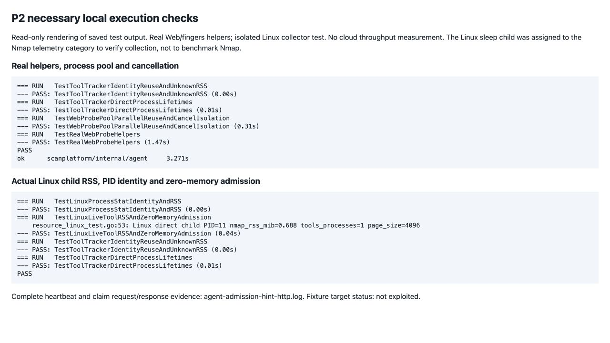
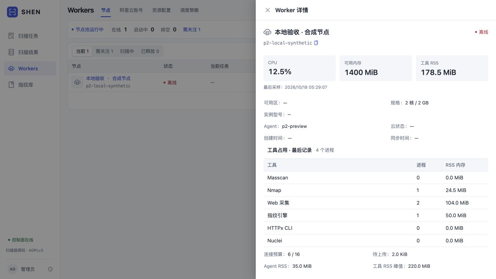
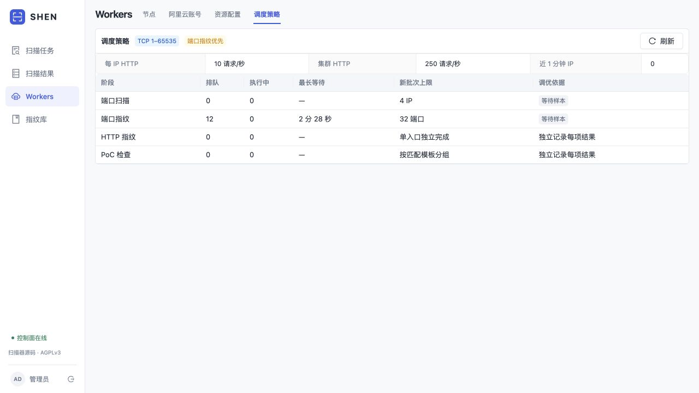

# P2 第一批必要验证

日期：2026-10-18；实现提交`6c41287`。本批是连接预算、直接工具进程统计和有期限的服务优先提示，语义见[P2执行资源](P2_EXECUTION.md)。验证对象均为本地隔离夹具，状态：**未利用**；没有新增云压测，也不把P1的5.52%对比结果当作本批性能收益。

## 已执行的检查

| 验证对象 | 结果与口径 |
|---|---|
| Web连接预算 | 单入口、旧批量、共享helper池、CLI保守线程、原生并发与未解析规则引用分别核验 |
| 服务优先 | 心跳提示、失效/过期、本机无槽、缺少Nmap、单槽公平；服务claim为空后继续领取port |
| 工具生命周期 | 六类直接进程的注册/退出、PID复用、旧清理不删除新注册、未知RSS省略 |
| 真实helper | 实际Web/fingers helper、双进程复用、取消隔离与回收，必要race检查通过 |
| Linux采样 | 隔离Linux容器中真实子进程采样与退出、启动时间身份、已知可用内存0时暂停接单 |
| Control与PG | 暂停/不兼容run排除；候选窗口1024/1025边界；冷样本不估算；短缓存、刷新失败和同步心跳复用 |
| 前端 | TypeScript与生产构建通过；实际浏览器核验工具详情和调度提示 |

Linux测试将一个实际`sleep`子进程归入Nmap统计类别以检查采样器；记录0.688MiB不能解释为真实Nmap内存基准。RSS仅覆盖直接受控进程，不能当作进程树或去重物理内存。最终发布包为`bundle-2e2fc78222de`，组件由干净提交交叉构建并核验SHA；本地真实helper与Linux采样测试分别覆盖各自层级，没有声称新安装包完成过云吞吐对比。

[完整Agent心跳/认领HTTP交换](validation/p2/http/agent-admission-hint-http.log) · [Linux原始输出](validation/p2/http/agent-linux-resource.log) · [真实helper输出](validation/p2/http/agent-tools-helpers.log) · [Control命令与记录](validation/p2/data/control-checks.json) · [发布组件来源](validation/p2/data/release.json)。最初Control夹具缺少必填derived_key，补齐夹具后通过；原记录保留。未因整理报告而重复运行已通过的测试。

## 页面与接口核验

以下是本地合成节点和排队数据的实际页面截图。CPU、RSS和队列值用于显示逻辑验收，不是生产测量；未启动扫描器或云实例。离线节点明确显示最后记录。

[完整合成API请求与响应](validation/p2/http/synthetic-api.md)包含注册、心跳和调度状态；认证值占位，其余请求与响应内容完整。源代码中的`TestPostgresServicePressureWindow`、`TestHeartbeatServiceHintAndNilClaimFallsBackToPort`及资源测试可在隔离环境复现对应行为。界面报文验证数据接收/渲染，Linux采样日志验证实际进程机制，两者不混用。

| 资产或接口 | 作用 | 验证状态 |
|---|---|---|
| 本地临时控制面127.0.0.1:18581 | 页面和API验收，合成节点/任务 | 未利用 |
| `POST /api/workers/register`、`/heartbeat` | 新指标及短期优先提示 | 未利用 |
| `POST /api/tasks/claim` | 领不到服务时回退端口的本地模拟交换 | 未利用 |
| `GET /api/scheduler/status` | 有界服务队列窗口、成本与优先状态 | 未利用 |
| 临时Linux容器/本地HTTP夹具 | RSS、真实helper与生命周期检查 | 未利用 |

截图、完整报文和SHA均在`validation/p2/`。本批不改变TCP全端口范围、PPS、进程硬上限或PoC默认关闭策略；仍未覆盖百万IP持续负载、所有实例规格或新一轮公网性能。
