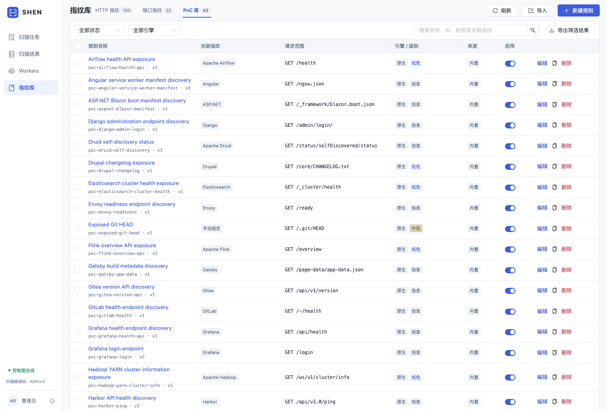

# 指纹库与只读 PoC

工作台“指纹库”分为 HTTP 指纹、端口指纹和 PoC 执行库。当前 bootstrap 为 **151 条 HTTP、22 条端口、43 条 PoC**。完整 Wapp 更新后，HTTP 执行库预计为 **7,793 条**（7,642 Wapp + 151 bootstrap）；PoC 执行库保持 **907 条**。实际数量以 live 数据库为准。



## 管理与执行

执行库列表支持搜索、启停、编辑、复制、JSON 导出与导入。内置及自定义规则都可以编辑、禁用和删除；删除使用持久标记，重启或补种不会复活。导入为原子操作，一次最多 10,000 条；import 端点请求体上限为 32 MiB，成功项默认禁用。其他 JSON API 仍保持 8 MiB 上限。

“上游原库”是独立的只读浏览与导出界面。目录条目带 `catalog_only` 和运行能力原因，不出现在可执行规则计数中，也不会因一键同步自动进入任务快照。原库 enabled 是目录管理元数据，不代表执行许可。

Nuclei 导入选择“原始 YAML（受支持子集）”时使用 `execution_profile:"http-basic-v1"`：平台保存原始字节、注释、行尾和模板 `id`，另生成平台规则 ID 与 `content_sha256`。执行器再次检查摘要后把原文写入临时文件，由 Nuclei 解析和匹配；控制面不保存第二套 matcher 定义。子集只允许 GET / HEAD、最多 3 个静态 `{{BaseURL}}` / `{{RootURL}}` 请求、每个请求最多 8 个 word / regex / status matcher，并要求 `info.author` 和明确的 `info.metadata.product`。DSL、extractor、动态变量、raw、payload、fuzz、race、flow、重定向、query、其他协议和未知字段会带字段路径拒绝。旧版导入仍可用“兼容规范化（旧）”保留。

创建任务时，平台保存当时启用的 HTTP / 端口规则及选择的 PoC 规则。修改、禁用或删除库内规则只影响之后创建的任务，已有任务继续使用其快照。界面显示的规则版本与观测记录对应。

**PoC / Nuclei 默认关闭。** 创建任务选择 HTTP 指纹后，可以显式勾选“PoC / Nuclei · 只读检查”。不选择具体规则时，在已启用且有 `applies_to` 绑定的规则中按指纹自动筛选；也可选取子集，产品型规则仍须命中绑定。没有识别结果时不派发产品型 PoC。`applies_to` 为空的通用 discovery 规则（如 security.txt、Git HEAD）仅在任务中明确选中该 ID 时执行；verification 全部有产品绑定，手选也不能绕过。只对本任务完成 HTTP 探测后发现的同源端点执行；同一任务、同一 origin、同一规则版本跨 URL 路径只执行一次。不追溯执行历史任务，不因跨源重定向自动扩展范围。

产品绑定取 HTTP 技术指纹及同目标、同 IP、同端口的服务产品；服务识别晚到时补派，其他端口的产品不参与匹配。结果详情显示触发依据与匹配产品。旧任务保留创建时的调度策略。

列表支持勾选跨页规则后批量导出和删除（最多 1000 条）；“导出筛选结果”导出当前条件的全部结果，不限当前页。版本冲突时整批删除失败，不会删一半。

每 Worker 最多执行一个 PoC。原生检查总超时 60 秒，单请求 8 秒；Nuclei 总超时 90 秒，进程请求速率 3/秒、并发 1。每条规则最多 3 个请求、8 个匹配器。`http-basic-v1` 任务只由声明 `supports_nuclei_http_original:true` 且本地 Nuclei 参数检查通过的 Agent 领取。任务取消、租约失效和实例回收继续沿用 Agent 的停止及重派机制。

## HTTPx 与 Wapp 被动指纹

Wapp source 保留全部 7,642 个 app 的原始 JSON。创建任务时，控制面冻结已启用 app；Agent 通过 rules_ref 下载一次规则集并重建 HTTPx v1.12.0 CFF。HTTPx 对一批端点执行被动技术识别，native HTTP 规则继续使用同一响应做补充匹配。

HTTPx `-cff` 会叠加 embedded fingerprints，所以 Agent 只接受冻结快照启用名单内的产品。包含 HTTPx 规则的 run 只能由同时声明 `use_rule_sets` 和 `supports_httpx_cff` 的 Agent 领取 HTTP task。固定引擎、默认 2 进程 × 8 线程和本地 fixture 结果见 [HTTPx 引擎说明](../deploy/httpx/README.md)。

## 结果语义

| 结果 | 含义 |
|---|---|
| 命中 `matched` | 完整执行后满足规则条件；需结合规则级别和证据判断 |
| 未命中 `not_matched` | 完整执行且响应不满足匹配条件 |
| 检测错误 `error` | 超时、连接失败、响应不完整、缺少引擎、输出无效等，不能推断目标安全 |

信息级检查如 security.txt、登录页或健康端点命中，不等同于确认漏洞。Git HEAD 暴露检查只读取固定路径并确认引用格式，不下载仓库、不提取凭据。结果包含规则 ID / 版本、引擎、级别、依据及请求响应；报文超过采集上限会标记 `truncated`。平台有界采集，不承诺保存任意大小的完整响应。

### 发现检查与漏洞验证

PoC 的 `purpose` 为 `discovery`、`verification` 或 `check`；旧规则省略该字段时兼容为 discovery。工作台分别筛选和统计结果：

- discovery 用于确认产品页面、面板、版本、健康状态或公开元数据。命中不会计入漏洞验证数。
- verification 必须是注册表中审核过的精确 native 定义，包含 CVE、类别、证据等级及上游 `source_pin`。用户不能把普通规则仅靠填写 `purpose` 或 metadata 升级为 verification。
- check 保留给不属于产品发现、也没有 verification 证据合同的安全检查；通过 `http-basic-v1` 导入的执行规则使用该 purpose，目录条目本身仍不可执行。

verification 使用按顺序的 `probe` / `control` 请求。Agent 回传每项完整原始请求响应，控制面再按冻结任务规则核对请求的同源、方法、URI、Header、响应 matcher 和整体差分结果；缺项、截断或阴性对照失败的 `matched` 不会入库。结果详情展示逐请求 evidence 和固定上游来源。完整规则清单与结果语义见 [只读漏洞验证](READONLY_VERIFICATION.md)。

## 原生 JSON 规则

从界面导出的 `{ "items": [...] }` 可以直接导入；以下示例识别已有响应中的明确 Header。字段枚举及约束以 `internal/rulelib/types.go`、`validate.go` 为准。

```json
{
  "items": [{
    "id": "http-example-server",
    "kind": "http",
    "name": "Example server",
    "engine": "native",
    "severity": "info",
    "enabled": false,
    "tags": ["server"],
    "source": "custom",
    "definition": {
      "product": "Example",
      "condition": "and",
      "matchers": [{
        "part": "header",
        "type": "word",
        "words": ["Server: Example"],
        "condition": "or"
      }]
    }
  }]
}
```

`kind` 为 `http`、`port` 或 `poc`。HTTP 可匹配 `body/header/title/status`；端口可匹配 `banner/service/product`。`type` 为 `word/regex/status`，组合使用 `and/or`；支持 `negative` 和 `case_sensitive`。`version_regex` 配合 `version_part` 从明确输出中提取版本，不按端口号推测。

PoC 顶层增加 `"applies_to": ["WordPress"]` 等绑定字段；名称经大小写、空白及明确别名归一后精确匹配，多个产品为 OR，禁止 `* / all / http` 等通配。普通自定义 PoC 属于 discovery；`purpose:"verification"` 只接受审核注册表中的完整固定定义。

原生 PoC 的 `definition.requests` 写入静态 `method`、`path`、可选 `headers` 和 `matchers`，例如：

```json
{
  "condition": "and",
  "requests": [{
    "method": "GET",
    "path": "/.well-known/security.txt",
    "condition": "and",
    "matchers": [
      {"part": "status", "type": "status", "status": [200]},
      {"part": "body", "type": "word", "words": ["Contact:"]}
    ]
  }]
}
```

新增和导入规则都经过控制面校验，Agent 执行前再校验。响应失败或截断时不会根据“缺少正文标记”作负向推断。

## 当前可执行的 Nuclei YAML

Nuclei 使用真实的 **v3.11.1 引擎**，仅开放受限 HTTP 子集；不是任意模板执行入口。导入使用“导入 → Nuclei YAML”。以下模板可用于自有测试站点：

```yaml
id: custom-security-policy
info:
  name: Published security policy
  author: local
  severity: info
  tags: discovery,read-only
http:
  - method: GET
    path:
      - '{{BaseURL}}/.well-known/security.txt'
    matchers-condition: and
    matchers:
      - type: status
        status: [200]
      - type: word
        part: body
        words: ['Contact:']
```

支持静态同源 `{{BaseURL}}` / `{{RootURL}}` 路径、GET / HEAD、word / regex / status 匹配器。模板 ID 与库内规则 ID 一致。`info.metadata.product` 可为产品名或名称数组，导入时映射到 `applies_to`；缺失时保留手动选择，不从泛化 tags 猜测绑定。关联指纹也可在编辑界面单独设置。编辑模板后重新解析规范化定义，不能通过修改 metadata 绕过执行校验。

手工导入和当前历史执行规则仍使用这一受限格式：不接受 POST、查询参数、目录穿越、动态变量、raw、DSL、workflow、flow、code、headless、网络 / DNS、payload、外部回连及重定向。YAML 别名和未知执行字段会被拒绝。

11 条 native verification 继续使用固定差分请求：9 条开放重定向行为验证和 2 条固定非敏感 `/etc/os-release` 越界读取验证。它们属于现有 907 条执行规则，不由新的 Nuclei 原库同步创建、更新或退役。

Nuclei 使用隔离临时目录、清理过的环境变量和目标范围代理，关闭自动模板下载、云认证、Interactsh、重定向及 HTTP 探活。HTTP 代理核对方法、主机、端口及路径；HTTPS CONNECT 固定目标主机和端口，TLS 内路径由预先校验的静态模板限定。地址仍由 Agent 的受保护目标校验处理。进程异常或缺少有效匹配事件记录为检测错误。

Nuclei 下载与校验见 [固定引擎部署](../deploy/nuclei/README.md)。全量原始目录保留完整 YAML、DSL 和 capabilities，但目录同步本身只用于查看和 ZIP 导出，不自动转为执行规则。需要执行的条目应单独导入为 `http-basic-v1`，并经过原文摘要、请求范围和产品绑定检查后再由受限执行器运行。

来源、许可证和执行 / 目录分界见 [规则来源](RULE_SOURCES.md) 和 [PoC 来源](POC_SOURCES.md)；官方源一键更新见 [规则源更新](RULE_UPDATES.md)。


新安装仅带内置执行规则（151 HTTP、22端口、43 PoC）；本文的907条PoC是既有部署此前已保存的执行库规模。新的Nuclei原库同步只收录原文目录，不会在新安装中自动建立旧兼容执行库；可执行原始 YAML 需按 `http-basic-v1` 单独导入。
