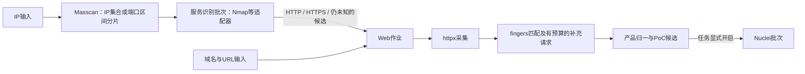

# Worker执行架构与平台调度方案 V2

版本：0.5；日期：2026-10-17；状态：完整方案审核后修订的设计基线。P0开发已启动，实际实现与验证状态见[P0核心闭环](P0_CORE.md)，设计条文不代表已部署能力。

本版按用户修正，重点回答工具组合、Agent如何调用工具、指纹库如何接入、平台如何分配任务和利用Worker。保留任务制，结果按run_id查看。旧版数据模型拆分属于辅助设计，不作为本次主线。

v0.4全文交由“构建扫描器方案”审核；本会话独立核对其R-01～R-12结论，并将修订取舍交回对方复核后形成v0.5。对方审核了v0.4全文和修订取舍，尚未审核本版最终全文。保留固定单向四类作业，重点补齐额度恢复、有效结果归属、逐项完成、Web故障隔离和分片启动条件。参数仍为待实测初值，不是已上线保证。采纳判断见第12节。

## 1. 推荐组合与自研边界

基线组合：**Masscan + Nmap + httpx + fingers + Nuclei**。

| 组件 | 主要职责 | 接入方式 |
|---|---|---|
| Masscan | IPv4 TCP 1–65535端口发现 | 独立子进程，行式结果 |
| Nmap | 已发现开放端口上的服务、协议、产品版本识别 | 独立子进程，XML结构化输出 |
| httpx | HTTP/HTTPS确认、页面采集、标题/响应头/TLS及Wappalyzer技术识别 | 官方SDK薄封装为有界采集子进程，输出自定义证据envelope；CLI为能力受限备选 |
| fingers | 对采集响应做多库Web指纹匹配，补充favicon及产品信息 | Go SDK，封装在本机常驻识别进程 |
| Nuclei | 对已匹配产品的Web端点执行选中的PoC | 有界批次子进程，逐模板结果 |

平台自研任务/额度调度、工具适配、结果规范化、证据保存和产品到PoC的映射。协议探测和指纹匹配优先复用成熟实现，不再把大量工具规则转换成自创matcher语言。

工具组合是职责分工；不是让五个工具各自扫描同一批目标一遍。也不要求把全部工具源码合入Agent单个二进制。

Nmap作为首版服务识别基线。fingers最新源码也有Nmap适配和ServiceMatch入口，但“使用Nmap探针资源”不能直接等同于官方Nmap完整探测行为；后续可用固定服务语料比较，确认收益后再替换，不同时重复跑两套服务探测。

## 2. Worker部署与进程结构

```text
Worker实例 / 发布包
├─ scan-agent                 常驻：任务通信、租约、本机调度、回传
├─ fingerprint-worker        常驻：薄Go包装，加载fingers SDK和指纹库
├─ tools/
│  ├─ masscan                按端口分片启动
│  ├─ nmap                   按服务批次启动
│  ├─ web-probe-worker       httpx SDK薄包装，按独立Web入口执行
│  └─ nuclei                 按候选PoC批次启动
└─ cache/
   ├─ rules/<content-hash>/  已下载的规则包
   ├─ jobs/<task-id>/        任务输入、临时输出、证据
   └─ spool/                 有界的待上传结果
```

推荐将工具安装在基础镜像/完整发布包中，Agent启动时报告工具存在性、版本和能力。创建实例不临时编译工具或下载整个GitHub仓库。规则更新独立下载，按实际内容摘要缓存；自动记录版本用于执行一致性，不要求用户手工锁版本。

fingers是Go库，适合SDK调用。建议放进一个小型常驻fingerprint-worker：每份规则包加载、编译一次，用本地Unix socket或有界IPC批量接收响应。它归Agent管理，不是独立集群服务。这样大量正则匹配、内存压力或异常可以单独终止和重启，不拖垮Agent心跳。

首版不为每个URL创建容器或启动一个fingers进程；也不引入Kubernetes。CLI及SDK包装进程都按进程组管理，统一截止时间、输出上限、CPU/内存预算和清理流程。Web采集进程复用是后续优化，启用前需证明各入口的截止、失败和结果归属独立；不以批量进程结束作为全部入口完成条件。

## 3. 平台发什么，Agent怎么执行

平台发送结构化任务，由Agent适配器构造工具参数。示例为设计协议，不是已实现API：

```json
{
  "task_id": "task-example",
  "run_id": "run-example",
  "stage": "service_probe",
  "attempt_no": 2,
  "targets": [{"ip": "192.0.2.10", "ports": [22, 80, 443]}],
  "profile": "light",
  "limits": {"execution_seconds": 90},
  "rules_ref": "content-addressed-bundle"
}
```

Agent执行流程：

1. 检查任务身份、lease、允许的目标、所需工具能力和可用资源。
2. 准备目标文件/规则引用；启动前核对期望与实际内容摘要、工具能力及选项，缺失或不兼容时等待/失败，不静默使用最新版。工具参数来自固定适配器，不接收任意shell命令字符串。
3. 向本机资源调度器申请进程、连接、发包和内存预算。
4. 启动工具并流式解析结果；日志与机器可读输出分开。
5. 结果规范化，关联原始证据，按batch_seq幂等回传。
6. 完成排空和确认后释放任务；取消或Spot排空通过进程组终止、证据回传和lease处理收敛。

平台决定任务图、目标范围和全局额度；Agent决定本机何时执行以及如何调参。Agent不因某个工具内部识别了产品，就绕过平台直接启动漏洞检查。

### 3.1 稳定工作身份与执行批次

区分`run_id`、稳定`work_key`和执行`job_id/attempt`。work_key表示端口区间、服务端点、Web入口或单模板检查；job是有界装箱和执行/租约单位。它们可映射现有PG账本及关联字段，不引入新的工作流服务。

按需批量领取多个工作单元以减少控制面往返，但只领取Agent已预留资源、能立即启动的数量。HTTP请求、favicon请求及被动matcher不是独立全局租约。

每个工作单元记录当前`execution_binding=(job_id,attempt_no)`或等价唯一epoch。不同job都可能有attempt 1，因此不能只校验attempt_no。结果入账同时校验job租约、work当前绑定和scope；重新装箱只包含未完成项，原job迟到结果不能覆盖已转移/封账的work。

每个工作单元用条件更新产生唯一获胜completion，保存不可变`accepted_job_id`、`accepted_attempt_no`、`completion_id`、scope摘要、结果清单和证据引用。派生事件引用completion_id。已封账的单元不因Worker后来失联而增加attempt，也不在消费派生事件时重新要求旧lease仍然有效。已提交相同内容的凭证重放可确认，新的迟到结果仍须拒绝。

## 4. 工具交接：单向流水线、批次级调度

本轮评审建议取消“常见端口先试httpx，再回退Nmap”的交叉路由。其本意只是按端口号猜测Web候选，并非Masscan已经识别出HTTP；没有性能对照前不引入这项优化。

Masscan工具本身有简单HTTP等Banner能力，但当前平台没有启用该路径。本设计仍只让它负责端口发现，服务结论来自服务识别阶段。[Masscan官方Banner说明](https://github.com/robertdavidgraham/masscan#banner-checking)



平台只调度端口、服务、Web、PoC四类工作。P0中Web以一个入口及其请求计划独立截止、独立封账，多个入口可批量领取但不共用一个完成屏障。httpx、被动指纹、favicon和允许的少量补充请求是入口作业内的本地步骤，不分别创建一个全局租约。未确认HTTP的端点保存未知/无响应结果，不重新派回Nmap形成回环。

以分片为流水线单位：前一分片提交完成即可生成它的下游，不等待整个run。对已确认非Web服务不做常规HTTP请求；对Nmap仍未知或只有TLS线索的端点保留一次有界HTTP/TLS兜底，以降低服务识别漏判造成的Web遗漏。

### 4.1 Masscan → Nmap

- Masscan保持TCP全端口范围；每个已提交完成的小分片可派生下游，不等待整个run扫描结束。
- Nmap只接收该批已发现的开放端口。它仍可能重新确认这些端口状态，但不重新执行65535端口发现。
- 同IP的端口合并执行，或按相同端口集合分组。不能把所有IP的开放端口取并集后，对所有IP执行这个大并集。
- P0使用一次轻量服务探测；未知或证据不足的端点按既定策略进入Web确认，不另建补充识别队列，也不默认再跑一轮Nmap。更深服务探测属于P1的显式profile扩展。
- 使用XML解析服务信息；完整host/port节点可逐项处理。进程异常导致尾部XML未闭合时，不把未出现的端点算作完成。

Nmap能识别HTTP和TLS中的服务，但默认虚拟主机、SNI或特殊响应会影响判断，所以其结果不是Web发现的唯一入口。[服务识别原理](https://nmap.org/book/vscan-technique.html)；[XML接口](https://nmap.org/book/output-formats-xml-output.html)

### 4.2 服务结果驱动Web作业

Nmap确认HTTP/SSL-HTTP后形成Web候选。未知端点也可进入Web作业的一次有限协议确认；不要把“Nmap未识别HTTP”直接等同于“不是Web”。域名与URL输入直接进入Web作业。

不能仅凭Nmap的`method=probed`和`conf=10`就判定非Web已可靠识别：核对的源码对hard match和soft match均可能赋予该组合。适配器需保留原始服务字段、TLS tunnel和可用的协议证据；无法可靠区分的结果归为`uncertain`，按预算进行一次Web确认，而不是靠置信度数字直接排除。[Nmap结果赋值源码](https://github.com/nmap/nmap/blob/master/portlist.cc)

服务探针明确排除的端点在Web兜底中仍遵守同一排除策略，不能通过另一个工具绕过；记录`skipped_by_policy`及对应范围，不与未识别混淆。

首版采用固定单向依赖，只有实际测量证明Nmap的前置等待成为主要瓶颈时，才单独评估Web快速通道。即便将来启用，也应作为可测量的执行策略，不扩展成任意阶段相互回退。

### 4.3 httpx → fingers，共享响应

httpx负责网络请求；将状态行、headers、正文、原始URL、实际连接IP和可用TLS信息规范化后交给fingers。正文只采集一次，不让每个指纹引擎重新访问首页。

必须用明确的证据对象交接，不把httpx摘要JSON当成完整响应对象：

| 类别 | 必需字段/引用 |
|---|---|
| 请求身份 | input URL、scheme、实际connect IP、port、HTTP Host、TLS SNI、method、原始path/query、影响响应的会话/请求头 |
| HTTP | 状态、完整采集头、正文引用、原始/解压/文本视图、字符集、长度、截断与错误 |
| TLS | 证书DER或完整所需字段引用、SAN、协商结果；单独传递，不从HTTP文本猜测 |
| favicon | 实际图标URL、原始图标字节引用、hash算法与结果；是否取过、失败或未取分别记账 |
| 识别出处 | observation ID、引擎版本、每个规则源的revision/schema/内容摘要、命中规则ID和短证据 |

httpx v1.12.0的`FaviconData`不进入JSON序列化；fingers的`WebMatch`会读取`http.Response.TLS`，只有HTTP文本的`DetectContent`调用不能恢复这些字段。因此CLI适配必须另外保存图标字节和TLS信息，SDK适配也必须明确拷贝这些字段，不能静默丢失。[httpx结果类型](https://github.com/projectdiscovery/httpx/blob/v1.12.0/runner/types.go)；[fingers响应匹配源码](https://github.com/chainreactors/fingers/blob/e870395e898422e43e271ec08f47ff2ccb4003ee/engine.go)

准确边界是普通JSON没有完整SDK对象，而不是“JSON完全没有TLS”：`TLSData`本身有JSON字段。主选SDK薄包装，显式提取可用字段并输出统一envelope；如果证书来自额外TLS探测而非HTTP对应连接，必须记录来源和关联，不能伪装为同次连接。缺字段标记missing；补采产生新的observation_id和时间，不覆盖原采集记录。独立补采图标时关闭重复的内置图标获取路径。

协议尝试在Web作业内明确列出HTTP/HTTPS子步骤和结果，不依赖采集器默认回退来推断覆盖。它们仍共用一个Web作业的预算和租约，不增加两份全局任务。重定向默认关闭，后续启用时逐跳保存证据并重新核对目标范围。

首版保留httpx中已接通的Wappalyzer识别；fingers仅显式启用新增有价值的引擎，例如原生fingers、FingerprintHub、EHole和favicon。避免默认启用所有引擎并再次运行一遍Wappalyzer。

favicon根据页面引用和有限回退路径单独获取，下载结果按本任务内完整请求身份缓存；hash交给相应成熟匹配器。正文解压/编码、响应长度和截断状态必须明确，不能把重新拼装的匹配输入当成原始网络证据。

### 4.4 Web入口预算与局部失败

一个入口拥有自己的请求计划、绝对截止和结果清单。多个入口可批量领取，但慢入口不阻塞其他入口封账或派生PoC。首版不把多个origin打包成一个必须一起结束的任务。

Web profile必须包含`max_requests`、请求超时、入口截止、编码读取字节、解码字节、匹配输入大小和图标数量/大小上限。初始对照可采用总请求8次、每请求8秒、入口90秒、正文编码/解码/匹配输入分别2 MiB、最多2个图标且各256 KiB；这些是待校准预设，不要求用户填参数，也不是已测容量结论。请求总数包括协议尝试、重试、图标和补采，读取/解压上限要在过程中执行，不能读取完整大对象后才截断。

基础采集优先。favicon或可选补采失败只产生局部`error/skipped_budget`，不撤销已保存的基础响应。页面引用的跨站资源仍检查范围，不能因它出现在HTML中就自动扩展目标。缺失、部分、完整三种证据状态必须区分；缺失图标不是图标未命中，截断正文不能支撑完整正文hash或否定匹配。SDK无法说明某结论所需证据是否齐全时，保守标为证据不足，不能单凭该结论派发产品PoC。

采集与匹配分别设本机预算，但仍属于同一入口作业。已保存证据作为匹配输入，helper重启优先复用；如果必须重采，记录新observation_id、时间和重试原因，不把新响应补写成旧响应。大字节数据使用有大小/摘要校验的证据引用，避免经JSON/IPC反复复制。

## 5. FingerprintHub与fingers如何接入

用户给出的项目是[chainreactors/fingers](https://github.com/chainreactors/fingers)；Introduce是README章节名。FingerprintHub是规则来源，fingers是多库识别引擎，二者可以组合。

### 5.1 不把FingerprintHub直接塞给httpx

httpx的自定义技术指纹入口面向它使用的Wappalyzer数据结构。FingerprintHub当前包含YAML请求、路径、matcher、提取和favicon等语义，不能视作可直接加载的同格式文件。对照已安装httpx v1.12.0的`CustomFingerprintFile`配置和现有Wapp接入代码，不建议做有损的大批量格式转换。[httpx配置源码](https://github.com/projectdiscovery/httpx/blob/v1.12.0/runner/options.go)

推荐在httpx后通过fingers SDK接入新增指纹库；纯响应匹配使用DetectContent/WebMatch一类入口。

### 5.2 被动匹配和主动规则分别执行

- 被动规则：对已取得的响应做匹配，无新增目标请求。
- favicon规则：按图标请求预算取回字节，再匹配hash。
- 主动规则：需要访问特定路径或按请求链采集额外数据，属于Web入口作业内有预算的请求步骤，不另建全局主动指纹队列；不能只喂首页响应后宣称覆盖全部规则。

本次读取的fingers源码已经有新版FingerprintHub解析及基于neutron的HTTPActiveMatch入口，不能仅凭旧README中的TODO判断“完全不支持”。但支持入口也不等于完整兼容上游每条规则。[FingerprintHub适配源码](https://github.com/chainreactors/fingers/blob/master/fingerprinthub/fingerprinthub.go)

当前主动入口有两个需要适配时处理的实现细节：它遍历已加载的主动模板，不能假设传一个level就自动只跑少量候选；内部缓存以URL.Path为key，不足以区分方法、查询参数、请求头和正文。我们的调度器必须提供选择后的规则集和正确的请求缓存边界，不能原样把全部规则交给它跑。[主动入口源码](https://github.com/chainreactors/fingers/blob/master/fingerprinthub/active.go)

P0先启用fingers被动匹配；少量已明确的补采由采集适配器执行，暂不调用其通用`HTTPActiveMatch`。该源码的服务匹配路径也不能仅凭sender参数存在，就假设全部网络操作会经过自定义发送器。开放通用主动接口前，必须验证请求计划选择、缓存语义、网络路径与实际预算；外层transport无法修正上层已经错误命中的缓存。

### 5.3 规则更新与质量

规则源同步后报告总数、可解析数、被动/主动分类数、不支持数及原因。不能只检查SDK初始化成功；当前部分加载入口会跳过坏规则，且可能最终返回nil错误。

run自动记录规则包内容摘要、引擎选项、产品映射和规范化版本，重试继承这些引用；更新默认库不改变已有工作单元的逻辑条件。这是自动执行追溯，不是逐版本人工审批。实际运行的工具build与profile另行记录，缺少兼容能力时等待兼容执行器，不能静默换语义。

对同一产品合并显示，但保留引擎、规则来源和依据。不同引擎结论冲突时保留冲突标记；版本未知不猜测。fingers输出中带有vuln提示，不自动升级为已确认漏洞，仍进入独立检查流程。

“保留依据”只承诺实际收到并保存的依据可追溯，不宣称找出了全部命中规则。fingers detail须显式配置并测量成本；聚合接口可能只保留同产品第一份details。需要逐引擎完整依据时，应在合并前保存各引擎结果。来自同一底层规则的重复命中不算独立佐证，也不因此增加置信等级。

默认不启用fingers的外部AI/Jev判定功能，先用本机规则完成识别。规则包驻留和版本缓存有内存上限；替换完整实例，不一边扫描一边修改共享matcher状态。P0按第10.5节排空后串行切换，并行加载新旧实例需另行验证内存容量。

若要求与最新版FingerprintHub主动语义原生一致，可用其配套ObserverWard作为增强适配器；它支持自定义探针和结构化结果。它是兼容性备选，不与fingers对所有目标同时跑全库，也不使用其自动PoC插件绕过平台统一派发。[ObserverWard项目](https://github.com/emo-crab/observer_ward)

## 6. Web PoC执行组合

HTTP指纹完成后，平台用标准产品ID、直接/推断证据、版本状态及适用条件选择PoC。产品/面板确认规则归HTTP指纹，安全检查保留在PoC阶段。

MVP先保持一端点、一模板的执行单元，平台可批量领取这类单元以降低调度开销，但不立即改成一个Nuclei进程跑很多模板。只有适配器能可靠证明每个模板的完成状态后，才将同一站点的少量兼容模板装入一个进程；具有完全相同模板集合的少量站点也可作为后续优化。不能将不同站点各自的候选模板做并集后，对每个站点运行整个并集。

原始Nuclei模板交官方引擎执行；平台负责目标、模板集合、资源预算、取消和证据。每个批次保留逐模板状态，不以进程exit 0或“没有输出”判定所有模板未命中。取消、崩溃或输出不完整只重派未确认完成项。已核对的执行器存在输入转换为空直接返回、请求错误另行记录的路径，因此普通返回值也不能独立证明有效检查已完整执行。[Nuclei v3.11.1执行器](https://github.com/projectdiscovery/nuclei/blob/v3.11.1/pkg/tmplexec/generic/exec.go)

多模板进程的启用门槛：输入模板清单与实际加载清单一致；同批原始模板ID无歧义；逐模板能区分匹配、完整未匹配、错误和未执行；取消时能确认已完成集合。达不到门槛就记录`unknown/incomplete`并保持单模板执行，不能把缺失事件补写成未命中。单模板执行仍需核对实际请求、有效matcher事件和错误输出，exit 0单独不足以证明完成。

适配器按实际验收的工具版本与模板结构profile声明`can_prove_no_match`，不把这个能力默认设为true。证明来源至少包含加载身份、计划要求的请求/响应、匹配覆盖和错误状态；对于已批准受限结构，可以使用经验证的CLI事件及逐请求证据，也可用薄SDK路径补齐。SDK返回nil同样不是自动证明。

该能力绑定模板内容摘要、引擎和相关选项版本；每次执行还要核对实际加载、必要请求和matcher覆盖。不能因为profile曾验收过就跳过本次证据核对，单个回调也不能代表多请求模板完整结束。启动前比较冻结的期望摘要与实际加载摘要；不一致时等待或明确失败，不能先执行新版、事后仅记录差异。

没有该能力时仍可保存有充分证据的命中，但其余记为`unknown/incomplete`，不靠反复重试变成阴性。取消、工具缺失、模板不兼容、输出缺失和网络错误分别记录。能力矩阵限定的是可证明的执行语义，不引入逐模板人工哈希准入表，也不扩大本次已有执行范围。

Nuclei进程数、模板并发、主机并发和RPS是不同控制项，均要纳入Agent总预算。库更新不自动开启DoS、破坏性或爆破检查；既有已确认的执行范围不会因架构设计自动扩大。[Nuclei执行与速率参数](https://docs.projectdiscovery.io/opensource/nuclei/running)

### 批量与并发的区别：20条规则示例

以下解释P1多模板进程优化的含义，不表示P0立即启用；P0仍按上文单目标单模板记账执行。

某站点按指纹筛出了20条检查规则。逐规则运行意味着启动20次Nuclei；若每批装10条，则只启动2次Nuclei。每批包含10条规则不代表同时发10个请求。

- 进程上限1：两批依次运行，主要节省启动和加载开销。
- 允许2个进程且同站点总额度允许：两批可以并行。
- 每个进程内部模板并发另行控制；多目标批次还有目标并发，首版可固定单站点以简化。
- 所有批次共享该站点的总RPS额度，不能每增加一个进程就重复获得一份完整额度。

每条规则仍独立记录命中、未命中、错误、取消和未完成；一个进程退出不等于全部规则已经完成。实现顺序先完成逐项记账，再启用批量优化。

## 7. 平台调度：全局公平 + 本机资源感知

适合当前Spot池的推荐策略是：**按run公平轮转、按Worker能力和资源拉取、按校准配置选分片、局部数据亲和、全局溢出处理、上下游背压。** P0采用确定的资源上限和反馈收紧，在线成本自动调优放P1；不固定把某几台Worker永久分配给某阶段。

### 7.1 四类队列与可借用资源

四类逻辑队列为port、service、web、poc。PG继续保存任务/lease/attempt和完成凭证；Worker只认领能立即开始或短时间内开始的任务，不预取一大批长期占租约。

同一Worker可混合执行不同阶段，但需要资源相容：

| 资源 | 如何控制 |
|---|---|
| 发包额度 | 控制面分配Worker与目标/网段的额度租约；Masscan在额度内运行 |
| 连接/FD | 服务、HTTP、主动指纹和PoC共享连接总预算，不把各工具默认并发直接相加 |
| CPU | 观察实际使用；指纹匹配、Nmap和Nuclei高CPU时减少新重任务 |
| 内存 | 以工具历史P95峰值估算准入，规则驻留、缓存和spool一起计入 |
| 磁盘/上传 | 接收队列和证据积压达到阈值时减小新任务派发，继续排空已有结果 |

初始Masscan预算可沿用现有5000 PPS作对照。对2核小Worker，先限制Masscan最多1个进程、Nmap最多1个批次、Nuclei最多1个批次，httpx线程由剩余连接和内存预算决定；这些上限不意味着允许它们无条件同时满载。

工具线程数与任务槽数不能混为一谈。“17个任务”无法描述17个轻HTTP任务和17个重Nuclei任务的资源差异。后续按工具成本更新资源估计，再提升并发。

### 7.2 自适应任务大小

P0用经必要对照校准的profile、批次上下界和资源估计分配工作，记录耗时、超时率、结果大小和资源峰值；压力增大时减小新批次或暂停认领。常规批次的目标粒度先定30–90秒，最大截止沿用现有阶段上限作迁移起点。网络请求级截止、Web入口截止和工具批次截止分别执行。

| 阶段 | 批次组织 |
|---|---|
| port | 按IP×端口工作量与实测速率切分，保持TCP全端口完整覆盖 |
| service | 单IP端口批次或相同端口集合的IP小组，避免并集放大 |
| web | 单入口独立封账；多个作业可批量领取，同站点总并发单独限制 |
| poc | P0单目标×单模板；可批量领取独立单元，多模板进程为P1 |

P1在线调优可评估：下一批工作量 ≈ 当前批工作量 × 目标耗时 / 最近有效耗时，并限制单次调整幅度、上下界与内存上限。对超时样本不能套用这个公式扩大批次，应减小/拆分并转慢队列；只调整尚未创建的工作，不改写已有范围。

### 7.2.1 单IP、多Worker：按端口区间并行

当前代码只按IP分片，单个IP只能生成一个端口任务，Agent也只接受ports=1-65535。这是需要修改的粒度限制；并不代表所有后续服务/HTTP/PoC任务都被强制绑定在同一Worker。

新策略区分：

- 大量IP、持续积压：以IP分片为主，减少重复的工具启动和收包等待，优先整体吞吐。
- 少量IP、空闲Worker较多：可将同一IP的1–65535分成互不重叠的端口区间，交给多台Worker降低任务时延。

例如按下述公式划分4个区间为1–16383、16384–32767、32768–49151、49152–65535。也可按实际容量分为其他数量；不是10台就一定固定切10份。

分片数同时考虑空闲容量、单目标总发送额度、网络能力、固定等待开销、其他任务公平性及预期收益。30–90秒粒度适用于常规吞吐任务，不应成为拒绝少量目标低时延分片的硬门槛。

示意公式：T(k) ≈ 65535 / min(k × 单Worker有效SYN速率, 目标总额度, 网络有效容量) + 收包等待 + 启动/回传开销。

假设单Worker有效SYN速率5000/s，收包等待15s，目标允许多Worker叠加额度，忽略额外开销：1台约28.1s，10台约16.3s。等待是各Worker并行等待，不相加为150s，也不会随Worker数变成1.5s；如果目标总额度始终5000/s，多Worker就不会获得这部分发送加速。以上只是算术，不是实测，配置PPS也不等同于有效SYN速率。

实现必须同时修改：任务载荷中的端口范围、Agent参数构造与范围校验、分片覆盖集合、完成统计、去重与失败重试。任务级仍要求区间并集完整覆盖1–65535；任何区间失败/未执行都不能显示为全端口完成。

每个有效完成区间的结果可以继续派发服务识别，不要求整IP所有区间完成后才推进。批次仍需合并少量端点，避免每发现一个端口就启动Nmap。后续识别可以跨Worker，但单站点PoC并发仍受共享额度约束；若只有一个Web端点和极少规则，没有必要制造重复任务让10台都忙。

建议首个可实现的选k策略（待夹具校准）：

1. P0只在同一已校准性能分组中采用等长区间模型，r使用保守有效覆盖速率；分组考虑工具/网络配置和实测表现，不只看CPU规格。无近期样本时使用同配置验收基准；连基准也没有则k=1并记录`no_rate_estimate`，不能用开放端口条数或配置PPS伪造r。
2. W是已取得短期启动许可的可立即执行槽数量，而不是心跳健康数。许可同时预留Agent本地资源和本组目标发现额度；采用有界收集窗口（初始候选约1秒）后按实到许可重算k，不在第一个响应到达时立即退化为1片。已明确k=1最合适时无需额外收集。窗口过期释放未使用的未激活许可，不新增通用组调度器。W=0或Q≤0时分别等待容量/额度，不创建空分片，也不把run判完成。
3. 对P>0，枚举`1 ≤ k ≤ min(W, 每目标并行上限, max(1,floor(P/4096)))`。P=65535时4096作为最小区间参考下界。
4. 对已校准、可使用线性近似的同质分组估算`T(k)=s_k+wait+P/min(Q,k×r)`；Q为分配给本组的同单位有效覆盖额度，s_k包括收集许可、启动/调度/回传开销。实际PPS配额另按原单位执行，profile须说明实际PPS额度与有效覆盖速率的换算。按各片实际获配PPS估计r_i，必要时改用下文的逐片最大耗时模型；没有换算依据时不能把配置PPS直接代入并宣称加速，不把HTTP RPS与SYN PPS相加。
5. 先构造`eligible={k≥2 | T(1)-T(k) ≥ max(2秒,0.15×T(1))}`。集合为空选1片；否则只在eligible内取`T(k) ≤ T_best + max(2秒,0.1×T_best)`的最小k，其中T_best也是eligible内最小值。收益门槛必须约束最终选出的k，不能只检查最快方案。
6. 忽略启动开销、r=5000、wait=15、Q=50000、W=10时，1/4/10片约28.1/18.3/16.3秒，按此规则选4片；Q=5000则选1片。均为算术示例，不是实测性能。
7. 确定k后，区间使用`I_i=[1+floor(i×P/k), floor((i+1)×P/k)]`，`i=0..k-1`。先持久化完整区间清单，再激活执行许可；启动许可、目标额度和区间有同一个幂等关联，不能每个候选Worker各预留一份完整Q。迟到的失效许可不能启动工具。许可只绑定启动窗口，不静态绑定整个run；已创建但未启动的区间仍按原范围重排。
8. 创建时检查区间并集及无重叠；运行中不修改已创建区间。Spot重派同一范围，可能重复发包，但不能重复累计覆盖。启动偏差/临时故障会使预测失效，记录实际起止时间并更新ETA，不能承诺严格同时启动。

异构加权划分放P1。若评估异构方案，必须按实际区间及获配额度计算`T=max_i(s_i+P_i/r_i+wait_i)`，不能把速率简单相加后继续等长划分。例如两节点1000/300端口每秒，等分65535端口并等待15秒，慢片约124.2秒；简单相加会错误预测65.4秒，而只用快节点约80.5秒。

v0.4门槛反例：P=65535、r=20000、Q=200000、W=10、wait=15且忽略开销，最快方案通过门槛，但旧近最优规则选k=2，只节省约1.64秒/8.96%，不满足2秒/15%。因此v0.5先逐候选过滤收益再取近最优最小k。上述阈值是首版策略，在线成本自动校准属于P1。

### 7.3 两层公平性与慢目标隔离

先在run之间按权重公平轮转，再在该run内选择资源合适的阶段。优先处理等候较久且能解除下游阻塞的任务；重试有配额，不占满全部Worker。

慢服务、重复超时和高开放率目标进入独立限额队列，保留等待时间提升优先级，既不拖住正常目标，也不让大任务永久饿死。完整TCP覆盖和识别受限状态分别记账。

### 7.4 利用本机缓存，但不锁死整条流水线

刚采集的HTTP响应优先在同Worker完成fingers匹配。PoC优先使用已有该规则包和该目标上下文的Worker；这是软亲和，不是强绑定。

只在前一阶段结果和后续任务身份已持久化后继续执行。若该Worker繁忙、排空或失联，其他Worker可立即接手；不能为等待本机缓存而让全局空闲资源一直闲置。

### 7.5 背压是调度的一部分

- 服务队列最老等待时间持续增长：减少新端口任务的占比，给服务队列更多可用槽。
- Web识别积压：提高Web执行机会；识别进程CPU已满时先限网络采集，避免响应缓存无限膨胀。
- 结果上传/数据库积压：收紧所有新任务，已产生结果继续回传。
- PoC成为瓶颈：按已开启PoC的任务权重分配容量，页面分开显示资产发现完成与PoC仍在执行。

判断积压使用等待时间和估计剩余工作量，不只比较队列条数。阶段资源配比随这些指标变化，不预设固定“10台Masscan、20台Nmap、20台PoC”。

### 7.6 额度可兑现程度

平台必须区分可强制执行的限额和只能近似控制的预算：

| 对象 | 首版能做到的控制 | 不应承诺 |
|---|---|---|
| Masscan | 同目标/网段的短期PPS额度分配、各进程速率设置和停止请求；实际停发独立确认 | 配置PPS等于有效SYN速率，所有探针必达，或lease过期自动保证停发 |
| Nmap -sV | 同目标活跃作业数、每批端口数、工具进程数、探测强度和总截止 | `--max-rate`精确限制应用层探针RPS |
| HTTP/主动补采 | 经过统一transport/范围代理的请求，按目标共享token与并发限制 | 未经过统一出口的SDK网络调用也受同样约束 |
| Nuclei HTTP | 单进程参数加统一出口预算；验证选用协议确实走受控路径 | 多个进程各自RPS上限天然等于全局目标上限 |
| 指纹匹配 | 进程数、待处理队列、CPU/内存和输入大小 | 固定毫秒级识别时间适用于所有规则/响应 |

额度租约记录worker/session、instance、scope、dimension、amount、enforcement_class、有效期和epoch。dimension至少区分发现PPS、服务作业/并行对象槽、HTTP RPS与同站点并发；连接预算默认是准入估算。enforcement_class标明协作式控制或已验证受控路径，不能把不同量纲加成一个“总速率”。同量纲的准入占用仍须统一扣账，不能因执行等级不同又各发一份完整额度；保证等级分别表述，混合路径不能宣称统一硬上限。

核算占用包括`reserved + active + suspect + revoking`。reserved只用于有界启动预留，不授权发包；已确认从未激活的预留可超时释放，已激活但没有收到启动ACK的不能按“没启动”处理。续期不能重置出额外突发额度。Worker按保守本地截止时间请求停止新工作，进程退出、在途/排空和停止确认另记。强制HTTP token bucket也需声明突发容量，不把平均速率配置当成任意时间窗口的零超限证明。

**lease/fence只约束调度与入账，不自动终止外部工具发包。** 额度状态与处理责任如下：

| 状态 | 动作及责任 | 转移条件 |
|---|---|---|
| reserved | 短期预留本地资源与目标额度；无发包授权 | 区间持久化后原子激活为active；有确证未激活时到期释放 |
| active | 调度器持有可追溯的配额；Agent执行与续期 | 正常完成并确认停发可释放；失联/失效进入suspect |
| suspect | 隔离旧session的新认领，冻结原额度；记录suspect_since/revoke_deadline | 由现有实例调和循环启动停止确认，进入revoking |
| revoking | 向Agent请求对应进程组停止，或对已核实属于本平台的Worker执行已授权停止/终止流程；有退避与操作幂等键 | 取得匹配instance/session/job/epoch的可信停止证据后released |
| released | 保存stop_evidence及时间，释放该份额度 | 不复活旧epoch；新执行取得新额度 |

超过撤销截止仍无证据时，受影响工作显示`blocked_quota_unknown`并告警，不自动解冻。可用性恢复由实例调和模块继续低频核实、恢复凭据或运维确认承担，不创建无限扫描重试。无关scope有剩余额度时仍可继续工作。云API报错、停止请求被受理、心跳消失均不等于实例已停止；不得误处置控制面或目标服务器。

MVP不要求新建网络出口服务，但只能宣称上述协作式控制与保守冻结。严格网络硬上限需另行验收覆盖所有发包路径的失效阻断机制。取消run也不能顺带释放suspect；逻辑取消、实际停止确认和配额释放必须分别记录。

Nmap官方说明min/max-rate只影响端口扫描与主机发现。核对的service_scan源码还会将`max_parallelism`纳入并行service对象数量，但这仍不是精确连接数、SYN数或应用请求RPS保证，必须按实际部署版本验证。首版对同目标服务作业采用保守并发、小端口批次和探测profile；需要实际网络硬上限时，另行验证覆盖所有发包路径的出口机制。[Nmap速率控制范围](https://nmap.org/book/man-performance.html)；[服务并行源码](https://github.com/nmap/nmap/blob/master/service_scan.cc)

## 8. 50台Worker、1000个IP时怎样运行

这是调度示例，不是本轮云测试或完成时间承诺。

1. 用户维持50台，平台只采用健康、能力匹配且未排空的容量。
2. 1000个IP拆成可重派的小分片进入全局队列，不一次给每台固定分配20个IP直到结束。
3. 任一端口分片完成后，该片的服务/Web任务即可开始；其他Worker继续端口发现。
4. Web候选走httpx，采集结果本机交fingers；新发现产品对应的PoC独立入队。
5. Worker按资源余量继续拉取；某阶段积压时，空闲容量自然转向该阶段。
6. Spot回收时停止认领、回传已有结果；未完成工作重新排队后，只有重新取得启动许可和可用额度才能交其他Worker执行。旧额度尚未确认释放时按suspect流程处理，不把lease过期当作立即可重启的证明。

吞吐目标是单位资源的有效识别/检查产出，同时约束漏报、超时和目标压力；不能仅靠提高PPS或进程数衡量成功。

## 9. 最小对照验证与实施顺序

先做三组有针对性的本地/隔离夹具对照，不直接启动大规模云压测：

1. **服务识别**：当前Go实现与Nmap轻量模式，对照非标准HTTP、TLS、SSH、数据库Banner和无响应端点；更深探测profile留P1单独对照。
2. **Web指纹**：httpx/Wapp基线，对比加fingers后的新增真命中、误报、解析失败、RSS和CPU；单独测试favicon和主动路径，不能只比较加载条数。
3. **调度**：快/慢/高开放率混合目标，比较固定任务槽与资源感知拉取的总耗时、P95尾延迟、资源利用、重复请求和结果完整性。

最小实施顺序：

| 优先级 | 交付 | 验收重点 |
|---|---|---|
| P0-1 | 稳定work绑定、端口区间载荷、启动预留、覆盖集合、封账和重派 | 实际取得容量/额度后建分片；全端口无区间缺口；逐候选收益成立；旧job迟到结果不能覆盖新绑定 |
| P0-2 | 四类批次和工具适配、分维度额度、停止确认及回收调和 | 固定单向流程；逐项失败不拖住成功项；旧额度不会仅因lease过期或run结束而提前释放 |
| P0-3 | httpx SDK证据契约、独立Web入口、常驻fingers被动helper、有限补采 | TLS/favicon来源明确，读取/解压在线有界；慢入口不阻塞其他入口；不直接开放上游通用主动接口 |
| P0-4 | 可选单目标单模板PoC、完成能力声明及实际证据核对 | 默认关闭、按指纹匹配；区分命中、可证明未命中、未执行/错误/不完整；规则和选项启动前一致 |
| P1 | 自适应成本参数校准、规则/进程复用、可靠逐模板完成后的多模板批次 | 在相同质量与范围下证明性能增益；不把候选优化写成已验证收益 |
| P1 | 未封账端口结果的更早派生 | 先解决源证据依赖、重派去重及覆盖语义，再缩短首结果时延 |

保持现有PG事务、lease、attempt和批次凭证，不新增首版必需的Naabu、UDP、浏览器、任意模板执行或额外中间件。现有已确认的regex/数量边界/界面字段问题应在受影响模块接入前修复，不能因重构被标记为已解决。

每步保持一个可运行闭环，复用现有PG幂等和Spot机制。工具/规则同步记录来源与兼容统计，不增加新的手工版本审批流程。测试报告附实际截图及完整请求响应，合成识别不当作真实漏洞发现。

本稿只有设计与源码调研，没有新增扫描、部署或性能测试。默认并发、SDK兼容率和2核Worker内存上限都需要上述必要验证后才能作为生产承诺。

## 10. 完成、证据、派生与任务终结

### 10.1 批次执行与逐项结论分开

复用PG任务/lease/batch账本，并以第3.1节的稳定work_key关联逐项状态。job完成表示这一轮执行清单已交代清楚，不等于每个目标都识别成功，更不等于每条PoC都有阴性证明。

| 维度 | 示例 | 含义 |
|---|---|---|
| job执行状态 | queued/running/finished/failed/cancelled | 进程与这一轮批次执行是否结束 |
| 工作项状态 | pending/running/terminal/retry_scheduled/blocked | 稳定逻辑工作是否还有后续执行 |
| 观测/检查结论 | identified/unknown/no_response/matched/not_matched/error/incomplete/skipped | 实际获得什么结论；不能互相代替 |
| 覆盖与证据 | complete/partial/unconfirmed，full/partial/missing | 计划范围和支撑材料是否齐全 |

这些是协议语义，可映射现有状态字段及统计；不要求把每个枚举都新增为顶层任务状态。界面分别展示处理进度、成功识别/检查数、错误与缺口，不能只给一个100%。

### 10.2 各类工作如何封账

| 工作单元 | 有效完成与派生条件 |
|---|---|
| port：单IP端口区间 | 正常完成范围、尾部等待和结果排空，捕获/解析质量可接受，才能封账为covered并派生本区间开放端点；无响应不等于closed |
| service：端点与探测profile | 批次返回清单中逐项记录识别/未知/无响应/错误/跳过；符合Web候选条件的有效项可派生，错误项单独重试或终结 |
| web：入口与请求计划 | 入口独立截止、封账，基础响应/指纹/图标/补采分别交代；缺可选证据不撤销有效基础采集，只有证据足够的产品进入PoC匹配 |
| poc：端点×模板内容 | 按can_prove_no_match及命中证据核对结论；执行结束但证据不足时终态仍为incomplete，不写not_matched |

例如服务批次8个端点中7个完成、1个超时：先完整交代这次批次，7个有效项各自封账并派生，超时项获得明确重试去向或终态。不会为了它重做7项，也不会因批次退出正常而把它算作识别成功。缺失项必须明确补记为执行未知/未完成，而不是凭空补一个网络阴性结论。

### 10.3 不可变完成快照

封账时在当前job/work绑定fence下条件写入accepted_job_id、accepted_attempt_no、唯一completion_id、最终清单、scope摘要及待派生意图。派生消费这个不可变快照，不再要求已经释放的旧lease仍有效。稳定派生键包括run、工作范围、被接受的完成身份及规则/策略身份，不包含临时PID或一次claim请求ID。迟到结果不能因attempt号碰巧相同而写入另一个job的工作项。

已封账单元不因其他单元或Worker失联而回退。未封账attempt的观测只作为带来源的历史未完成证据保存，P0不合并到最终有效结果。如果attempt 1发现443但未封账，attempt 2完整完成却未发现443，最终视图采用attempt 2，另可查看attempt 1的历史证据；不能显示旧开放结果却又没有对应派生。跨attempt合并阳性证据需要另设明确策略。

端口早到结果只入证据账本，P0等待该小区间完成后派生。首结果等待包含剩余扫描、尾部等待和封账延迟；k=1可能覆盖整IP。一个区间进入服务阶段时，其他区间仍可能发包，各阶段使用第7.6节的分维度预算和准入策略，不能忽略并行影响。

### 10.4 有界重试与终结

- 语法/能力/证据协议等确定性错误不自动重试；修复配置或执行器后由明确的新尝试继续。
- 对可重试的执行失败，首版沿用最多3次的现有上限，并记录分类；每次只重派未确认完成的工作项/区间。
- Spot等基础设施失败单独计数，不扣相同的执行错误配额，但也不能无限重排：逻辑工作须有total_attempt_limit和执行恢复窗口。初始可用总尝试6次、首次获得可执行租约后30分钟作为待校准保护值；续租不计新尝试。尚未开始执行、只在大任务中排队的工作不因这个30分钟窗口自动失败，未启动等待使用独立的显式run截止策略；超出执行恢复deadline明确终结为缺口。
- 每次网络重新执行都会记录attempt和原因；不承诺网络exactly-once。已保存证据的纯匹配重试优先复用原observation，不伪造新的采集时间。
- suspect导致的待额度状态为blocked，不能伪装完成。用户取消或到达绝对截止可结束逻辑工作，但停止未确认状态和额度记录继续由调和模块处理，不因run终态自动释放。

run仅在下列条件全部满足后结束：原始计划范围均已完成或明确以缺口终结；所有封账产生的派生意图已处理或明确终结；所有逻辑工作均终结，没有pending/running/retry_scheduled/blocked项。队列暂空不代表run完成。全覆盖且没有未完成工作时可为completed；存在范围缺口、耗尽重试或证据不足时展示partial及分类统计；用户取消为cancelled，并单独展示实际停止是否确认。

run取消、归档或终结不删除仍处于suspect/revoking的额度回收记录；实例调和必须独立于run生命周期继续处置和保存证据。

### 10.5 证据存储和匹配复用

本机缓存只优化成本，不是唯一证据来源。需跨Worker继续处理的数据在封账前必须有持久引用与摘要；上传失败不能确认完成。匹配结果缓存键包含证据摘要及规则包/引擎/映射版本，证据摘要覆盖实际依赖的请求身份、HTTP、TLS和图标，不只使用正文hash。

fingers helper的输入队列和规则实例驻留均受内存预算限制。P0优先一个活动规则实例，切换在当前使用者排空后进行；若内存不允许同时加载新旧实例，采用串行卸载/加载并说明暂时等待，不在2核小Worker上无条件双份驻留。只有容量实测支持后才开启并行热切换和更多版本缓存。

## 11. 协同评审决策记录

| 议题 | 最终采用的设计判断 |
|---|---|
| 单向流程还是交叉分流 | 保留用户要求的固定单向四类批次；不启用按常用端口猜测后的交叉回退 |
| 工具范围 | 复用已用Masscan和PG；Nmap/httpx/fingers为对应阶段适配器，Nuclei显式开启；不从通用扫描器建议重新扩充首版范围 |
| 开放端口早到结果 | 对方最初建议有效批次入账即派生；协调后接受MVP在小区间完整封账后派生，早到结果派生放P1 |
| 单IP分片 | 先取得短期容量与额度预留；同质分组枚举k，每个候选先满足2秒/15%收益门槛，再在近最优容差内取最小k；区间清单先持久化再激活 |
| Nmap限速 | 服务并行对象、进程数、端口批次与强度可控；不能把其端口扫描PPS参数当作-sV请求RPS |
| 故障后的额度 | 入账fence与网络停发分开；reserved/active/suspect/revoking均计占用，未知旧执行由实例调和确认停止后才释放 |
| Web证据 | 主选httpx SDK薄包装；HTTP响应、TLS、favicon分别携带并标来源；单入口独立截止和封账，缓存包含完整请求语义 |
| fingers主动路径 | P0只做被动；少量补采由采集适配器负责；上游主动接口通过缓存、预算与路径核对后再接入 |
| Nuclei批量 | 调度批量领取与引擎批量执行分开；MVP单模板仍需可靠完成证据，进程复用和多模板批次作为P1 |

仍待本地/隔离验证：有效覆盖速率r与调度开销s_k、Masscan输出刷新及封账时机、Nmap实际部署版本的并行行为、Agent失联后的进程停发、证据/规则内存占用、Nuclei实际加载/跳过/未命中事件语义。评审共识不替代这些验证。

## 12. 全文审核与独立复核结论

审核对象为v0.4完整文本。本会话在收到对方结论前记录独立检查要点，随后逐项核对R-01～R-12，并把拟采用的解决方式交回对方复核。第二轮补充的job归属、启动预留、逐次证据检查和run终态不删除额度回收记录已写入v0.5。问题判断总体成立，解决方式按首版范围收敛如下：

| 编号 | 本会话复核与取舍 | 落入章节 |
|---|---|---|
| R-01 额度冻结无恢复终点 | 采纳。现有实例调和负责停止确认；超过撤销截止显式阻塞和告警，不能自动解冻或静默无限重扫 | 7.6、8、10.4 |
| R-02 共享额度量纲不清 | 采纳问题，修正求和边界。同量纲的占用统一扣账；执行等级用于表达保证强弱，不能成为重复发放完整额度的另一套命名空间 | 7.1、7.6 |
| R-03 有效attempt与历史证据混用 | 采纳并补充job身份。每项按当前(job_id,attempt_no)条件封账；派生用不可变completion，旧未完成证据不混入最终有效视图 | 3.1、10.3 |
| R-04 批次结束等于逐项成功 | 采纳。分开执行状态、逐项结论和覆盖；7项完成1项超时只重试后者，有效项可独立推进 | 10.1、10.2 |
| R-05 Web批次尾延迟放大 | 采纳独立截止/封账，保留批量领取。请求、解压和匹配输入在线有界；可选图标失败不撤销基础响应 | 4.4、7.2 |
| R-06 Nuclei未命中证据缺失 | 采纳能力声明与逐次验证，不据此强制全部改写SDK。经验证的受限CLI或薄SDK路径均可；证据不足终结为unknown/incomplete，不盲目重试 | 6、10.2 |
| R-07 httpx交接接口未闭合 | 采纳SDK薄封装主选，纠正“JSON无TLS”的过度概括。SDK也必须标明TLS来源，不能保证证书必然来自同次HTTP连接 | 1、2、4.3 |
| R-08 异构速率求和与等分冲突 | 反例成立。P0使用校准性能分组；异构加权切片放P1，不按总速率预测等长慢片 | 7.2.1 |
| R-09 最终k未通过收益门槛 | 独立反例复算成立。先筛合格候选，再在其中选择近最优最小k | 7.2.1 |
| R-10 容量快照不等于取得容量 | 采纳短期启动预留，复用认领/额度机制。预留同时覆盖本机与目标资源，收集后重算；无速率基准退回1片，无容量等待 | 7.2.1、7.6 |
| R-11 重试规则漂移与依据过度承诺 | 采纳自动记录并检查执行引用，不增加人工版本审批；只承诺已收到的依据可追溯，不把重复库命中当独立证据 | 3、5.3、10.5 |
| R-12 重试、终结与P0边界不统一 | 采纳有限重试及生产范围/派生/工作项联合终结条件。执行恢复窗口从首次可执行租约起算，未启动的大任务排队不被30分钟误杀；不新增主动指纹队列 | 4.1、5.2、7.2、10.4 |

复核没有改变工具组合，也没有增加中间件。SDK薄包装、逐项身份和启动预留是实现接口，不应扩展成新的通用编排平台。P0完成正确执行与必要资源控制；异构加权、在线成本自动调优、多模板进程复用以及未封账端口的提前派生放P1。

本轮完成的是文档一致性、公开源码与分片算术检查。尚未验证实际吞吐、工具组合内存、失联后的真实停发、TLS关联和Nuclei逐次完成能力；它们按第9节的最小对照验证逐项进入实现，不因两轮评审已通过就视为实测通过。
