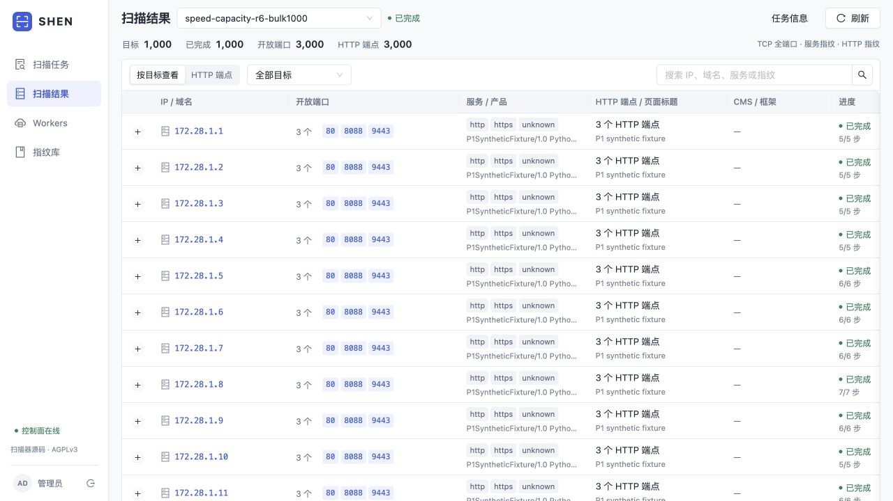
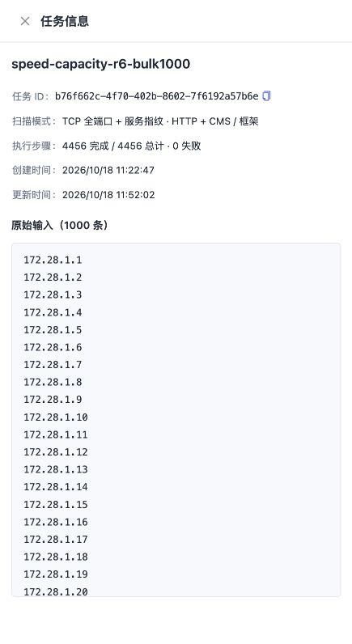

# 扫描速度优化与部署验收

**2026-10-18：5 台相同 2 核 / 2 GiB Worker，1000 个自建 IPv4 的 TCP 全端口、服务及 HTTP 识别，实测 29 分 22.48 秒。** R6 使用10000 PPS/Worker、cap8、15秒尾等，经过100IP预检后由同一批进程完成主case。独立核验65,535,000个SYN、1000份完整端口位图、3000开放端口与3000HTTP端点，失败任务及观察器丢包均为0；测试资源创建至释放39分41.98秒。

另一次严格同节点、同目标、同5000PPS的R4配对，将100IP客户端观察耗时从502.721秒降至354.999秒，减少29.38%。这是73970c7整包相对7e0bfbb的结果；R6最终2691677的高参数容量成绩分别记录，不重复归为纯代码收益。历史约59分钟运行存在版本、节点和目标行为差异，不能据此计算严格同条件加速比。

R5高参数预检曾发现独立SYN门未通过，1000IP未启动。本轮随后修复了发送错误被忽略的明确缺陷，保留了原失败及证据限制；R6实际EAGAIN恢复和完整性通过不能补写R5当时缺失的逐包errno。

最终Control和Agent包已部署，新任务采用已验证的10000PPS/cap8。原待执行任务记录和关闭的Worker池保持不变。下文包含完整HTTP、独立wire复核、真实R6截图、发布后验证及v0.5进度核对。所有测试资产均为自建合成目标，状态为**未利用**；R6截图不冒充历史轮次画面，历史缺项保留在[交付状态](validation/speed/screenshots/PENDING.md)及[证据缺项](validation/speed/missing-items.json)。

## 验证轮次与失败记录

| 记录 | 已得到的证据 | 可以得出的结论 |
|---|---|---|
| 历史 1000 IP，约 59 分 33 秒 | 运行完成、3000 开放端口、2000 HTTP；期间替换 Worker、重试和滚动更换工件 | 不能唯一复原整段运行的版本，不能充当严格冻结基线 |
| R1 | harness 把 Worker 状态写成 `healthy`，实际枚举为 `ready/running/draining/offline`；未创建扫描 | 测试准备失败，无产品性能结果；失败 readiness 的远端原 HTTP/日志未保全，不能补造 |
| R2 | 旧 Control 对新增 `poc_enabled` 请求字段返回 HTTP 400；保存 DB 中 runs/tasks 为 0 | 请求 schema 不兼容，无扫描性能结果；[完整 400 请求响应](validation/speed/http/r2-schema-failure/complete-400-post.json) |
| 本地 compatibility | 实际 Linux amd64、真实两版 Control/Agent、隔离 PG 和单 IP 全 TCP/三 HTTP/TLS；兼容旧列缺失及可选接口 404 | 验证 API/capture/collector 能完成真实流程，非云性能基准 |
| R3 | 历史后加载冻结工件对比 `7e0bfbb`；同 5 Worker、100 IP、5000 PPS；两臂质量与全范围 SYN 通过 | 首结果显著提前，最终完成没有实质改善；存在后台包维护噪声和执行器工作形状差异 |
| R4 | `7e0bfbb` 对比最终 `73970c7`，固定工件、相同目标/规格/PPS；完整性通过 | 本轮客户端观察完成时间减少 29.38%，仍是单次合成 100 IP 结果 |
| R5 | 100IP业务 completed，但原始 SYN 6,552,523 少于期望6,553,500；5 observer drops=0；1000IP未启动 | **完整性门未通过、原因待查**；不能把业务完成时间当作通过的容量成绩 |
| R6 | 2691677，10000PPS/cap8，100IP预检通过；1000IP客户端观察1762.481秒，65,535,000SYN/1000完整位图、3000端口/3000HTTP；5observer drops0 | 本轮1000IP实际容量通过；资源清理完成。与R4配置不同，不作代码单项加速归因 |

失败和兼容材料见 [R1](validation/speed/summaries/r1-setup-failure.json)、[R2](validation/speed/summaries/r2-schema-failure.json)、[本地兼容](validation/speed/summaries/local-compatibility.json)。R1 缺失的原始 HTTP 是已知证据缺口，不以当前重新生成的响应代替。

## 历史 59 分钟为何不能当作唯一旧版本

历史运行从 `2026-10-16T18:51:22.719385Z` 到 `19:50:55.579638Z`，共 3572.860253 秒。期间有两次 Worker 强制移除/替换、7 个 port task 重试；Masscan 在运行中更新，Agent v3 和 Control 也在运行中替换。最后 5 台 Worker 的内存规格还包含 4 台 2 GiB 和 1 台 4 GiB。6 个历史 Worker ID 不代表同时存在 6 个扫描 Worker。

R3 选择的是可校验的 **historical-postload-stable-v3** 工件，而不是宣称重建了历史整段运行：旧 Agent bundle SHA 为 `ebdb049795f08ff4c9f9da1b33da5537b4b792019be4d17843732fba513e63cd`，其 VCS 元数据为 `3ffe0d5+dirty`，`29b96cb` 只是源代码参考，源码与整个历史运行的精确对应未成立。[历史来源与混杂因素](validation/speed/summaries/historical-1000-provenance.json) 保留这个区别。

## R3：首结果与总完成不是同一指标

| 客户端轮询口径 | 历史冻结工件 | `7e0bfbb` |
|---|---:|---:|
| 观察完成秒数 | 501.526 | 502.024 |
| 首次观察到端口或 HTTP 结果 | 68.789 | 6.461 |
| Masscan 实际扫描进程数 | 25 | 25 |
| 实际 Masscan SYN | 6,553,500 | 6,553,500 |
| observer socket drops | 0 | 0 |

总完成相差约 +0.099%，不能声称整体加速；首结果是 API 轮询观察值，不是浏览器首屏、首个 HTTP 的专用计时或最终完成。旧版原生 Go 服务路径与新版 Nmap/fingers 路径、任务批大小和请求计划不同，逻辑端点相同不代表探测深度相同。缺失的旧 `first_started_at`/manifest 保留为不支持或未知，没有补成零。

R3 baseline 的**计时窗口内**确实采到包维护脚本：约 143.088 秒的 `python3-jwt.postinst`、245.287–309.571 秒间的 requests/urllib3/jwt 包脚本，以及约 323.674 秒的 urllib3 postinst。不能写成“旧版和新版都严格无后台负载”，也不能把几个不足 1 MiB RSS 的脚本等同于整个包管理进程树 CPU。[包维护采样审计](validation/speed/summaries/r3-package-maintenance.json) 保留原时点和限制。

两秒抽样不能证明所有瞬时后台活动不存在；噪声也不能被用来归因全部性能差异。R3 扫描与质量成功后，原离线分析器还因 Python 3.9 的时间小数解析失败退出；原错误未抹掉，清理后只修复了离线副本。[修复记录](validation/speed/summaries/r3-offline-parser-repair.json) 与 [R3 机器摘要](validation/speed/summaries/r3-machine-summary.json) 区分扫描成功和分析工具失败。

## R4：同配置的最终对照

R4 两臂使用同一批 5 台 2 CPU / 2 GiB Worker，另有 1 台 2 CPU / 4 GiB 的隔离 Control/fixture。目标为 `172.28.1.1–172.28.1.100`，每 IP TCP 1–65535；前 50 个关闭端口返回 RST，后 50 个静默 DROP，全部 IP 都有 80、8088、9443 三个已知合成 HTTP/TLS 服务。每 Worker 5000 PPS、wait15、cap4、port hard180，PoC 默认关闭。

两臂均使用相同的 source-port40000 审计归因和 ICMP 1 PPS instrumentation。工件在测量前固定安装，测量中未更新。开测前和计时中共四组后台稳定性快照记录 6 台机器；它们不等同于连续每毫秒证明没有后台进程，宿主 CPU 也包含 observer/metrics 的成本。制品完整 SHA 见 [R4 身份清单](validation/speed/summaries/r4-artifacts.json)。

| 指标 | Baseline `7e0bfbb` | Candidate `73970c7` |
|---|---:|---:|
| 客户端观察完成秒数 | 502.720990 | 354.999478 |
| Control 创建至完成秒数 | 499.969505 | 349.305473 |
| 首结果轮询秒数 | 6.760028 | 3.788755 |
| port / service / HTTP task 数 | 25 / 288 / 300 | 25 / 251 / 300 |
| port claim-to-complete 中位秒数 | 93.994345 | 68.991394 |
| service claim-to-complete 中位秒数 | 6.458470 | 6.451362 |
| HTTP claim-to-complete 中位秒数 | 0.138669 | 0.135118 |
| 实际 Masscan SYN | 6,553,500 | 6,553,500 |
| 实际 Masscan TX RST | 3,276,467 | 300 |
| 每 IP 65535 个不同 SYN / 5 observer drops | 全部覆盖 / 0 | 全部覆盖 / 0 |

客户端口径减少 **29.3844%**；Control 创建至完成口径减少 **30.1346%**。两者分别列示，不混成一个值。客户端口径包含轮询/API 取数成本；claim-to-complete 也不等于纯 CPU 执行时间。全轮只有一组配对，没有多轮置信区间。

两臂都 completed、task_failed=0、每 IP 开放端口正好 `[80,8088,9443]`、300 个逻辑 HTTP 入口无错误。任务数不同反映服务批次/派生时序不同，不用任务数代替覆盖质量。两版都实际执行 25 个四 IP port task、attempt1；candidate 的统计身份冻结在首次 lease payload，仅用于成本分组，执行范围仍为全 TCP，PPS/wait 未改变。[统计身份与范围](validation/speed/summaries/r4-statistical-tool-identity.json)、[独立 wire 复核](validation/speed/summaries/r4-independent-wire-check.json)、[机器摘要](validation/speed/summaries/r4-machine-summary.json) 可交叉核对。

“全端口覆盖”在这里指每个预期目标端口的 SYN 均被独立观察到，并通过已知开放服务集合验收；并不声称所有关闭端口有响应。零 observer drop 也不代表任意公网网络无丢包或产品识别全面完整。

## 为什么有效 SYN 吞吐恢复

原 Masscan 的无状态路径对通过 cookie 校验的 SYN-ACK **或 RST** 都排队发送清理 RST。排队包优先消耗同一 `packets_sent`/PPS 配额，所以闭端口返回 RST 时，一个逻辑 SYN 会额外占一个发送包；不能把这种 RST→RST 开销都叫作 SYN 重传。

最终补丁只允许 `status == PortStatus_Open` 时清理，保留正常开放 SYN-ACK 的 RST，同时跳过关闭 RST 和组合 SYN-ACK+RST。R4 的四 RST-IP 批次进程窗口中位数从 119.952 秒降到 68.941 秒；DROP 批次约 68.948/68.944 秒基本不变。candidate 仍有 300 个开放清理 RST，scope 和 PPS 没有借此放宽。

本地隔离 12000 端口微测也确认同样机制：

| 微测 | 原版平台二进制 | 最终 statusOpen 候选 |
|---|---:|---:|
| SYN / 不同目标端口 | 12000 / 12000 | 12000 / 12000 |
| 发往关闭端口的额外 RST | 11999 | 0 |
| 开放 8080 清理 RST | 1 | 1 |
| 首末 SYN 间有效 SYN/s | 2507.279 | 5042.385 |
| 已知开放识别 / capture drops | 8080 / 0 | 8080 / 0 |

短窗口约 5k 的数值含批处理和有限样本抖动，不是提高配置上限。有效 cookie 的组合旗标用例也保留了完整帧：原版回复 RST，最终候选不回复，二者均不记录开放。原始 TCP 证据见 [微测证据包](validation/speed/micro/README.md)、[PCAP](validation/speed/micro/pcap/)、[完整代表帧](validation/speed/micro/complete-representative-frames.txt)。这些 raw TCP 实验没有 HTTP，**不编造 HTTP 报文或截图替代**。

受测最终 ELF SHA 为 `afc20e66f99e13f4c65a7a7acc52b51d9f51b3798c3f7ac296abc6121ba39f7d`；微测当时对应源码包为 `36362eb485e77e9489cfded88599c3f9d26fa9d2f8a428436635d4956ae976b8`。后续仅说明文件更新后的源码包为 `162ae4a3f5c933d74048864fbe37492ce48c485fdd443cbaa5cc1d077f45a349`，不能覆盖历史身份。上游源码、补丁、构建脚本、许可证一致，微测 ELF 未因此改变。[对应源码身份](validation/speed/micro/summaries/artifact-provenance.json) 与 AGPL 文件随证据保留。

统计 profile 是 PATH audit launcher 的哈希 `5a349e47…`，它的固定注释绑定另行 SHA 校验的真实 ELF；launcher hash **不等于** ELF hash。本轮 R4 是最终包整体对照，并非把每项改动单独消融后测得贡献，不能将全部 29.38% 逐项重复归因。

## R5：10000 PPS 预检完整性门未通过，原因待查

R5 实际100IP预检固定 `73970c7`：5台同规格Worker、10000PPS/Worker、每目标discovery quota10000、cap8、wait15/hard180。1000IP manifest从 `172.28.1.1` 连续到 `172.28.4.232`，100/1000子集都各半DROP/RST，目标使用3条区间过滤规则；**1000IP主case没有启动**。

已归档的完整HTTP/DB显示：100IP业务 `completed`，客户端业务完成观察时间 **229.68559775秒**，300端口/300HTTP、0 failed task。业务质量门通过，但独立原始SYN计数为 **6,552,523**，比期望 **6,553,500** 少观察到 **977**，5个observer报告的socket drops均为0。因此这不是通过的容量成绩，不能用229.69秒对R4计算配置加速比，也不能外推1000IP。

进一步只读复核发现：缺口都落在5个Worker的首个Masscan目标组，分别142/191/221/199/224；后续8个组完整。这是“首组关联”，尚未证明丢的是发送序列前缀。目标namespace的独立DROP规则计数 **3,276,375**，比覆盖50个DROP目标全部关闭端口所需的最低 **3,276,600** 少225；source观察到的对应关闭DROP SYN为 **3,276,376**，与目标只差1。它不支持把全部977都解释为纯observer少计，但仍不能直接证明全部977实际丢失、具体缺失pair未发送，或锁定ENOBUFS/EAGAIN/qdisc等原因。

当时未保存逐发送返回/errno、qdisc和相关邻居状态，也没有R5原始PCAP（保留的是AF_PACKET计数、位图和时间bins）。`IpOutDiscards`还混有刻意丢弃的宿主kernelRST，不能直接当作SYN失败计数。[完整失败摘要与缺失集合](validation/speed/summaries/r5-failed-precheck.json)、[目标规则原输出](validation/speed/r5-logs/fixture-iptables.txt) 区分事实与未证明的解释。下面的错误传播修复是单独发现和验证的缺陷，**不是已证实的R5根因**。

R5因独立完整性门失败而没有创建1000IP run，不能改写为预算跳过。原driver还因缺少`cleanup.py`退出2；随后资源owner使用未改的R4清理逻辑配合R5作用域完成删除，原错误保留。[最终清理摘要](validation/speed/summaries/r5-cleanup.json) 为 `remaining=[]`、security group已删除、区域实例数0；[原清理错误](validation/speed/r5-logs/original-cleanup-script-missing.txt) 只归一化个人路径，没有隐藏失败。该轮没有实际UI截图，已释放后不能假称还能补采该轮实时页面。

R4的5000PPS整包对照与R5的10000PPS/cap8配置容量是不同问题；配置收益与代码收益保持分开。R5尚未给出通过的1000IP耗时。

## Linux libpcap 发送错误传播：本地注入与真实失败链

代码核对发现，原Linux live-libpcap发送失败返回可被上层probe忽略，扫描索引和进度仍继续推进。私有隔离注入直接复现了CLI假成功：对256个SYN持续返回ENOBUFS，实际没有成功发送，source/target均观察到0SYN且observer drops0，原版却显示100%并退出0。该错误传播缺陷成立，不能据此倒推R5当时出现了哪种errno。

修复集中在共享Linux libpcap出口：同包最多8次调用，仅EINTR/EAGAIN/ENOBUFS重试，退避1/2/4/8/16/32/64ms（请求sleep累计127ms）；其他/未知错误或耗尽退出1，并保留errno、pcaperr和失败/重试数。正常协议、范围、索引、PPS和现有接收/输出边界未变，也没有用热身掩盖冷启动问题。

| 已有本地用例 | 退出码 | 源 / 目标观察SYN | 结果 |
|---|---:|---:|---|
| 原版持续ENOBUFS，256次失败 | 0 | 0 / 0 | 复现假成功 |
| 最终8次候选，持续ENOBUFS | 1 | 0 / 0 | 8次失败、7次重试后明确失败 |
| 最终候选，连续40ms EAGAIN | 0 | 256 / 256 | 6次失败后第7次同包恢复，每端口一次、8080识别 |
| 最终候选，新建kernelVXLAN、10000PPS | 0 | 65535 / 65535 | 全范围各一次、8080识别，双端observer drops0 |

这是已有Docker `--network none` 内的私有netns/underlay/veth/VXLAN、单IP本地检查，**没有复现R5缺口，也不证明云端容量或R6通过**。注入只作用于指定Masscan子进程/接口/地址，不修改其他进程环境。`phase=rx_shutdown`日志只是接收线程退出快照，不称作最终全部发送调用总数；成功sendpacket本身也不是远端交付证明。微测当时对Agent非零退出路径只做源码核对；随后完成了下面独立的实际Agent→Control失败链验证，两者分别记载。

[发送错误证据子集](validation/speed/send-error/README.md) 保留最终8次案例、原版假成功、完整日志与双端PCAP无损压缩；4次旧候选不作为最终身份重复复制。受测ELF为 **`2ee12f51003d127996b49c98771d118d713a9fc5d16ff623de864e1ac9bb0c3d`**，本地微测源码包为 **`c644521abff78949a8d511d80237e97d1e33af6f142080268895cc0318cebf8f`**。后续只刷新README/SOURCE和build验证断言的来源包为 **`88fd72494c8b98488b9984e902bf26758de413e4e2f75c7e85a6bd19193d1c73`**；上游tar、精确代码补丁一致，ELF没有重编译。不要用新来源包覆盖微测历史身份。

后续 `2691677` 构建bundle为`b20474d68e6d…`，只是[新制品身份](validation/speed/send-error/summaries/release269.json)。R4的29.38%仍属于73970c7，R5预检也未测2691677；R6预检与主case的独立验收结果另见下节。

## 实际 Agent→Control：持久发送失败没有封账

后续独立隔离链路使用真实`2691677` Agent/Control及`2ee12f…` Masscan：持续ENOBUFS造成8次调用/7次重试后fatal、CLI非零，Agent报告`masscan failed`；Control对任务release返回200且accepted=true。归档15组请求中**没有complete请求**，随后API显示task_done=0、target_done=0、port_coverage=`unconfirmed`、positive_observations=0。[完整15组HTTP索引](validation/speed/http-index.json)、[失败release](validation/speed/http/send-chain/009.json)、[run状态](validation/speed/http/send-chain/012.json)、[覆盖结果](validation/speed/http/send-chain/013.json)、[机器摘要](validation/speed/summaries/send-chain.json)保留了实际因果链。

当时run仍为`running`，不是整run终态失败。Agent立即领取attempt2，随后被停止并释放为terminated；没有等待或验证重试耗尽生命周期。独立容器与数据库已删除，无云操作；末尾direct SQL快照因通用表名不匹配失败，**没有留存直接port_range_manifest快照**，所以本结论只引用真实API而不补造数据库证据。注册响应中的worker_token连同认证头脱敏，其他业务字段完整保留；脱敏后的长度变化在索引明确标注。

## R6：1000 IP 实测29分22.48秒，完整性与清理通过

R6固定`2691677`/ELF`2ee12f…`，沿用5台同规格Worker，10000PPS/Worker、每目标10000、cap8、wait15/hard180，PoC关闭、各半DROP/RST。100IP预检run为`49f644af-d141-444a-939f-fdd2480f23cd`：客户端观察完成 **207.295382416秒**，首结果3.681879916秒；100目标completed、task_failed=0，开放端口与逻辑HTTP各300。独立观察到 **6,553,500个Masscan SYN**，每IP位图65535、5observer socket_drops=0；13个port task均attempt1。6节点和DB采集完整。[业务摘要](validation/speed/summaries/r6-precheck.json)、[完整性门](validation/speed/summaries/r6-precheck-quality.json)、[采集摘要](validation/speed/summaries/r6-precheck-collection.json)可交叉核对。

13份实际Masscan stderr中，3个首片进程分别记录3、2、5次EAGAIN失败/重试，**共10次，均在第2次调用恢复**；其余日志快照为0。完整stderr及SHA见[日志索引](validation/speed/summaries/r6-precheck-stderr-index.json)，[阶段与发送诊断](validation/speed/summaries/r6-precheck-send.json)保留原日志行。`phase=rx_shutdown`仍只表示当时快照，不能扩大成全部发送调用最终总数。全范围实际观察覆盖与成功业务集合才共同支持此次预检通过；R5没有errno，不能用R6恢复日志逐包归因R5缺口。

[创建](validation/speed/http/r6-precheck/create.json)、[终态](validation/speed/http/r6-precheck/completed-run.json)、[全100结果](validation/speed/http/r6-precheck/results-offset-0.json)、[HTTP前200](validation/speed/http/r6-precheck/http-all-offset-0.json)/[后100](validation/speed/http/r6-precheck/http-all-offset-200.json)均为既有完整应用层请求/响应。本次整理没有重发请求。

1000IP主case为`b76f662c-4f70-402b-8602-7f6192a57b6e`。目标由`ipaddress`从`172.28.1.1`连续生成到`172.28.4.232`，每IP TCP1–65535，500个RST/500个DROP，全部有80、8088、9443服务。固定5台2CPU/2GiB Worker，另有独立Control/target；PPS、cap8和wait15在测量中没有更新，主case上限2100秒。实际成绩如下：

| 指标 | R6 1000IP主case |
|---|---:|
| 客户端API观察完成 | **1762.480900875秒（29分22.48秒）** |
| 首结果轮询 | 5.054246292秒 |
| Control创建至updated_at | 1755.519179秒（29分15.52秒） |
| port / service / HTTP task | 125 / 1331 / 3000 |
| port / service / HTTP claim-to-complete中位秒数 | 68.995784 / 6.502370 / 0.238737 |
| 完成目标 / 开放端口 / 逻辑HTTP | 1000 / 3000 / 3000 |
| task_failed / attempt>1 | 0 / 0 |
| 实际Masscan SYN / 多余重复SYN | **65,535,000 / 0** |
| 每IP不同目标端口 / observer socket_drops | 1000个IP全部65535 / 5个observer均0 |
| 开放清理RST | 3000 |

[业务终态摘要](validation/speed/summaries/r6-main.json)、[阶段/发送统计](validation/speed/summaries/r6-main-stage-send.json)、[全1000位图计数与业务门](validation/speed/summaries/r6-main-quality.json)、[根独立位图OR复核](validation/speed/summaries/r6-independent-wire-check.json)及[验收记录](validation/speed/summaries/r6-root-acceptance.json)相互核对。独立复核只选本case的`bulk1000/packet-counts.json`，没有把此前100IP预检累计进去；实际bitmap并集与65,535,000总数相符，重复excess为0。原bitmap和DB仍留在私有原始归档，公开材料保留完整每IP计数和对应来源SHA，不把派生摘要冒充原PCAP。

公开保留[23组主case完整HTTP索引](validation/speed/http-index.json)：创建、终态、scheduler，**results全5页共1000条、HTTP全15页共3000条**；[第1页results](validation/speed/http/r6-main/results-offset-0.json)、[最后页results](validation/speed/http/r6-main/results-offset-800.json)、[第1页HTTP](validation/speed/http/r6-main/http-all-offset-0.json)、[最后页HTTP](validation/speed/http/r6-main/http-all-offset-2800.json)。其余页均列在索引，完整业务响应体未截断、脱敏前后body SHA一致；各HTTP记录还包含实际目标请求/响应证据。不能仅凭截图第一页代替全量验收。

本case125份实际Masscan stderr按执行窗口过滤，均有rx_shutdown统计并返回0。3个首片进程记录1、2、1次EAGAIN重试，**共4次，均第2次调用恢复**；没有把预检的10次再累计。[125份完整日志及SHA](validation/speed/summaries/r6-main-stderr-index.json)保留诊断，快照口径仍不冒称最终所有send调用总数。实际恢复证据支持重试路径在本轮工作，仍不证明R5当时977缺口的errno。统计身份为PATH launcher SHA`68064d8f…`，真实ELF为`2ee12f…`；[五Worker工具身份](validation/speed/summaries/r6-statistical-tool-identity.json)明确两者不同，来源包仍区分微测c644与说明刷新88fd。

两张图均来自本次真实隔离Control UI的**R6主case**，在API业务完成后、实例清理前取得。结果页图保存于03:53:18.882Z，当时原始采集尚在收尾；任务详情图保存于03:54:17.431Z，位于独立质量通过后的60秒核对窗口。图片证明业务状态，wire完整性另行核验：

任务详情显示本地时间创建11:22:47、更新11:52:02，精确API值为03:22:47.033973Z与03:52:02.553152Z。创建至更新1755.519179秒和客户端API观察1762.480900875秒是不同起点/取样口径，UI又仅显示整秒；不能将差值直接当作某一阶段开销。[计时口径](validation/speed/summaries/r6-timing-scope.json)保留两种数值。这些图不证明R4/R5当时的计时画面，也不承担wire完整性证明。

主case结束后六节点/DB[采集完整](validation/speed/summaries/r6-main-collection.json)；`2026-10-18T03:54:42.824772Z`[清理结果](validation/speed/summaries/r6-cleanup.json)为remaining=[]、delete_errors=[]、security_group_deleted=true、regional_instance_count=0，driver已released。实际UI核对在计时结束后、清理前进行，包含在原55分钟释放边界内；不计入扫描耗时，也没有测量中更新工件。本节记录隔离验证和资源清理，生产发布后验记录见下文。

R6是**单轮合成1000IP实测容量**，不是任意公网或多轮统计保证；未开启PoC。它将2691677发送错误修复与10000PPS/cap8配置一起验证，不能与R4的5000PPS/cap4对照混算为纯代码收益，也不能对历史59分33秒混合版本运行给出严格同条件加速比。R5失败历史保留，未倒写成通过。

## 与 v0.5 的开发进度核对

已与“构建扫描器方案”会话核对，并由本会话复核其结论。任务制、四阶段单向派生、成熟工具适配、固定连接 IP、阳性凭证与覆盖封账分离仍符合 v0.5。问题主要在实施顺序：部分自适应与早派生能力尚未证明最终吞吐收益，就继续增强识别功能。本轮暂停新增功能，先完成性能和正确性验证。

P95 内存预测、完整带权公平、独立慢队列及重试份额、全阶段成本背压、服务按端点剩余项恢复、PoC 缓存亲和仍是部分或未实现能力，不以本次性能修复冒称全部完成。有界批次整体重跑与已经封账项重复累计必须区分；原有完成凭证、attempt fence 和覆盖幂等不能因性能调优放宽。

采纳对方关于统计身份独立、固定等待加回预测、同工件同配置比较和统一云轮截止的意见；统计字段进入完成摘要的问题已在 `73970c7` 修复。未采纳新增 1–2 秒 Nmap 领取窗口：当前目标的开放端口到达间隔较大，缺少收益证据。本轮不增加新队列框架。

对方的 R4 最新评估基于提供给它的实测记录，不能冒充对未推送工件的独立复测。R4 的 29.38% 属于整包配对成绩。R5 暴露了发送完整性问题；随后完成发送错误传播修复，并由 R6 验证最终高参数配置。R5 当时缺失的 errno 仍不能逐包追溯。高级调度欠项没有因此被冒称完成。

## 生产部署与后验核对

已部署来源`2691677e02185a63c8494920bee0864477df4553`，Agent包`bundle-b20474d68e6d`。实际Control、安装包、指纹helper、CA及Masscan对应源码摘要均与已验收工件一致；本地规范Masscan二进制/源码也已更新，后续构建不会回退到旧发送行为。

新任务配置为`SCAN_PORT_RATE_PPS=10000`、`SCAN_TARGET_DISCOVERY_PPS=10000`、`SCAN_PORT_SHARD_MAX=8`；代码缺省仍为5000PPS/cap4。已有待执行任务的完整数据库记录前后相同，既有范围/参数没有重写。Worker池保留关闭、desired_workers=10、在途lease=0；本次没有启动生产扫描。测试Worker全部释放，后续启动的节点会取得新安装包。

发布前已备份数据库、程序、运行配置、凭据密钥和Web文件。发布后健康接口、调度接口及HTTPS安装包HEAD均通过；公开的[验证摘要](validation/speed/deployment/verification.json)、[完整健康HTTP](validation/speed/deployment/health.json)和[完整安装包HEAD](validation/speed/deployment/download-head.json)保留实际检查结果。生产用户任务正文、账号信息、Worker历史和环境凭据不进入公开报告；完整相等核对只公开布尔结果。

## 完整 HTTP、脱敏与截图交付

[HTTP 索引](validation/speed/http-index.json) 列出 88 份选中的既有完整应用层交换及来源 SHA：含 R2 完整失败 POST、本地兼容、R3 创建/终态/结果、R4 两臂创建/终态/results，以及 R4 最终 **全部 300 HTTP 记录的两页响应**；另有每臂三个实际 fixture GET/响应；追加R5失败预检的创建/业务终态、全部results、全部300HTTP两页及三个实际目标GET/响应。选中报文均保留方法、URL、Headers、请求体和响应体，业务响应体未截断，索引提供脱敏前后 body SHA。另含R6预检6组（全部300HTTP两页）、R6主case23组（results全5页1000条、HTTP全15页3000条）及独立发送失败链的全部15组HTTP；注册响应凭据字段脱敏，明确记录body变化，不将其称为原字节不变。

Authorization、Cookie 等凭据用占位符替换，未附 admin/join/worker token、私钥或环境文件。占位符须在自有隔离环境中替换，不能把这些归档理解为仍在线的公开测试接口。`http.client.read()` 记录的是去传输编码后的完整应用响应体；chunked 原 Header 保留，不声称文件包含原始 TCP chunk framing。9443 fixture 文件是 TLS 端解密后的 HTTP，不是 raw TLS PCAP。

- R4 baseline：[创建](validation/speed/http/r4-baseline/create.json)、[终态](validation/speed/http/r4-baseline/completed-run.json)、[全目标结果](validation/speed/http/r4-baseline/results-offset-0.json)、[HTTP 0页](validation/speed/http/r4-baseline/http-all-offset-0.json)/[200偏移页](validation/speed/http/r4-baseline/http-all-offset-200.json)。
- R4 candidate：[创建](validation/speed/http/r4-candidate/create.json)、[终态](validation/speed/http/r4-candidate/completed-run.json)、[全目标结果](validation/speed/http/r4-candidate/results-offset-0.json)、[HTTP 0页](validation/speed/http/r4-candidate/http-all-offset-0.json)/[200偏移页](validation/speed/http/r4-candidate/http-all-offset-200.json)。
- 实际目标 HTTP/TLS：[80](validation/speed/http/r4-candidate/fixture-port-80.json)、[8088](validation/speed/http/r4-candidate/fixture-port-8088.json)、[9443](validation/speed/http/r4-candidate/fixture-port-9443.json)。
- [资产状态](validation/speed/assets.json)、[机器来源索引](validation/speed/machine-source-index.json)、[交付清单](validation/speed/evidence-manifest.json) 区分原报文、只读派生摘要、既有微测和待补证据。

R5实际HTTP见[创建](validation/speed/http/r5/create.json)、[业务终态](validation/speed/http/r5/business-completed-run.json)、[全目标结果](validation/speed/http/r5/results-offset-0.json)、[HTTP第1页](validation/speed/http/r5/http-all-offset-0.json)/[第2页](validation/speed/http/r5/http-all-offset-200.json)、[实际TLS端HTTP](validation/speed/http/r5/fixture-port-9443.json)。这些业务成功报文不覆盖独立SYN门失败的事实。

R6实际截图已在上节引用，原图与SHA见[截图索引](validation/speed/screenshots/index.json)。R4/R5及rawTCP微测没有据此补成同轮截图；历史证据缺失仍如实列出。
