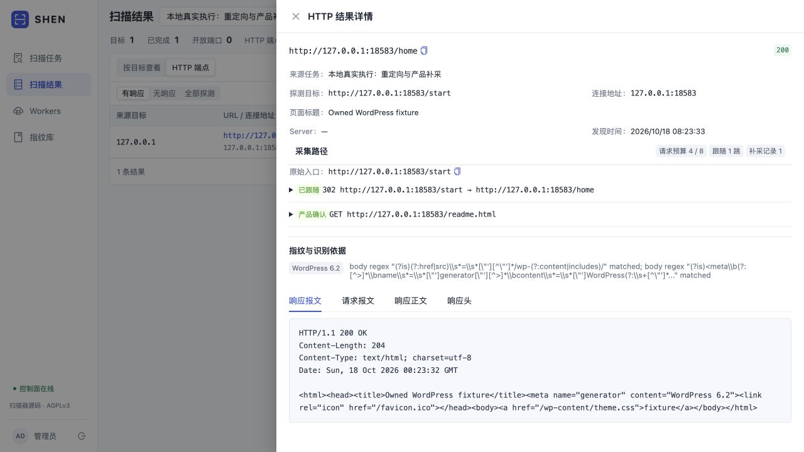
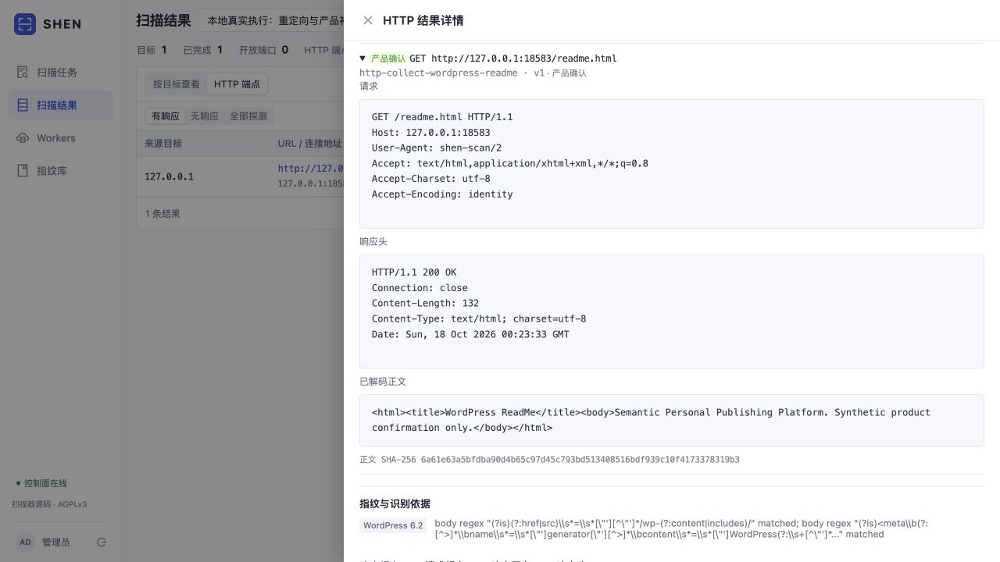
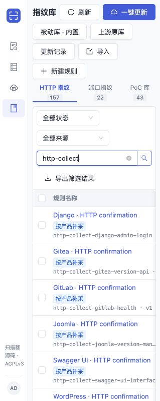

# Web 重定向与产品补采验证

日期：2026-10-18。验证对象是本地自建合成 HTTP 目标，状态：**未利用**。无漏洞利用，也没有新增云实例或公网扫描。本批实现边界见 [Web 补采](WEB_ENRICHMENT.md)。

## 真实执行结果

本机实际启动 Control、PostgreSQL、Agent、Web helper 和 fingers helper，创建仅 HTTP、PoC 关闭的任务。`/start` 返回 302，跳转到同源 `/home`；真实响应识别到 WordPress，再请求 `/readme.html`，命中 `http-collect-wordpress-readme`。连同 favicon 共 4 次目标请求，任务完成，只有 1 个 HTTP task，PoC 检查数为 0。

[任务结果摘要](validation/web-enrichment/data/smoke-result.json) · [完整目标 HTTP 报文与复现步骤](validation/web-enrichment/http/fixture-full.md) · [创建任务的完整 API 交换](validation/web-enrichment/http/smoke-create.json) · [完整观测 API 交换](validation/web-enrichment/http/smoke-observation.json)。认证字段使用占位符，其余关键数据不截断；报文包含 URL、方法、Headers、请求体及响应体。本地 fixture 返回合成产品标记，不能据此宣称测试了真实 WordPress 安装或漏洞。

真实流水线验收先于最后的证据清理终止修复；该修复不改变正常路径，随后只复测受影响的超限证据用例，未重复整条流程。

## 必要检查与限制

| 层级 | 结果与证据 |
|---|---|
| Helper | 同源跳转、3 跳上限、环路、错误 Location、下一跳失败、取消、预算耗尽、旧 profile、补采单 GET；[定向 race 输出](validation/web-enrichment/data/helper-enrichment-tests.txt) |
| 共享预算 | 慢 TLS 的两次 grant 使用同一 request_seq，实际仅 1 次目标 GET；[输出](validation/web-enrichment/data/helper-slow-tls.txt)，完整 callback/目标报文位于同目录 `http/helper-*.http.json` |
| Agent | 实际 helper 集成、候选上限、相同 URL 复用、响应不完整、预算、逐规则结果；[输出](validation/web-enrichment/data/agent-tests.txt)与[完整 HTTP](validation/web-enrichment/http/agent-complete-http.json) |
| 证据大小 | 修复清理完所有可缩减内容后仍超限时无法退出的问题；剩余超限交现有不可重试 guard 拒绝。控制字符/超长元数据与原最坏大小用例通过，见[修复记录](validation/web-enrichment/data/agent-evidence-termination-fix.json) |
| Control / PG | 新旧快照隔离、能力与重放过滤、collection CRUD/导入导出、证据归属、PoC 原始入口、调度不变量；[分阶段命令与结果](validation/web-enrichment/data/control-checks.json)保留夹具修正前的失败记录 |
| 规则 | HTTP collection 不参与首采匹配、产品绑定与内置规则检查；[已执行记录](validation/web-enrichment/data/root-rule-checks.json) |
| 前端 | TypeScript 与生产构建通过，实际浏览器核验结果和规则列表；[构建输出](validation/web-enrichment/data/web-build-final.txt) |

Agent 整包检查存在一项旧的时间边界失败：`TestHTTPProtocolFallbackSharesEndpointTimeout` 在 300ms 断言下测得约 302.94ms。在未改动的 `dc1cf0b` 基线上同项也测得约 304.94ms，见[基线对照](validation/web-enrichment/data/legacy-baseline-timing.json)和[本轮整包输出](validation/web-enrichment/data/agent-package-regression.txt)。未修改无关旧路径，不将整包测试写成全通过。

## 资产与接口清单

| 资产 / 接口 | 作用 | 验证状态 |
|---|---|---|
| `127.0.0.1:18583` 的 `/start`、`/home`、`/favicon.ico`、`/readme.html` | 自建目标，真实 Agent 请求 | 未利用 |
| `127.0.0.1:18584` 的 `POST /api/runs` 与任务结果读取 API | 隔离 Control/PG 闭环与界面验收 | 未利用 |
| 测试中随机 loopback HTTP/TLS 端口 | 重定向拒绝、预算与慢 TLS grant 回调 | 未利用 |
| 本地 PostgreSQL 临时库 | 任务与规则持久化检查 | 未利用 |

所有截图、完整报文和检查记录在 `validation/web-enrichment/`；[SHA256SUMS](validation/web-enrichment/SHA256SUMS)供完整性核对。截图为实际页面，不是效果图。TCP 1–65535、端口分片与发包策略未改变，本批没有重跑全端口云压测；以往性能结果见 [P1 验证](P1_VALIDATION.md)，不能当成本批性能收益。
