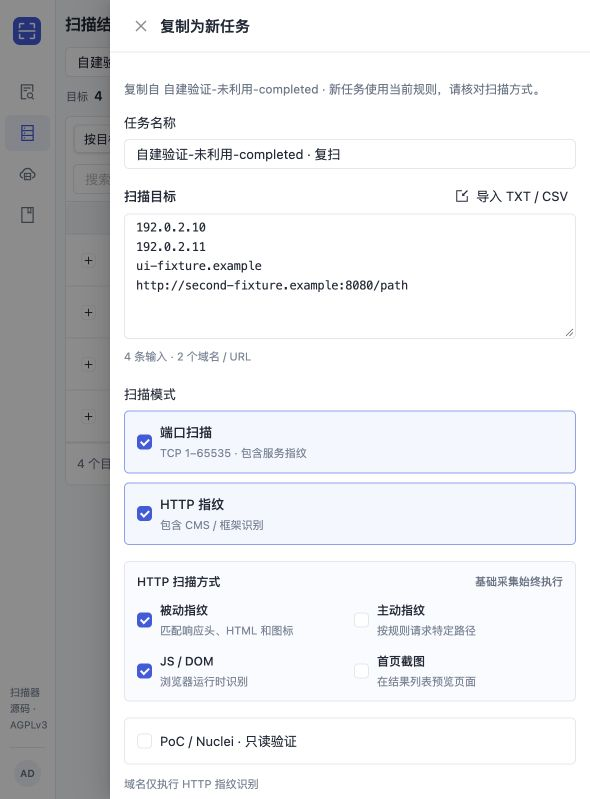
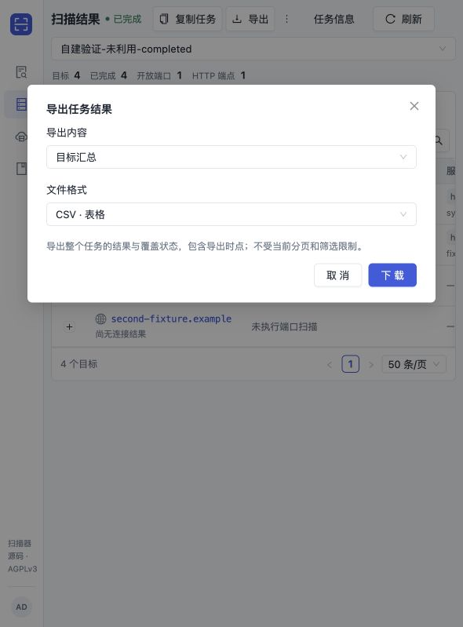
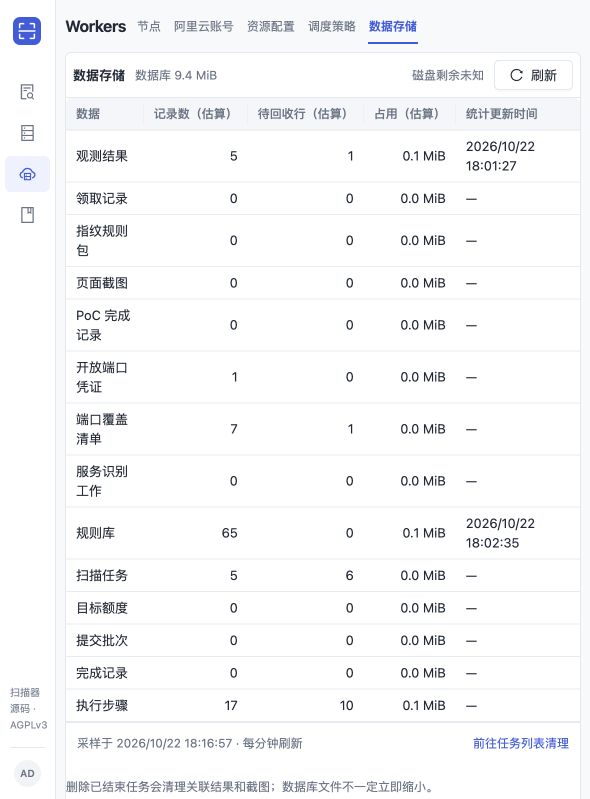
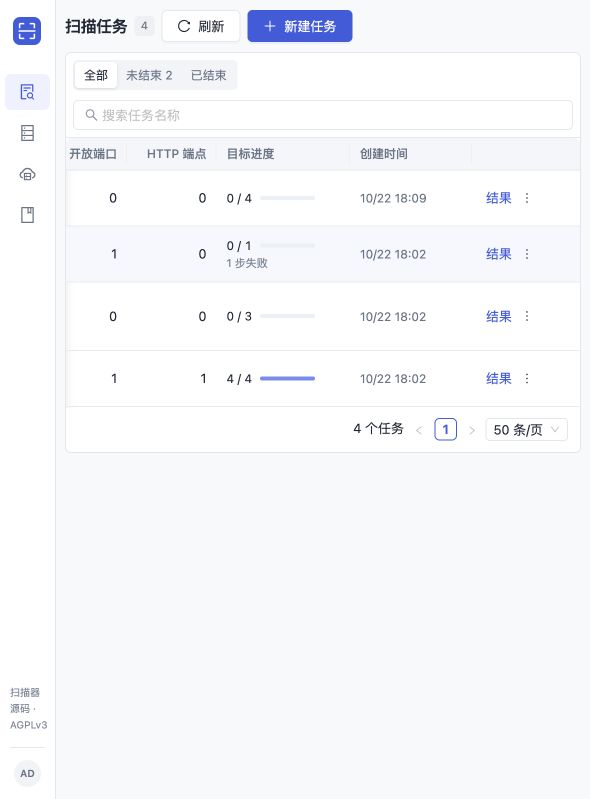

# 自建验证资产台账（2026-10-22）

本台账仅记录本次本机临时功能环境。分类统一为“自建验证；未利用；非性能结果”。没有连接生产库、生产控制面或外部扫描目标；`192.0.2.0/24`、`198.51.100.0/24` 与 `.example` 名称只作为填入测试数据库的合成字段，没有访问它们。

| 资产/接口 | 用途与边界 | 验证状态 | 证据 |
| --- | --- | --- | --- |
| `127.0.0.1:19890` | 当前 Control + 已构建 web/dist；仅本机监听 | 自建验证通过；未利用；Control已停止 | [health](http/health-response.http) |
| `127.0.0.1:55441` | 新建 PostgreSQL 16 容器；UI独立库 scan_ui_20261022，测试独立 schema | 自建验证通过；未利用；临时PG已停止 | [环境与任务身份](fixture-context.json) |
| `GET /api/runs/{id}` | 单任务完整原 targets/modes/options，供复制读取 | 已验证200；未利用 | [完整响应](http/get-completed-response.http) |
| `GET /api/runs/{id}/export?format=csv\|json&kind=targets\|ports\|http\|findings` | 管理员下载；快照与质量数据；全部分页 | 已验证200/401；未利用 | [HTTP清单](http/checks.json) |
| `GET /api/storage/status` | 数据库占用与表估计值，明确未知磁盘容量与缓存时点 | 已验证200；未利用 | [完整响应](http/storage-status-response.http) |
| `DELETE /api/runs/{id}` | 仅显式终态删除；有活动/未确认执行时受保护 | 已验证200/409/404；未利用 | [删除响应](http/delete-terminal-spare-response.http)、[保护响应](http/delete-paused-blocked-response.http) |
| `GET /api/worker-pool` | 核实 manual、disabled、desired0 | 已验证200；未利用 | [完整响应](http/worker-pool-final-response.http) |

主任务 `e157b86f-34aa-4000-b377-876dcb044dfb`：completed，原始输入4条。paused任务 `c5db7df2-1347-418f-ba35-3d86abbda5f2`；partial任务 `b010038a-e375-4416-9503-dbb73972f07b`。浏览器删除预留任务 `045c1054-d4fc-4e54-8b25-ff1f94bf1fba` 已由主 agent 实际浏览器删除，后续 GET 已返回404。HTTP专用删除任务 `66df6212-2718-4892-9f20-435637294ceb` 已经实际删除。

浏览器复制生成 `e46c5827-3c01-450b-b771-ae47db0fe709`，另一次真实 API 复制复现生成 `7065eee6-4495-45a7-8124-3ccee13616bc`；均 pending、完整4条输入、Web开关保留、PoC off。后者不是原浏览器POST抓包，[来源说明](http/copy-api-reproduction-NOTE.txt)单列。本次仅手动终态清理，无自动过期删除、无自动PG压力熔断。

真实截图与每项完整业务报文已在[验证日志](validation-log.md)逐项配对：

完整业务 HTTP 请求响应位于同级 `http/`，没有截断；浏览器Downloads未找到实际CSV落盘文件，仅另一次API CSV响应的4条质量记录已验证。生产始终未动，所有资产均是自建验证、未利用、非性能结果。

收尾状态：本轮Control与两个临时PG均已确认停止；PG16容器已自动移除，PG9.6数据目录保留。持久化 `codex-scan-platform-pg`/15432、新版18584及Docker本身未停止。详见[验证日志收尾记录](validation-log.md)及[环境状态](fixture-context.json)。
