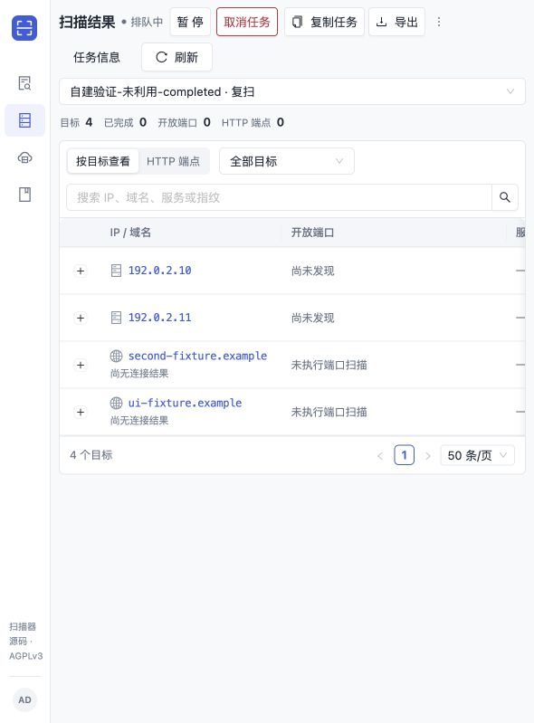
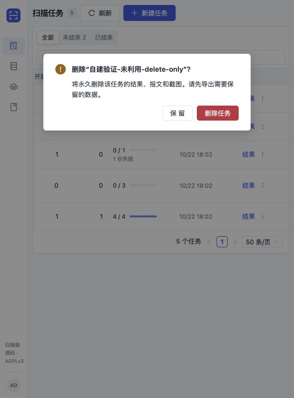

# 2026-10-22 本地功能验证日志

状态：主 agent 已亲自完成浏览器操作并保存真实截图，实际 HTTP 请求响应已补齐。验证对象全部为自建合成数据，统一标记“未利用”；没有执行扫描、性能测试或真实漏洞利用，生产环境始终未动。

环境：仅本机 `http://127.0.0.1:19890`；隔离 PostgreSQL 16 容器 `scan-export-pg16-20261022` 仅映射 `127.0.0.1:55441`，UI 独立数据库为 `scan_ui_20261022`。Control 使用清空继承环境后的显式测试配置；`SCAN_CLOUD_PROVIDER=manual`、worker pool disabled、desired workers=0，无 Agent，不加载生产 `.env`、生产数据库或云凭据。HTTP 报文中的管理员 token 是本环境专用的非生产测试凭据；公开副本统一替换为 LOCAL_TEST_ADMIN_TOKEN，复现时设置自己的隔离测试令牌。业务字段完整保留。

合成任务名均以“自建验证-未利用-”开头。主任务 `e157b86f-34aa-4000-b377-876dcb044dfb` 为 completed，原始输入4条。paused 任务为 `c5db7df2-1347-418f-ba35-3d86abbda5f2`；partial 任务为 `b010038a-e375-4416-9503-dbb73972f07b`。所有端口/HTTP观察都是直接填入测试数据库的合成记录，不是扫描输出。

**成果一：复制配置创建新任务**

浏览器实际创建 `e46c5827-3c01-450b-b771-ae47db0fe709`。真实 GET 响应确认：新任务 pending、完整保留4条原始 targets 及 modes/Web开关，PoC off；原任务的 id/name/targets/modes/Web开关/PoC/status 均未改变。Web选项为 passive=true、active=false、js_dom=true、screenshot=false。截图显示复制界面及创建后的 pending 状态。

完整业务报文：[原任务GET请求](http/after-ui-original-run-request.http)、[响应](http/after-ui-original-run-response.http)；[浏览器新任务GET请求](http/after-ui-browser-copied-run-request.http)、[响应](http/after-ui-browser-copied-run-response.http)。

为提供可复现 POST，另行实际创建了 `7065eee6-4495-45a7-8124-3ccee13616bc`，任务名明确含“API复制复现-非浏览器原请求”。[实际POST完整请求](http/copy-api-reproduction-request.http)、[响应](http/copy-api-reproduction-response.http)、[后续GET请求](http/copy-api-reproduction-get-request.http)、[响应](http/copy-api-reproduction-get-response.http)。这是独立 API 复现，不是原浏览器 POST 抓包；[来源说明](http/copy-api-reproduction-NOTE.txt)明确区分两者。两个新任务都没有 Agent 执行，没有发起扫描。

**成果二：CSV/JSON结果导出与质量信息**

浏览器实际完成导出格式/类型选择及下载弹窗。`/Users/yym1ng/Downloads` 没有找到 `scan-e157*` 文件，因此没有声称校验了浏览器落盘文件。另一次真实 API CSV 响应已用 CSV 解析器校验，恰有4条 `target_quality` 记录；[下载检查记录](http/download-check.json)注明此边界。

| 实际验证 | 结果 | 完整请求 | 完整响应 |
| --- | --- | --- | --- |
| 主任务 targets CSV | 200；解析得到4条质量记录 | [请求](http/after-ui-targets-csv-request.http) | [响应](http/after-ui-targets-csv-response.http) |
| 目标 JSON | 200；快照时间、run、全部目标质量 | [请求](http/export-targets-json-request.http) | [响应](http/export-targets-json-response.http) |
| 端口 CSV | 200；质量与结果按record_type区分，details_json保留完整字段 | [请求](http/export-ports-csv-request.http) | [响应](http/export-ports-csv-response.http) |
| HTTP JSON | 200；不含raw HTTP、token、PNG内容 | [请求](http/export-http-json-request.http) | [响应](http/export-http-json-response.http) |
| 空findings | 200；仍保留目标质量 | [请求](http/export-findings-json-request.http) | [响应](http/export-findings-json-response.http) |
| partial任务端口 | 200；阳性凭证和partial/失败质量同时保留 | [请求](http/export-partial-json-request.http) | [响应](http/export-partial-json-response.http) |
| paused任务动态快照 | 200；没有强制终态限制 | [请求](http/export-paused-json-request.http) | [响应](http/export-paused-json-response.http) |
| 未认证下载 | 401 | [请求](http/export-unauthorized-request.http) | [响应](http/export-unauthorized-response.http) |

partial 摘要同时为 `open_port_count=1`、`port_coverage=partial`、`task_failed=1`；[完整摘要请求](http/results-partial-request.http)、[响应](http/results-partial-response.http)。HTTP 200 只证明请求成功，不代表扫描覆盖完成。

**成果三：数据库容量可见性**

浏览器实际查看容量界面。接口返回统计时点、表估算标记、60秒缓存和服务压力信息；无法获取的磁盘空闲/总容量明确标记不可用，不推算不存在的数据。这是只读统计，不是容量压测或自动 PostgreSQL 压力熔断。

[容量完整请求](http/storage-status-request.http)、[响应](http/storage-status-response.http)；[删除后刷新请求](http/storage-status-after-delete-request.http)、[响应](http/storage-status-after-delete-response.http)。

**成果四：管理员手动终态清理**

浏览器实际确认并删除预留任务 `045c1054-d4fc-4e54-8b25-ff1f94bf1fba`，随后列表刷新为4项；对应 GET 实际返回404。[浏览器删除后GET完整请求](http/after-ui-deleted-run-request.http)、[响应](http/after-ui-deleted-run-response.http)；[当时4项列表请求](http/after-ui-run-list-request.http)、[响应](http/after-ui-run-list-response.http)。列表4项是独立 API 复制复现之前的实际状态，后来 API 复现有意增加了另一个 pending 任务。

另一个 HTTP 专用终态任务 `66df6212-2718-4892-9f20-435637294ceb` 已由实际 DELETE 返回200，再GET404、重复DELETE404：[删除完整请求](http/delete-terminal-spare-request.http)、[响应](http/delete-terminal-spare-response.http)；[不存在GET请求](http/deleted-run-absent-request.http)、[响应](http/deleted-run-absent-response.http)；[重复DELETE请求](http/delete-terminal-again-request.http)、[响应](http/delete-terminal-again-response.http)。paused 删除返回409并保留任务：[完整请求](http/delete-paused-blocked-request.http)、[响应](http/delete-paused-blocked-response.http)。

本次只有管理员显式手动终态清理；没有自动过期删除，也没有自动 PostgreSQL 压力熔断。存在队列/租约/未确认执行停止的任务受后端保护；本地合成环境没有启动任何执行器。

完整初始清单：[22项HTTP检查](http/checks.json)；浏览器后复核：[9项HTTP检查](http/after-ui-checks.json)。同目录保存全部4类×2格式导出的完整请求响应，业务数据未截断；请求含方法、完整URL、实际Headers及请求体，响应含状态行、Headers及完整响应体。GET/DELETE无请求实体即空请求体。

[最终worker pool完整请求](http/after-ui-worker-pool-request.http)、[响应](http/after-ui-worker-pool-response.http)确认manual/disabled/desired0；[workers请求](http/after-ui-workers-request.http)、[响应](http/after-ui-workers-response.http)确认0个worker。跨页、旧attempt、独立凭证、CSV公式、写失败、临时文件清理和并发快照的真实 PostgreSQL 集成测试也已通过。

漏洞点：本次没有发现或利用真实漏洞；验证点是任务复制、分页/快照与质量保留、管理员认证、终态删除保护及统计语义。截图均为主 agent 实际浏览器操作所得，截图与另一次 API 复现的来源没有混同。

收尾：本轮临时验证服务均已停止。Control `/tmp/scan-ui-control-20261022` PID 78868（exec session 69512）此前已正常退出；隔离PG16容器 `scan-export-pg16-20261022`（ID `c33371742204626021a29d0105514fc52fdb2131a7729470022d46ca0de14861`，仅55441）本次已核实ID/端口后停止，因其启动时设置 `--rm` 已自动移除。最初PG9.6的 `/tmp/scan-export-pg/postmaster.pid` 指向PID7246/端口55439，核实该PID已不存在且端口无监听，没有向其他进程发送信号，数据目录保留。没有停止Docker本身、持久化 `codex-scan-platform-pg`/15432 或新版18584服务。准确环境身份见 [fixture-context.json](fixture-context.json)。
